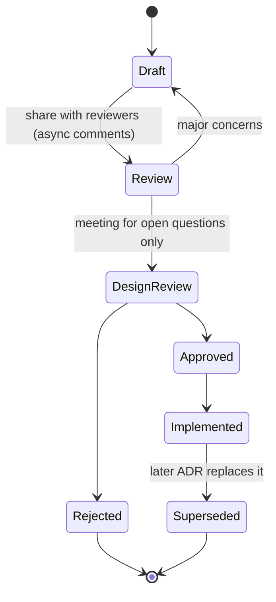
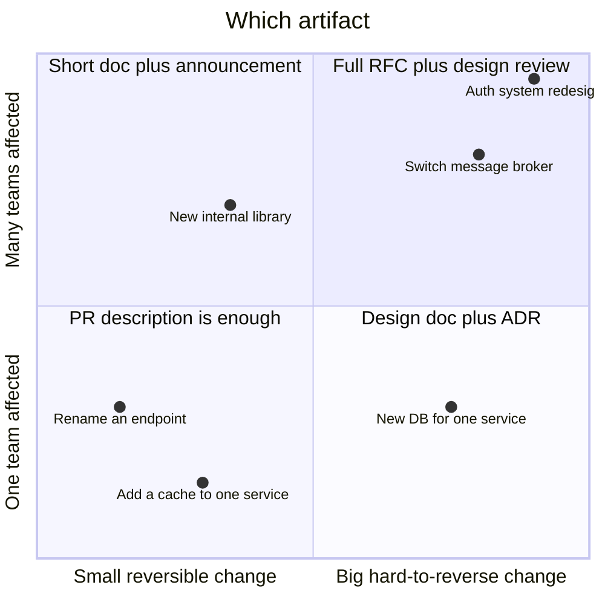
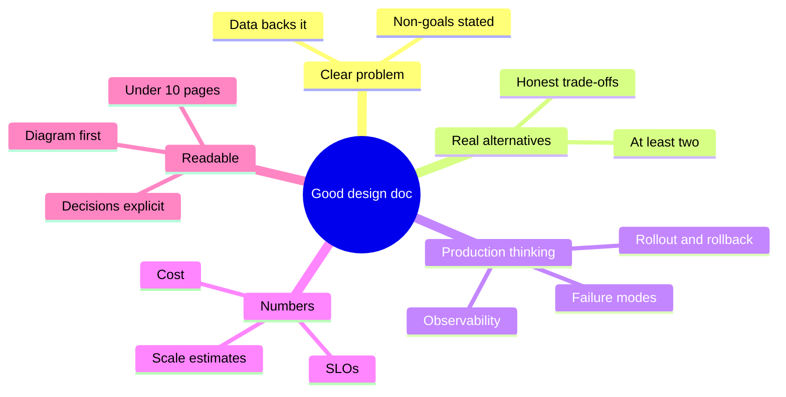

# Design Docs, RFCs and ADRs

## What is it?

- **Design doc / RFC:** a written proposal for how to build something non-trivial: context, goals, options, chosen design, risks. Reviewed *before* code.
- **ADR (Architecture Decision Record):** a short, permanent record of **one** significant decision and why it was made.

## Why it matters (and more in the AI era)

- At Google, Amazon, Uber, Flipkart and Razorpay, the design doc is how an engineer **gets agreement** and **shows seniority**. SDE-2 promotion usually needs a few approved docs; SDE-3 needs to review and shape others'.
- When AI agents write most of the code, **the spec is the product of your thinking**. A clear design doc becomes the prompt, the review checklist and the test plan. → [[AI-Native-SDLC]]
- A system design interview is literally a design doc spoken out loud in 45 minutes. → [[Interview-Framework]]

## Analogy

An architect's blueprint plus the planning-permission meeting. You don't pour concrete and *then* ask the city if the building can stand there.

## Interview definition

> "A design doc aligns people on a problem and a solution before code. It states goals and non-goals, compares alternatives with trade-offs, covers failure modes, rollout, cost and testing, and records why the chosen option won. ADRs capture individual decisions so future engineers know the context."

## Design doc template (adapt per company)

```markdown
# [Title] — Design Doc
Author · Reviewers · Status (Draft / In review / Approved) · Last updated

## 1. Context & problem      — what's broken or needed, with data
## 2. Goals / Non-goals      — measurable goals; explicit out of scope
## 3. Requirements           — functional + NFRs (latency, availability, scale, cost, compliance)
## 4. Proposed design        — diagram, components, APIs, data model, flows
## 5. Alternatives considered — 2–3 options, table of trade-offs, why rejected
## 6. Failure modes & reliability — what breaks, blast radius, SLOs, degradation
## 7. Security & privacy     — authN/Z, PII, threat model, compliance
## 8. Rollout & migration    — flags, canary, expand–contract, rollback plan
## 9. Testing & verification — test strategy, evals (for AI), load tests
## 10. Observability         — metrics, alerts, dashboards
## 11. Cost                  — monthly at launch and at 10×
## 12. Open questions / risks
## 13. Timeline & milestones
```

## ADR template (Michael Nygard style)

```markdown
# ADR-017: Use Kafka (not SQS) for order events
Status: Accepted (2026-11-10) · Supersedes: ADR-009
## Context
Three consumers need the same events; replay needed for rebuilding search index; ~8k events/s peak.
## Decision
Use Kafka (MSK) with order_id as key, RF=3, 7-day retention.
## Consequences
+ Replay, per-order ordering, multiple consumer groups
− Ops complexity; team must learn partitioning; ~₹X/month more than SQS
```

## 📊 Visual model

**Doc lifecycle:**



**When to write what:**



**Alternatives table — the heart of the doc:**

| Criterion (weight) | A: Postgres + read replicas | B: DynamoDB | C: Cassandra |
|---|---|---|---|
| Fits access pattern (30%) | 4 | 5 | 5 |
| Team familiarity (20%) | 5 | 3 | 2 |
| Ops cost (20%) | 4 | 5 | 2 |
| Transactions (20%) | 5 | 3 | 1 |
| Cost at 10× (10%) | 3 | 4 | 4 |
| **Weighted** | **4.3** | 4.1 | 2.9 |

**What reviewers look for:**



## Writing tips that work
- **Lead with the diagram and the decision**; details after.
- Write for a reader joining in 2 years.
- Quantify: "p99 from 900 ms → 200 ms", "₹2.1 L/month".
- Make non-goals explicit to prevent scope creep.
- Use AI to draft sections and find gaps, **but you own every claim and number**.
- Async comments first; meetings only for unresolved questions.

## Common mistakes

> [!warning] Traps to avoid
> 1. Writing the doc after the code ("documentation", not design).
> 2. One option presented as if there were no alternatives.
> 3. No rollout, failure or cost sections.
> 4. 30-page docs nobody reads.
> 5. ADRs never written → "why on earth did we pick this?" a year later.

## Interview understanding

> [!question] What the interviewer is really testing
> - *Behavioural:* "Tell me about a design you proposed that was challenged." — Show the doc, the alternatives, the disagreement and how data settled it.
> - *Tricky:* "Design doc vs ADR?" — Doc covers a whole design and is a living proposal; ADR records one decision immutably.
> - *Tricky:* "How do you get buy-in from a sceptical team?" — Involve them early, address their criteria in the alternatives table, prototype the risky part.

## Mini quiz
1. Three sections every design doc needs beyond "proposed design"?
2. What makes an ADR useful years later?
3. When is a PR description enough?
4. Why weighted criteria in alternatives?
5. How does AI change design docs?

> [!success]- Answers (click to reveal)
> 1. Goals/non-goals, alternatives with trade-offs, failure modes, rollout, cost, testing (any three).
> 2. It captures the context and consequences, not just the decision.
> 3. Small, reversible changes affecting one team.
> 4. Makes trade-offs explicit and debatable instead of opinion-driven.
> 5. The spec becomes the input to agents and the review/test checklist; writing clear specs becomes a core skill.

---
**Next:** [[Large-Scale-Migrations]] · **Up:** [[Senior-Engineering-MOC]]

## 📚 Resources
- 📄 [Design Docs at Google (Industrial Empathy)](https://www.industrialempathy.com/posts/design-docs-at-google/)
- 📄 [Michael Nygard — Documenting Architecture Decisions](https://cognitect.com/blog/2011/11/15/documenting-architecture-decisions)
- 📄 [adr.github.io — ADR templates](https://adr.github.io/)
- 📄 [Gergely Orosz — RFCs and design docs](https://blog.pragmaticengineer.com/rfcs-and-design-docs/)

## My notes
-
