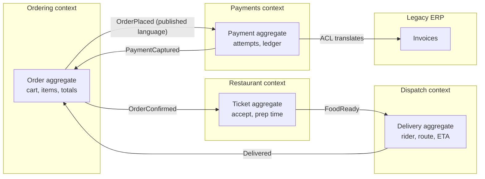
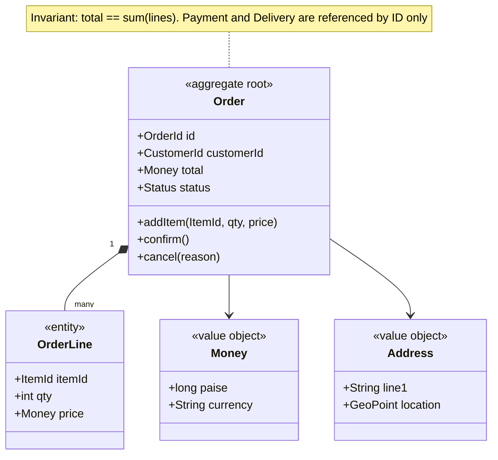
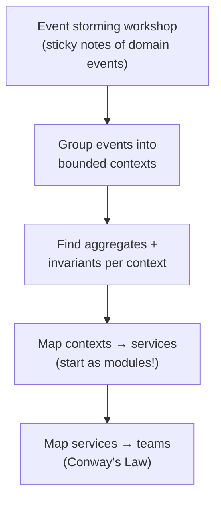

# Domain-Driven Design (DDD) and Service Boundaries

## What is it?

A way to design software around the **business domain**: split a big problem into **bounded contexts** (areas where a word has one meaning), model each with the language domain experts use, and protect each model's rules inside **aggregates**.

## Why it matters at SDE-2/3

Most microservice pain comes from **wrong boundaries**: services that must change together, chatty sync calls, shared tables, distributed transactions everywhere. DDD is the toolkit seniors use to draw boundaries that survive years of change. It also aligns code with team ownership (Conway's Law).

## Analogy

The word "Order" means different things in a restaurant chain. To the **kitchen** it's dishes and prep time. To **billing** it's amounts and taxes. To **delivery** it's an address and a time window. Forcing one giant `Order` class on all three makes everyone miserable. Each department keeps its own model and they exchange messages.

## Interview definition

> "DDD splits a domain into bounded contexts, each with its own ubiquitous language and model. Inside a context, aggregates enforce invariants and are the unit of consistency. Contexts integrate through explicit contracts, usually events, which makes them natural service boundaries."

## Core building blocks

| Concept | Meaning | Example (food delivery) |
|---|---|---|
| **Ubiquitous language** | Shared vocabulary between engineers and domain experts, used in code | "Order is *accepted* by restaurant", not "status=2" |
| **Bounded context** | Boundary in which a model and its terms are consistent | Ordering, Kitchen, Dispatch, Payments, Catalog |
| **Entity** | Object with identity over time | `Order#991`, `Rider#42` |
| **Value object** | Immutable, defined by value | `Money(49900, INR)`, `Address`, `GeoPoint` |
| **Aggregate** | Cluster of objects changed together; one **aggregate root** guards invariants | `Order` (root) + `OrderLines` — total must equal sum of lines |
| **Domain event** | Something that happened, in past tense | `OrderPlaced`, `RiderAssigned` |
| **Repository** | Loads/saves whole aggregates | `OrderRepository.get(id)` |
| **Domain service** | Logic that doesn't belong to one entity | Fare calculation across distance + surge |
| **Anti-corruption layer (ACL)** | Translator protecting your model from another's | Wrapping a legacy ERP or a payment gateway API |

### Aggregate rules (the part seniors get asked about)
1. **One transaction = one aggregate.** Need to change two aggregates? Use eventual consistency via events. → [[Distributed-Transactions]]
2. Reference other aggregates **by ID**, not object pointers.
3. Keep aggregates **small**: big aggregates create lock contention and huge loads.
4. Invariants that must be *immediately* consistent belong in the same aggregate. Everything else can be eventual.

## Strategic design: context mapping

| Relationship | Meaning |
|---|---|
| Partnership | Two teams coordinate closely |
| Customer–Supplier | Upstream serves downstream's needs |
| Conformist | Downstream just accepts upstream's model |
| Anti-corruption layer | Downstream translates to protect itself |
| Open host service / published language | Upstream offers a stable public API/event schema |
| Shared kernel | Small shared model (use sparingly) |

## 📊 Visual model

**Context map for a food delivery company:**

**Aggregate boundary — what's inside one transaction:**

**From domain to services and teams:**

## Trade-offs

| Benefit | Cost |
|---|---|
| Boundaries match business change → fewer cross-team changes | Upfront modelling effort; needs domain-expert access |
| Clear ownership + language | Overkill for CRUD apps |
| Natural fit for events and microservices | Eventual consistency between contexts |

## Who uses it
Large fintech and e-commerce platforms (payments, ledgers, orders); Shopify's modular monolith components; most event-driven architectures with Kafka.

## Common mistakes

> [!warning] Traps to avoid
> 1. Treating DDD as "use these class names" (tactical only) and skipping bounded contexts (strategic).
> 2. One giant aggregate (`Customer` containing all orders forever).
> 3. Splitting by technical layer or by noun ("UserService") instead of by capability.
> 4. Sharing a database table across contexts.
> 5. Applying DDD to a simple CRUD admin panel.

## Interview understanding

> [!question] What the interviewer is really testing
> - *"How would you split this into services?"* — Name the bounded contexts, the events between them, and which invariants stay inside one service.
> - *Tricky:* "Two aggregates must change together — what now?" — Rethink the boundary (maybe one aggregate), or accept eventual consistency via domain events + saga.
> - *Tricky:* "Entity vs value object?" — Identity over time vs defined purely by attributes (immutable).
> - *Tricky:* "What's an anti-corruption layer for?" — Keeps a messy external/legacy model from leaking into your domain.

## Mini quiz
1. What is a bounded context?
2. Rule of thumb for transactions and aggregates?
3. Why reference other aggregates by ID?
4. Name two context-mapping relationships.
5. When is DDD overkill?

> [!success]- Answers (click to reveal)
> 1. A boundary within which a model and its terms have one consistent meaning.
> 2. One transaction modifies one aggregate; cross-aggregate changes are eventual.
> 3. Keeps aggregates small and decoupled; avoids loading huge graphs and cross-boundary locks.
> 4. Customer–supplier, conformist, anti-corruption layer, shared kernel, open host, partnership.
> 5. Simple CRUD with little business logic.

---
**Next:** [[Data-Modeling-and-Schema-Evolution]] · **Up:** [[Senior-Engineering-MOC]]

## 📚 Resources
- 📖 *Domain-Driven Design Distilled* (Vaughn Vernon), the short version. *Learning Domain-Driven Design* (Vlad Khononov), a modern and practical take.
- 📄 [Martin Fowler — Bounded Context](https://martinfowler.com/bliki/BoundedContext.html)
- 📄 [EventStorming (Alberto Brandolini)](https://www.eventstorming.com/)

## My notes
-
