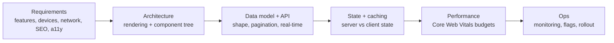
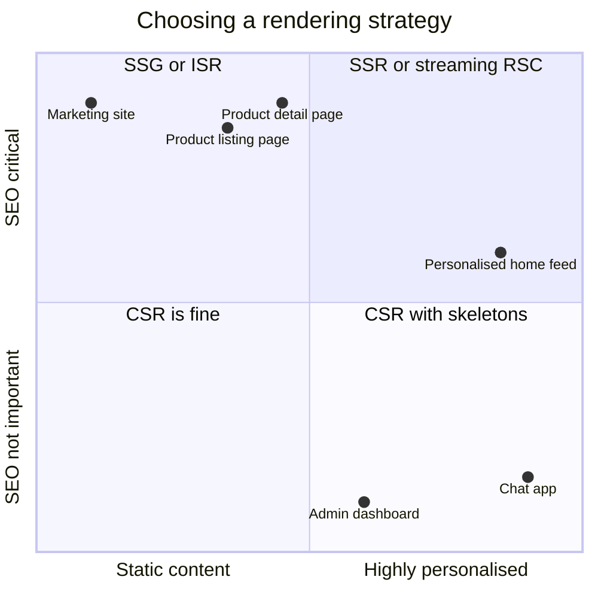
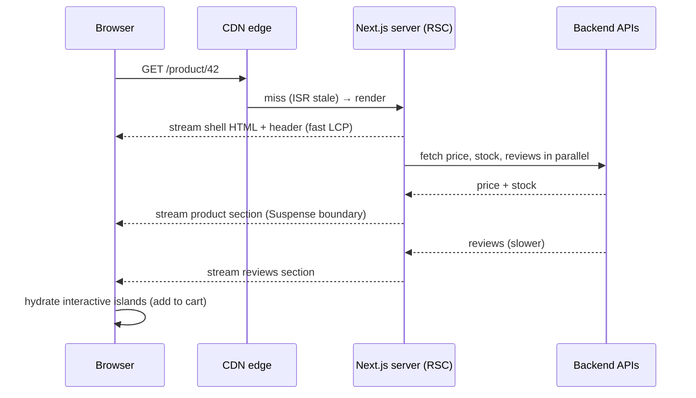
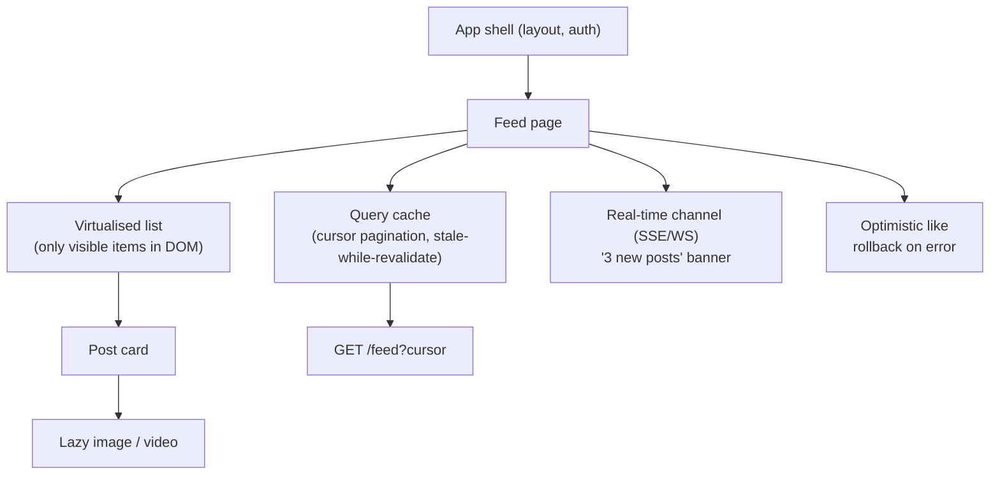
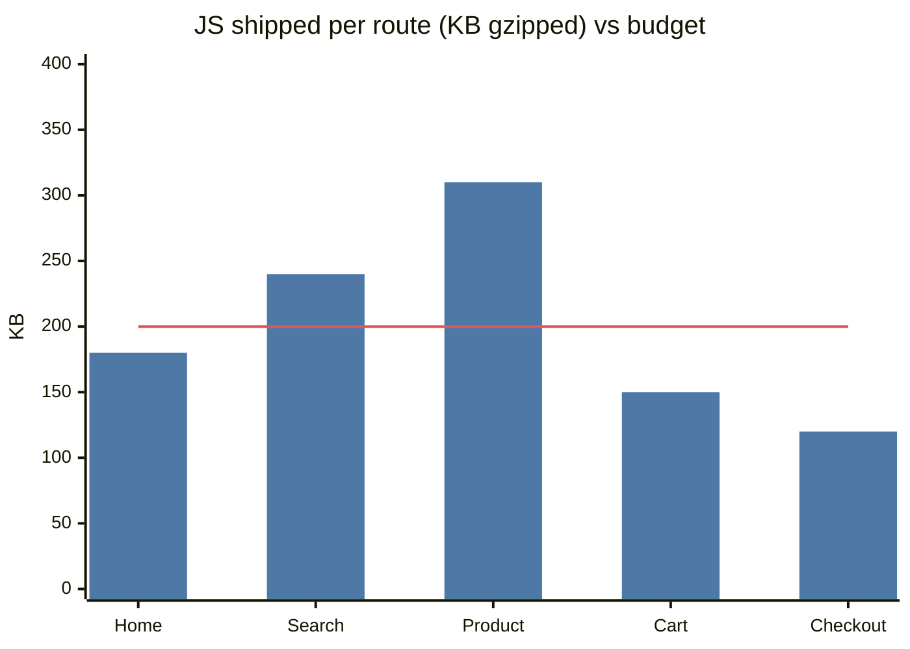

# Frontend System Design ➕ (for full-stack engineers)

> [!info] Why this is here
> Many companies (Flipkart, Atlassian, Microsoft, Uber, Meta, and most product startups) run a **frontend/client system design round** for UI and full-stack roles. With a React/Next.js stack, this is a round I can ace while others prepare only backend HLD.

## What is it?

Designing the **client side** of a product at scale: rendering strategy, data fetching and caching, state management, performance, offline support, real-time updates, component architecture and how frontend teams scale.

## Interview definition

> "Frontend system design covers how the UI gets data and renders it fast and reliably for many users and devices: the rendering strategy, the API contract, client caching and state, performance budgets, accessibility, and how the codebase scales across teams."

## The framework (adapted for frontend)

## Rendering strategies

| Strategy | How | Good for | Cost |
|---|---|---|---|
| **CSR** | JS renders in browser | Dashboards, logged-in apps | Slow first paint, weak SEO |
| **SSR** | Server renders HTML per request | SEO + personalised pages | Server cost, TTFB |
| **SSG** | HTML built at deploy | Docs, marketing | Rebuild on change |
| **ISR** | SSG + background re-generation | Product/catalogue pages | Staleness window |
| **Streaming SSR + React Server Components** | Server streams HTML + server components; less JS shipped | Data-heavy pages in Next.js App Router | Mental model complexity |
| **Islands / partial hydration** | Static HTML, interactive islands | Content sites (Astro) | Less suited to app-like UIs |
| **Edge rendering** | SSR at CDN edge | Global low-latency personalisation | Runtime limits → [[Edge-Wasm-and-eBPF]] |

## Core Web Vitals (performance budget)

| Metric | Measures | "Good" threshold |
|---|---|---|
| **LCP** (Largest Contentful Paint) | Loading | ≤ 2.5 s |
| **INP** (Interaction to Next Paint) | Responsiveness (replaced FID in 2024) | ≤ 200 ms |
| **CLS** (Cumulative Layout Shift) | Visual stability | ≤ 0.1 |

Levers: code splitting, lazy loading, image optimisation (AVIF/WebP, `srcset`), CDN caching, prefetching, fewer client JS bytes (RSC), virtualised long lists, web workers for heavy compute, avoiding layout shift with reserved dimensions.

## State management — the key distinction

| Kind | Examples | Tooling |
|---|---|---|
| **Server state** (cache of backend data) | Feed, orders, profile | TanStack Query, SWR, Apollo/Relay, RSC fetch cache |
| **Client/UI state** | Modal open, form drafts, theme | `useState`, Zustand, Redux Toolkit, Jotai |
| **URL state** | Filters, pagination | Search params (shareable) |
| **Persistent offline state** | Drafts, offline queue | IndexedDB, service worker |

Most "Redux everywhere" pain comes from treating server state as client state.

## 📊 Visual model

**Rendering strategy map:**

**Request timeline for a streamed Next.js page:**

**Feed page component and data architecture:**

**Performance budget per page (illustrative):**

## Scaling frontend teams
- **Monorepo** (Turborepo/Nx) with shared design system + lint rules.
- **Micro-frontends** (Module Federation, route-based splits) only when many independent teams own separate areas. Costs: duplicated deps, inconsistent UX, runtime integration.
- **BFF** per client to shape APIs. → [[Proxies-and-API-Gateways]]
- Feature flags + canary for frontend deploys; RUM (real-user monitoring) + error tracking (Sentry).

## Classic frontend design prompts
News feed (infinite scroll), autocomplete/typeahead, image carousel, chat UI, Google Docs-style editor ([[Real-Time-Collaboration-CRDTs]]), e-commerce product page, video player, data table with 100k rows, notifications centre, Kanban board with drag-drop.

## Common mistakes

> [!warning] Traps to avoid
> 1. Treating server data as global client state.
> 2. Shipping huge JS bundles; no budgets.
> 3. Infinite scroll without virtualisation (DOM with 10k nodes).
> 4. Ignoring accessibility (keyboard, ARIA, contrast) and i18n.
> 5. Micro-frontends for a team of 6.

## Interview understanding

> [!question] What the interviewer is really testing
> - *"Design the frontend for an autocomplete"* — Debounce, cancel stale requests (AbortController), cache per prefix, keyboard navigation + ARIA, highlight, race conditions, empty/error states. → [[Design-Typeahead]]
> - *Tricky:* "SSR vs SSG vs ISR?" — Per-request render vs build-time vs build-time with background regeneration.
> - *Tricky:* "What replaced FID?" — INP (March 2024).
> - *Tricky:* "How do you render 100k rows?" — Virtualisation (windowing), pagination or server-side filtering, web workers for sorting.

## Mini quiz
1. Three Core Web Vitals and thresholds?
2. Server state vs client state?
3. When would you choose ISR?
4. What problem does virtualisation solve?
5. One cost of micro-frontends?

> [!success]- Answers (click to reveal)
> 1. LCP ≤ 2.5 s, INP ≤ 200 ms, CLS ≤ 0.1.
> 2. Cached copy of backend data (needs fetching, invalidation) vs UI-only local state.
> 3. Mostly static pages that change occasionally and need SEO (product/catalogue pages).
> 4. Rendering only visible items so huge lists stay fast.
> 5. Duplicated dependencies / inconsistent UX / runtime integration complexity.

---
**Next:** [[Technical-Leadership-for-Engineers]] · **Up:** [[Senior-Engineering-MOC]]

## 📚 Resources
- 📄 [web.dev — Core Web Vitals](https://web.dev/articles/vitals)
- 📄 [Next.js docs — Rendering](https://nextjs.org/docs/app/building-your-application/rendering)
- 📄 [GreatFrontEnd — Front End System Design guide](https://www.greatfrontend.com/front-end-system-design-playbook)
- 📄 [TanStack Query — Does this replace client state?](https://tanstack.com/query/latest/docs/framework/react/guides/does-this-replace-client-state)

## My notes
-
