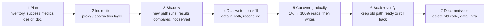
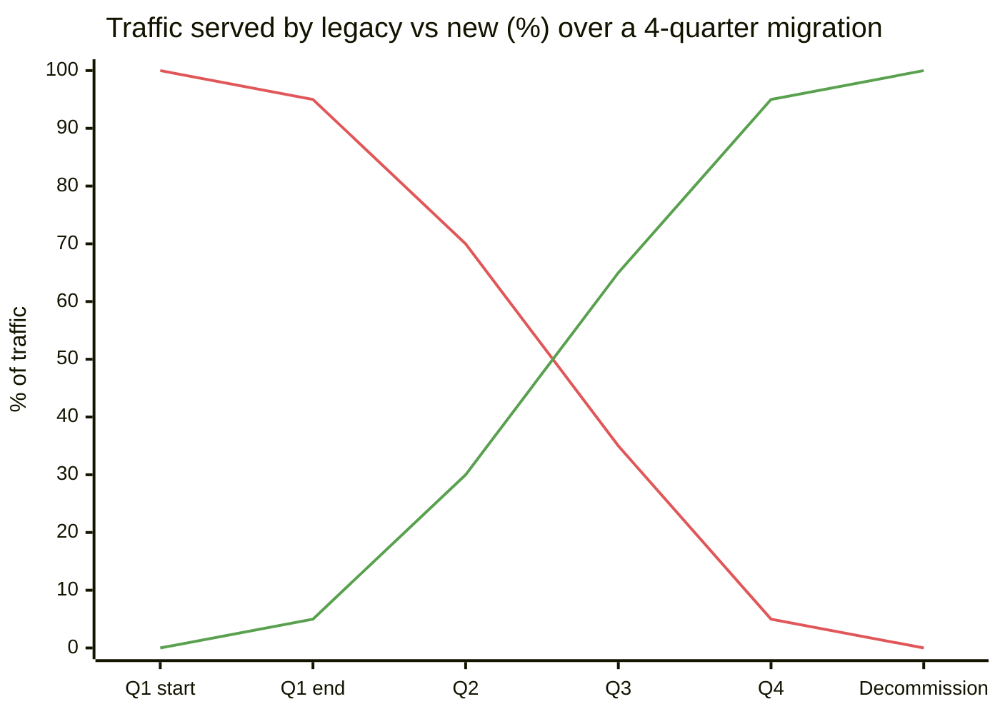
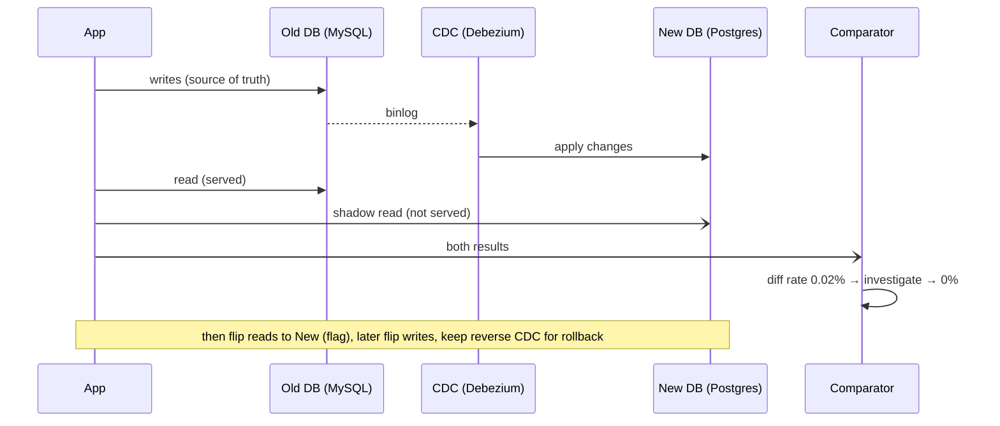
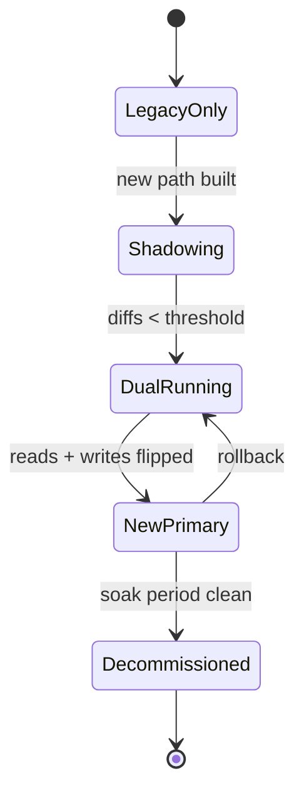
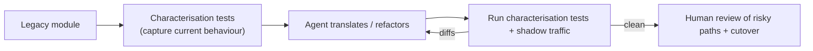

# Large-Scale Migrations and Legacy Modernisation

## What is it?

Moving a **live** system to something new (a new database, a new service, a new cloud, monolith → services, a new payments provider) while it keeps serving users, with data verified correct at the end.

## Why it matters at SDE-3

A huge share of senior work at established companies is **migration**, not greenfield. Amazon, Uber, Stripe and Flipkart engineers describe multi-quarter migrations as their defining projects. It needs every senior skill at once: design, data correctness, rollout, communication and patience. In 2026 there's an extra driver: **modernising legacy code with AI agents**. Agents can translate code fast; humans must prove behaviour didn't change.

## Analogy

Moving a hospital to a new building without discharging any patients: build the new wards, move patients one ward at a time, keep both open during the move, check every patient's chart arrived correctly, and only then close the old building.

## Interview definition

> "Migrate incrementally behind an indirection layer: route a slice of traffic or data at a time, run old and new in parallel with dual writes or shadow reads, verify with automated comparison, cut over reversibly, and decommission the old path only after a soak period."

## The playbook

## Key techniques

| Technique | What | Used for |
|---|---|---|
| **Strangler fig** | Proxy routes features one by one to the new system | Monolith → services, legacy rewrite |
| **Branch by abstraction** | Interface in code with old + new implementations; flag switches | Library/DB swap inside a codebase |
| **Shadow traffic / dark reads** | Send real requests to new path, compare responses, discard | Rewrites, new DB, new search, ML models |
| **Dual writes** | Write to old and new stores | DB migrations; beware partial failures |
| **CDC-based sync** | Stream changes from old DB to new | Safer than app dual writes → [[Event-Driven-Architecture]] |
| **Backfill** | Copy historical data in batches | All data migrations |
| **Reconciliation / diffing** | Automated comparison jobs (counts, checksums, sampled rows) | Proving correctness |
| **Parallel run** | Both systems compute; outputs compared over weeks | Billing, payments, ledgers |
| **Tenant-by-tenant cutover** | Move cohorts (internal → small → large customers) | SaaS, multi-tenant → [[Multi-Tenancy-and-SaaS-Architecture]] |

## 📊 Visual model

**Strangler fig over time:**

**DB migration with CDC + shadow reads:**

**Phase states for one migrated component:**

**AI-assisted modernisation (2026 pattern):**

## Running the project (the senior part)
- Write the design doc with **exit criteria** ("diff rate < 0.001% for 14 days").
- Track migration progress publicly (dashboard: % traffic, % tenants, % data).
- Budget for the long tail: the last 10% of callers takes 50% of the time.
- **Decommission is part of the project.** Two systems forever is the worst outcome.
- Communicate: consumers get deadlines, docs and support.

## Common mistakes

> [!warning] Traps to avoid
> 1. Big-bang cutover with no way back.
> 2. App-level dual writes without handling partial failures (one write succeeds, one fails).
> 3. "Verified" by eyeballing a few rows.
> 4. Never finishing: the old system lives forever ("migration debt").
> 5. Rewriting *and* changing behaviour at the same time. Migrate first, improve after.

## Interview understanding

> [!question] What the interviewer is really testing
> - *"How would you migrate from MySQL to Postgres with zero downtime?"* — CDC replication, backfill, shadow reads + diffing, flag-controlled read cutover, write cutover, reverse replication for rollback, decommission.
> - *Tricky:* "Dual writes vs CDC?" — App dual writes risk divergence on partial failure; CDC derives from the source of truth's log, which is more reliable.
> - *Tricky:* "How do you know the migration is correct?" — Automated reconciliation (counts, checksums, sampled deep compare) + shadow traffic diff rates + business metrics parity.
> - *Tricky:* "Rewrite from scratch or strangle?" — Strangle almost always; rewrites stall delivering nothing for months.

## Mini quiz
1. What is the strangler fig pattern?
2. Why shadow traffic?
3. Main risk of application dual writes?
4. What's an exit criterion?
5. Why migrate first and improve later?

> [!success]- Answers (click to reveal)
> 1. A proxy routes functionality incrementally from the old system to the new until the old one can be removed.
> 2. Validate the new path with real traffic without affecting users.
> 3. Divergence when one write succeeds and the other fails.
> 4. A measurable condition that must hold before the next phase (e.g., diff rate below X for N days).
> 5. Separating migration from behaviour change makes diffs meaningful and rollback safe.

---
**Next:** [[Frontend-System-Design]] · **Up:** [[Senior-Engineering-MOC]]

## 📚 Resources
- 📄 [Martin Fowler — Strangler Fig Application](https://martinfowler.com/bliki/StranglerFigApplication.html)
- 📄 [Stripe — Online migrations at scale](https://stripe.com/blog/online-migrations)
- 📄 [Slack Engineering — Scaling datastores with Vitess (migration story)](https://slack.engineering/scaling-datastores-at-slack-with-vitess/)
- 📄 [GitHub — Scientist (compare old vs new code paths)](https://github.com/github/scientist)

## My notes
-
