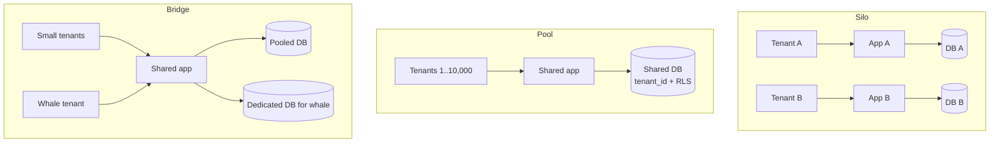
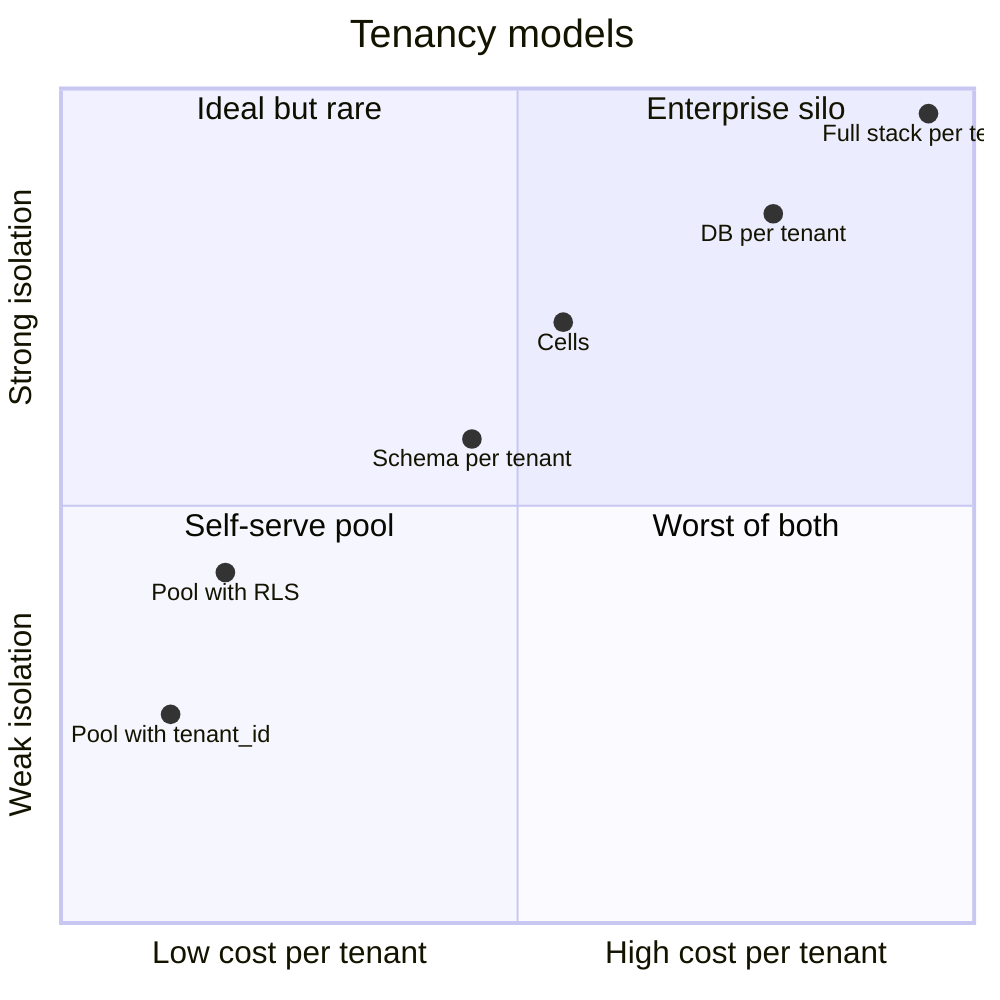
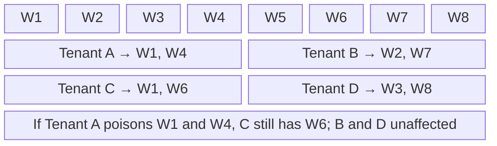
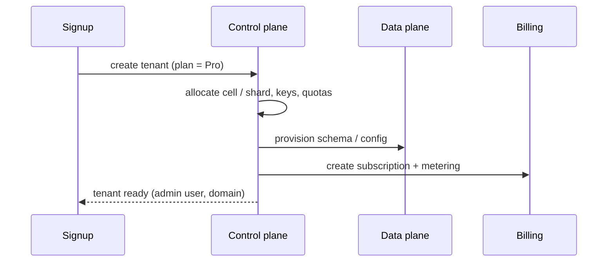

# Multi-Tenancy and SaaS Architecture

## What is it?

One system serving many **tenants** (customer organisations), with each tenant's data and performance isolated from the others. Slack workspaces, Freshworks accounts, Razorpay merchants, Zoho orgs.

## Why it matters at SDE-2/3

Almost every B2B product and every internal platform is multi-tenant. The hard questions are senior-level: **how isolated**, **who pays for what**, **what happens when one big tenant goes wild**, and **can we delete or move one tenant's data** (compliance).

## Analogy

An apartment building. **Pool:** everyone shares the same floors and pipes (cheap, but a leak can affect neighbours). **Silo:** each tenant gets a separate house (expensive, fully isolated). **Bridge:** shared building, but big tenants get their own floor.

## Interview definition

> "Multi-tenancy trades isolation for cost efficiency. You pick a model (silo, pool, or hybrid) per layer, enforce tenant context everywhere (auth → queries → caches → queues), protect against noisy neighbours with per-tenant quotas and isolation, and keep per-tenant observability and cost attribution."

## Tenancy models

| Model | Data | Compute | Isolation | Cost / tenant | Fits |
|---|---|---|---|---|---|
| **Silo** | DB per tenant | Stack per tenant | Strongest | Highest | Enterprise, regulated (banks, govt) |
| **Pool** | Shared tables with `tenant_id` | Shared | Weakest (logical) | Lowest | SMB/self-serve, long tail |
| **Bridge / hybrid** | Schema per tenant, or pool + silo for whales | Shared + dedicated tiers | Medium | Medium | Most real SaaS at scale |
| **Cell-based** | Tenants assigned to cells (mini-stacks) | Per cell | Blast radius = one cell | Medium | Large SaaS (Slack, AWS services) |

## Enforcing isolation in a pooled DB

- **Tenant context** from the auth token, propagated through every call (header + context object); never from user input.
- Every query scoped by `tenant_id`; composite indexes start with `tenant_id`.
- **Postgres Row-Level Security (RLS):** DB enforces `tenant_id = current_setting('app.tenant_id')` as defence in depth.
- Cache keys, queue messages, object-storage prefixes, search indexes **all** include tenant ID.
- Per-tenant encryption keys (BYOK) for enterprise tiers.

```sql
ALTER TABLE invoices ENABLE ROW LEVEL SECURITY;
CREATE POLICY tenant_isolation ON invoices
  USING (tenant_id = current_setting('app.tenant_id')::bigint);
-- app sets per request:  SET app.tenant_id = '42';
```

## Noisy neighbours

One tenant's import job or traffic spike degrades everyone.
- **Per-tenant rate limits and quotas** (API, storage, jobs). → [[Design-Rate-Limiter]]
- **Fair scheduling**: per-tenant queues or weighted fair queuing for background work.
- **Bulkheads**: separate pools for big tenants. → [[Resilience-Patterns]]
- **Shuffle sharding**: give each tenant a random small subset of N workers; two tenants rarely share the same whole subset, so one bad tenant can't take everyone down.
- Move whales to dedicated shards/cells (tenant migration tooling!).

## 📊 Visual model

**Three models side by side:**



**Isolation vs cost:**



**Shuffle sharding — blast radius:**



$$P(\text{two tenants share the exact same shard of size } k \text{ out of } n) = \frac{1}{\binom{n}{k}}$$

> [!example] Numbers
> n = 8 workers, k = 2 per tenant → 28 combinations. n = 100, k = 5 → ~75 million combinations. That's why AWS uses shuffle sharding for Route 53.

**Tenant onboarding as a workflow:**



## Control plane vs data plane

- **Control plane:** tenant lifecycle, plans, quotas, routing tables, provisioning. Low traffic, high correctness.
- **Data plane:** serves tenant traffic. High volume, must keep working even if the control plane is down (cache the routing config).

## Common mistakes

> [!warning] Traps to avoid
> 1. Tenant ID taken from a request parameter instead of the authenticated token.
> 2. Forgetting tenant scoping in caches/search/queues (cross-tenant data leaks).
> 3. No per-tenant metrics → can't find the noisy neighbour or price the plan.
> 4. No tooling to move a tenant between shards/regions.
> 5. One giant tenant in a pooled DB with no limits.

## Interview understanding

> [!question] What the interviewer is really testing
> - *"Design a multi-tenant SaaS"* — Choose a model per tier, tenant context propagation, RLS, quotas, noisy-neighbour defence, per-tenant observability and cost, data residency.
> - *Tricky:* "How do you delete all data of one tenant (GDPR/DPDP)?" — Tenant-scoped keys/prefixes everywhere, per-tenant encryption keys (crypto-shredding), deletion workflow across stores + backups policy.
> - *Tricky:* "What's shuffle sharding?" — Random subsets of workers per tenant; limits blast radius combinatorially.
> - *Tricky:* "Control plane down — what breaks?" — New signups/changes; data plane should keep serving from cached config.

## Mini quiz
1. Silo vs pool in one line?
2. What is RLS and why use it?
3. Three noisy-neighbour defences?
4. Control plane vs data plane?
5. What is crypto-shredding?

> [!success]- Answers (click to reveal)
> 1. Dedicated resources per tenant (isolated, costly) vs shared resources with tenant_id (cheap, logical isolation).
> 2. Postgres row-level security: the DB enforces tenant filtering as defence in depth.
> 3. Per-tenant rate limits/quotas, fair queues/bulkheads, shuffle sharding, moving whales to dedicated shards.
> 4. Management/provisioning layer vs the layer serving tenant traffic.
> 5. Deleting a tenant's encryption key, making all their encrypted data (incl. backups) unreadable.

---
**Next:** [[Capacity-Planning-and-Performance-Engineering]] · **Up:** [[Senior-Engineering-MOC]]

## 📚 Resources
- 📄 [AWS — SaaS Tenant Isolation Strategies (whitepaper)](https://docs.aws.amazon.com/whitepapers/latest/saas-tenant-isolation-strategies/saas-tenant-isolation-strategies.html)
- 📄 [AWS Builders' Library — Workload isolation using shuffle-sharding](https://aws.amazon.com/builders-library/workload-isolation-using-shuffle-sharding/)
- 📄 [PostgreSQL — Row Security Policies](https://www.postgresql.org/docs/current/ddl-rowsecurity.html)

## My notes
-
