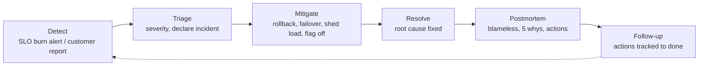
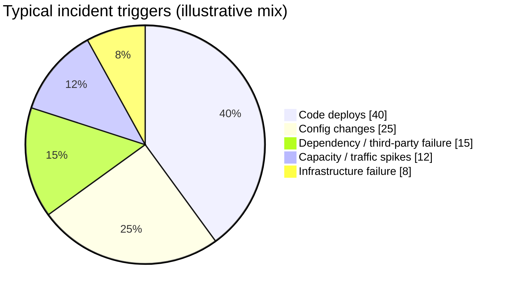
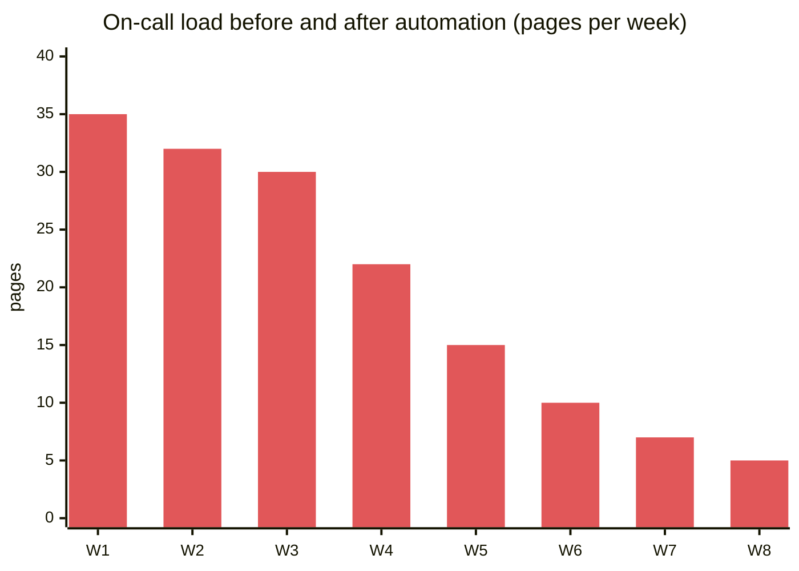

# Operational Excellence, On-Call and Incident Management

> DevOps-vault link: this note covers the **engineering-leadership** side. Tooling (Prometheus, Grafana, alertmanager configs) lives in my DevOps notes.

## What is it?

The practices that keep a service healthy **after** launch: on-call, alerts that matter, runbooks, incident response with clear roles, blameless postmortems, and turning every incident into a lasting fix.

## Why it matters at SDE-2/3

"You build it, you run it" is standard at Amazon, Flipkart, Swiggy and most product companies. Promotion packets at SDE-2/3 almost always include "led incident X" or "reduced pages by Y%". Amazon interviews probe it under the leadership principles Ownership and Dive Deep.

## Analogy

A hospital emergency room. There's a **triage nurse** (incident commander) who doesn't operate but coordinates, **surgeons** (responders) who fix, a **scribe** (comms lead) who updates the family, and a **morbidity & mortality review** (postmortem) where the goal is learning, not blame.

## Interview definition

> "Operational excellence means measurable reliability: SLO-based alerting, documented runbooks, a clear incident-command structure that mitigates first and diagnoses second, and blameless postmortems whose action items actually get done."

## Incident lifecycle



**Mitigate before diagnose.** Rolling back a bad deploy in 5 minutes beats finding the exact bug in 2 hours while users suffer.

## Severity levels (typical)

| Sev | Meaning | Response |
|---|---|---|
| SEV1 | Core flow down for many users (checkout, payments, login) / data loss / security breach | All hands, IC + comms lead, status page, exec updates every 30 min |
| SEV2 | Major degradation or a key feature down for a subset | On-call + team, IC, regular updates |
| SEV3 | Minor impact, workaround exists | On-call fixes in business hours |
| SEV4 | Cosmetic / internal | Ticket |

## Roles during an incident

| Role | Does | Doesn't |
|---|---|---|
| **Incident commander (IC)** | Coordinates, decides, assigns, keeps timeline | Debug code themselves |
| **Ops / tech lead** | Investigates and executes mitigation | Talk to execs |
| **Comms lead** | Status page, stakeholders, customer support | Touch prod |
| **Scribe** | Timeline in the incident doc | — |
| **Subject experts** | Join when paged | Freelance changes without IC |

## 📊 Visual model

**Incident timeline metrics:**

```mermaid
gantt
    title SEV2 incident — where time goes
    dateFormat HH:mm
    axisFormat %H:%M
    section Detect
    Bad deploy goes out          :milestone, d0, 14:00, 0m
    Error budget burn alert      :crit, d1, 14:00, 6m
    section Respond
    On-call acks, declares SEV2  :r1, after d1, 4m
    IC assigned, war room        :r2, after r1, 3m
    section Mitigate
    Identify recent deploy       :m1, after r2, 7m
    Rollback                     :m2, after m1, 5m
    section Recover
    Metrics back to baseline     :milestone, m3, after m2, 0m
```



> MTTD (time to detect) = 6 min · MTTA (to acknowledge) = 4 min · MTTM (to mitigate) ≈ 25 min. Postmortem actions target the biggest bar.

**What causes incidents (where to invest):**



> Google's SRE book: roughly 70% of outages come from changes to a live system, which is why [[Zero-Downtime-Migrations-and-Deployments]] is the biggest reliability lever.

**Toil vs engineering:**



## Blameless postmortem template

```markdown
# Postmortem: Checkout errors 14:00–14:25 IST (SEV2)
**Impact:** 18% of checkouts failed for 25 min (~4,100 orders), est. ₹X GMV
**Detection:** SLO burn-rate alert at 14:06 (6 min after deploy)
**Root cause:** v2.31 changed payment status enum; old consumer threw on unknown value
**Trigger:** deploy of payments-api v2.31
**Mitigation:** rollback at 14:25
**What went well:** fast rollback, clear IC
**What went wrong:** no contract test; canary watched CPU, not checkout errors
**Action items (owner, due):**
1. Add consumer-driven contract tests for payment events (Agnik, 20 Nov)
2. Canary analysis on checkout success rate (Ravi, 25 Nov)
3. Consumers must tolerate unknown enum values (team, 30 Nov)
```

## Operational readiness review (before launch)
SLOs defined · dashboards · alerts with runbooks · capacity tested · rollback plan · dependencies' SLOs known · on-call rotation + training · data backups + restore tested · feature flags / kill switch · cost alarms.

## Common mistakes

> [!warning] Traps to avoid
> 1. Alerting on causes (CPU 80%) instead of user symptoms (SLO burn).
> 2. IC also debugging, so nobody coordinates.
> 3. Postmortems that blame a person ("Rahul ran the wrong command") instead of fixing the system that allowed it.
> 4. Action items never completed.
> 5. Runbooks that are out of date or say "contact X".

## Interview understanding

> [!question] What the interviewer is really testing
> - *"Tell me about an incident you handled"* (behavioural) — STAR: impact, detection, mitigation first, root cause, systemic fixes, what you'd change.
> - *Tricky:* "Rollback or fix forward?" — Roll back if safe and fast; fix forward only if rollback is unsafe (e.g., irreversible migration) or the fix is trivial and verified.
> - *Tricky:* "How do you reduce on-call pain?" — Delete noisy alerts, SLO-based alerting, automate runbooks, fix top recurring causes, error budgets.
> - *Tricky:* "What's blameless and why?" — Focus on systems and conditions, so people report honestly and learning compounds.

## Mini quiz
1. Incident lifecycle steps?
2. What does the incident commander *not* do?
3. Mitigate or diagnose first?
4. Biggest source of outages?
5. Three postmortem sections?

> [!success]- Answers (click to reveal)
> 1. Detect → triage → mitigate → resolve → postmortem → follow-up.
> 2. Hands-on debugging; they coordinate and decide.
> 3. Mitigate first.
> 4. Changes to the live system (deploys, config).
> 5. Impact, timeline, root cause/trigger, what went well/wrong, action items with owners and dates.

---
**Next:** [[Cost-Aware-Architecture]] · **Up:** [[Senior-Engineering-MOC]]

## 📚 Resources
- 📄 [Google SRE Book — Managing Incidents](https://sre.google/sre-book/managing-incidents/) and [Postmortem Culture](https://sre.google/sre-book/postmortem-culture/)
- 📄 [PagerDuty Incident Response guide](https://response.pagerduty.com/)
- 📄 [Atlassian — Incident management handbook](https://www.atlassian.com/incident-management/handbook)

## My notes
-
