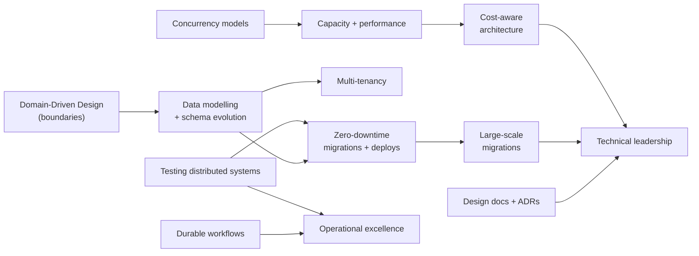
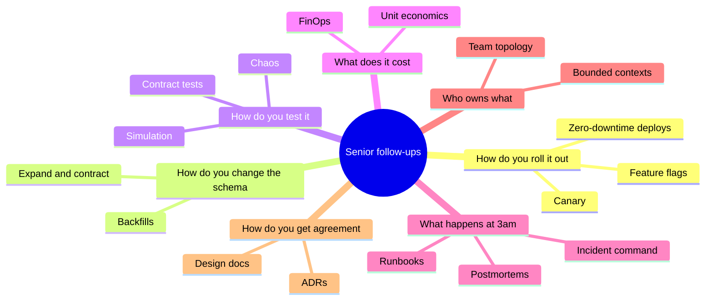

# 🧑‍💻 13 · Senior Engineering MOC (SDE-2 → SDE-3) ➕

> [!important] Why this module exists
> Modules 01–10 teach you how to **design** a system on a whiteboard. Engineers with 5–7 years are paid for what happens *after* the whiteboard: modelling data that will change for years, shipping changes with zero downtime, proving it works, running it, keeping it affordable, and getting other engineers to agree. Those are the topics here. Interviewers probe them as "how would you roll this out?", "how do you test it?", "what does it cost?", "how do you migrate?".

## The notes

| # | Note | Level | One-line why |
|---|---|---|---|
| 1 | [[Domain-Driven-Design]] | SDE-3 | Drawing service boundaries that don't hurt in 2 years |
| 2 | [[Data-Modeling-and-Schema-Evolution]] | SDE-2 | Data outlives code; changing it safely is the job |
| 3 | [[Zero-Downtime-Migrations-and-Deployments]] | SDE-2 | Expand–contract, feature flags, canaries |
| 4 | [[Multi-Tenancy-and-SaaS-Architecture]] | SDE-3 | Every B2B company: isolation, noisy neighbours, per-tenant cost |
| 5 | [[Capacity-Planning-and-Performance-Engineering]] | SDE-3 | Queueing theory, load tests, profiling, tail latency |
| 6 | [[Concurrency-and-Async-Models]] | SDE-2 | Threads vs event loop vs actors; races and backpressure in code |
| 7 | [[Workflow-Orchestration-and-Durable-Execution]] | SDE-3 | Long-running business processes that survive crashes |
| 8 | [[Testing-Distributed-Systems]] | SDE-2 | Contract tests, integration, chaos, deterministic simulation |
| 9 | [[Operational-Excellence-and-Incidents]] | SDE-2 | On-call, runbooks, incident command, postmortems |
| 10 | [[Cost-Aware-Architecture]] | SDE-3 | Unit economics, FinOps, the cheap-by-design choices |
| 11 | [[Design-Docs-and-ADRs]] | SDE-2 | The artifact that turns you from coder to engineer |
| 12 | [[Large-Scale-Migrations]] | SDE-3 | Moving live systems: shadow traffic, dual writes, verification |
| 13 | [[Frontend-System-Design]] | SDE-2 (full-stack) | Rendering strategies, state, performance, micro-frontends |
| 14 | [[Technical-Leadership-for-Engineers]] | SDE-3 | Scoping, estimation, tech debt, influence without authority |

## How they connect

## Which interview question each note answers

**Prev module:** [[Interview-Questions-MOC]] · **Next:** [[Future-Engineering-MOC]] · **Up:** [[System-Design-MOC]] · **Ladder:** [[SDE-Career-Ladder]]
