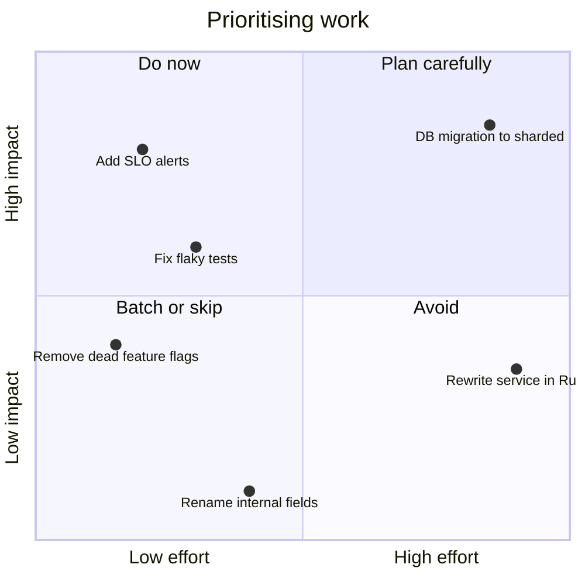
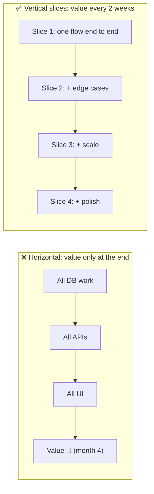
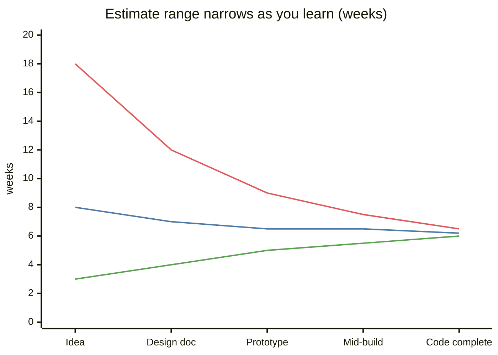
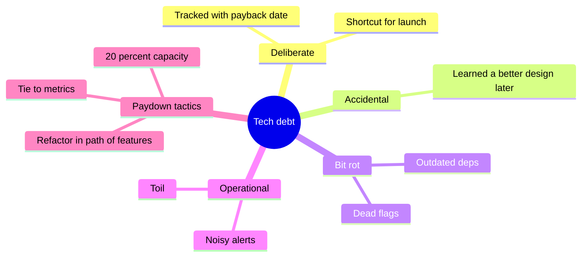

# Technical Leadership for Engineers

## What is it?

The non-coding half of a senior engineer's job: turning vague problems into scoped projects, estimating and sequencing work, managing tech debt, making build-vs-buy calls, mentoring, and **influencing decisions without authority**.

## Why it matters now

- It's the clearest line between SDE-2 and SDE-3 (see [[SDE-Career-Ladder]]).
- With AI agents doing more implementation, **judgment, scoping and review** are what remain scarce. Companies are cutting coordination layers (Amazon removed management layers; Canva merged teams into small empowered groups), so ICs are expected to lead more.

## Analogy

A film director doesn't operate every camera. They decide the story, cast, schedule and trade-offs, unblock the crew, and are accountable for the movie.

## Interview definition

> "Technical leadership is multiplying a team's impact: framing the right problem, choosing a simple design, de-risking early, sequencing delivery, keeping quality high through reviews and standards, and growing other engineers, mostly through influence rather than authority."

## The skills

### 1. Scoping ambiguous problems
Restate the problem as a measurable goal → find the riskiest assumption → design a thin vertical slice that tests it → define milestones with user-visible value each.

### 2. Estimation
- Break into ≤ 3-day tasks; estimate ranges (best/likely/worst), not single numbers.
- Add explicit buffers for integration, migrations, reviews, on-call.
- Re-estimate when you learn; communicate changes early.
- AI-era twist: implementation is faster, but **review, verification and integration** don't shrink as much. Budget for them.

### 3. Prioritisation
Impact vs effort, with **reversibility** as a third axis (Amazon's one-way vs two-way doors: decide two-way doors fast; slow down on one-way doors).

### 4. Tech debt management
Make it visible (register with cost of delay), tie paydown to business outcomes ("deploys 3× faster", "pages down 60%"), reserve capacity (~15–20% per sprint), prefer incremental refactors in the path of feature work.

### 5. Build vs buy
| Build when | Buy / use OSS when |
|---|---|
| Core differentiator | Commodity (auth, email, payments gateway, observability) |
| Unique constraints (scale, compliance) | Vendor meets 80%+ and is cheaper than team-time |
| Long-term ownership is acceptable | You need it this quarter |

### 6. Code review & standards
Review for **correctness, design, failure modes, tests, readability**, not style (automate that). For AI-generated PRs: demand tests and explanations; reject code nobody can explain. → [[AI-Native-SDLC]]

### 7. Mentoring & raising the bar
Pairing, design-doc feedback, letting juniors own incidents with backup, interview bar-raising.

### 8. Influence without authority
Write things down, bring data, understand the other team's incentives, offer options not ultimatums, disagree and commit once decided.

## 📊 Visual model

**Impact vs effort vs reversibility:**

**Thin vertical slices beat horizontal layers:**

**Estimate as ranges (cone of uncertainty):**

> [!note] Line 1 = worst case, line 2 = likely, line 3 = best case. Communicate the range, not the best case.

**Tech debt as a portfolio:**

## Behavioural questions this note prepares you for
- "Tell me about a time you disagreed with a technical decision." → data, alternatives, disagree-and-commit.
- "A project you scoped from an ambiguous ask." → goal, slices, risks, outcome with numbers.
- "How do you handle tech debt vs features?" → visibility, business framing, reserved capacity.
- "How did you help someone grow?" → concrete mentoring, their outcome.
- "Biggest mistake / failed project?" → what you learned, what you changed systemically.

## Common mistakes

> [!warning] Traps to avoid
> 1. Being the hero who fixes everything personally (doesn't scale, burns out).
> 2. Single-number estimates that become deadlines.
> 3. "Rewrite it" as the answer to every debt.
> 4. Approving AI-generated code you can't explain.
> 5. Winning arguments instead of reaching good decisions.

## Mini quiz
1. One-way vs two-way door decisions?
2. Why thin vertical slices?
3. How do you justify tech-debt work?
4. What to review in an AI-generated PR?
5. When to build vs buy?

> [!success]- Answers (click to reveal)
> 1. Irreversible decisions need care; reversible ones should be made fast.
> 2. Deliver value and learning early; de-risk integration.
> 3. Quantify the cost of delay and tie paydown to business metrics (speed, reliability, cost).
> 4. Correctness, failure modes, tests that prove behaviour, security, and whether the author can explain it.
> 5. Build core differentiators; buy commodities where vendors meet needs at lower total cost.

---
**Up:** [[Senior-Engineering-MOC]] · **Next module:** [[Future-Engineering-MOC]]

## 📚 Resources
- 📖 *The Staff Engineer's Path* (Tanya Reilly) — the best book on IC leadership.
- 📖 *An Elegant Puzzle* (Will Larson) and [staffeng.com](https://staffeng.com/)
- 📄 [Gergely Orosz — The Pragmatic Engineer](https://newsletter.pragmaticengineer.com/)
- 📄 Jeff Bezos, 2015 Amazon shareholder letter — "Type 1 vs Type 2 decisions" (the origin of one-way/two-way doors; search the title to read it)

## My notes
-
