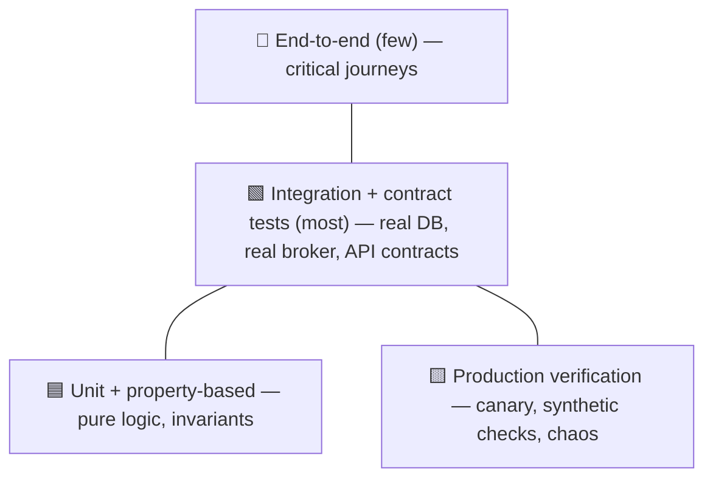
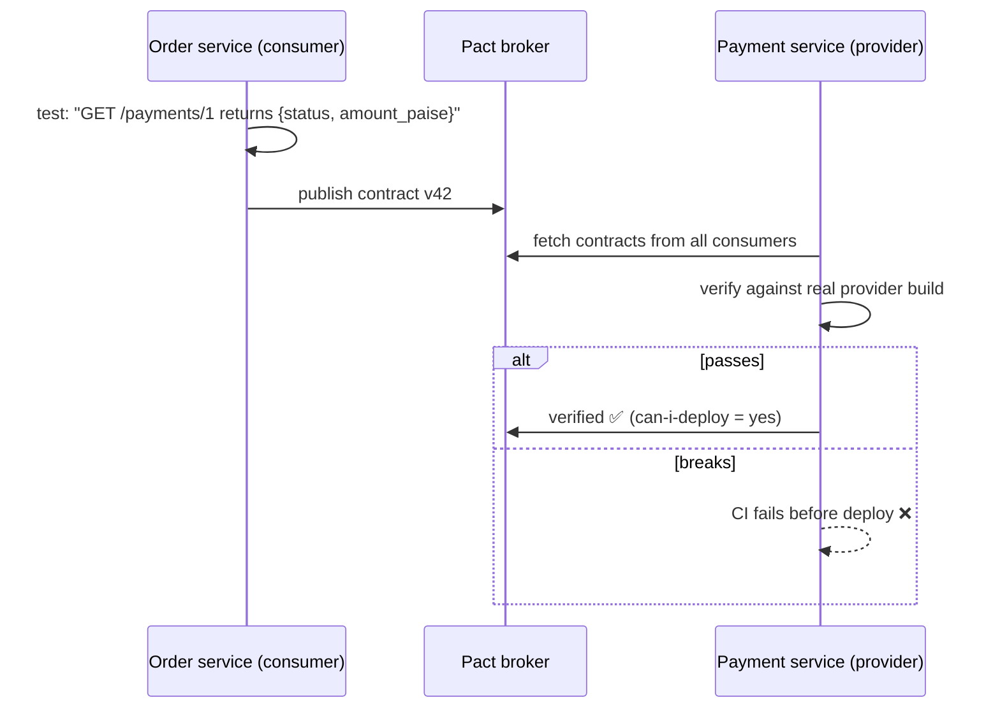
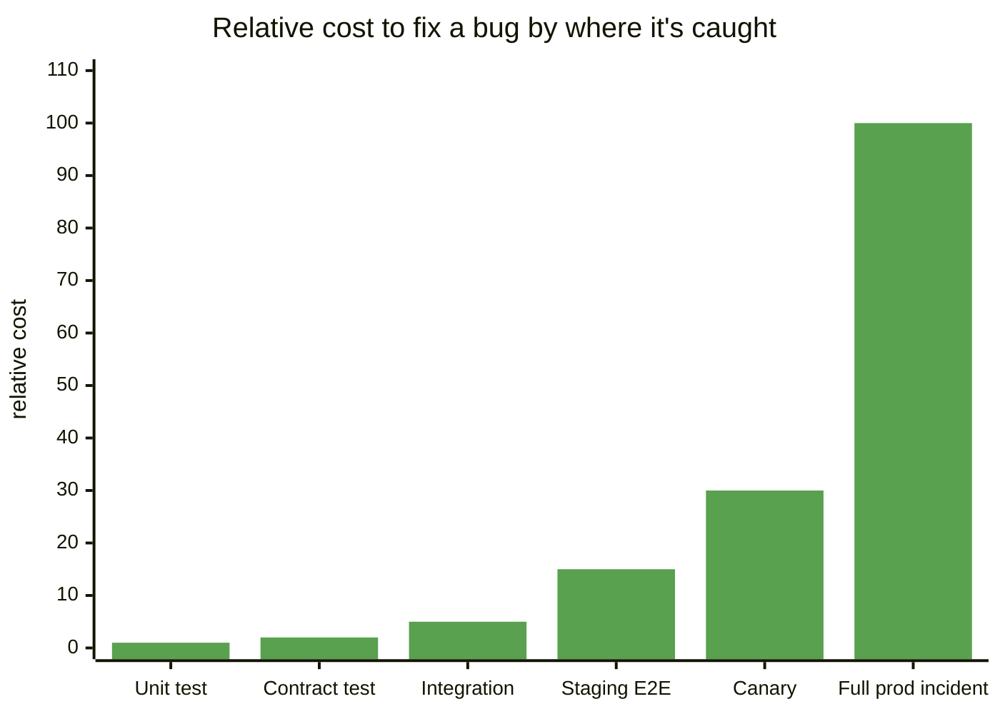
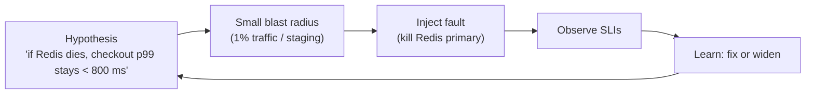

# Testing Distributed Systems

## What is it?

Strategies to gain confidence that a system of services, queues and databases behaves correctly, **including under failures, concurrency and version skew**, which unit tests never exercise.

## Why it matters (more in the AI era)

- Microservices break at the **seams**: a renamed field, a changed status code, a slow dependency.
- As AI agents write more code, **tests become the specification and the safety net**. Engineers who design good test strategies become more valuable, not less. → [[Verification-Engineering]]

## Analogy

Testing a car: checking each bolt (unit tests) doesn't tell you the brakes work at 100 km/h on a wet road (integration + failure testing). Crash tests (chaos) tell you what happens when things go wrong on purpose.

## Interview definition

> "Test pyramid for logic, contract tests for service seams, a few end-to-end tests for critical journeys, plus fault injection and production verification such as canaries and synthetic checks, because the hardest bugs in distributed systems only appear with concurrency, partial failure and version skew."

## The testing portfolio

| Layer | What it catches | Tools | Notes |
|---|---|---|---|
| **Unit** | Logic bugs | Jest/Vitest, pytest, JUnit | Fast, many |
| **Property-based** | Edge cases you didn't think of | fast-check, Hypothesis, jqwik | Define invariants ("sum of ledger = 0"), generator finds counterexamples |
| **Component / integration** | Real DB/queue behaviour | **Testcontainers**, docker-compose | Test with real Postgres, not mocks |
| **Contract (consumer-driven)** | Breaking API/event changes between services | **Pact**, Spring Cloud Contract, schema registry checks | Consumer publishes expectations; provider CI verifies |
| **End-to-end** | Critical user journeys | Playwright, Cypress | Few, slow, flaky; keep to top journeys |
| **Performance/load** | Capacity and regressions | k6, Gatling | → [[Capacity-Planning-and-Performance-Engineering]] |
| **Chaos / fault injection** | Resilience under failures | Chaos Mesh, Litmus, AWS FIS, Toxiproxy | Kill pods, add latency, partition network |
| **Deterministic simulation** | Rare concurrency/failure interleavings | FoundationDB-style simulation, Antithesis, Jepsen | Run the whole system in a simulated, seeded world |
| **Production verification** | What only prod shows | Canaries, synthetic probes, shadow traffic, feature-flag experiments | Testing *in* production safely |

## 📊 Visual model

**The modern test "honeycomb" for services:**



**Consumer-driven contract testing:**



**Where bugs are found vs cost to fix (illustrative):**



**Chaos experiment loop:**



**Property-based test example (ledger invariant):**

```ts
import fc from "fast-check";
test("every transfer keeps total balance constant", () => {
  fc.assert(fc.property(
    fc.array(fc.record({ from: fc.nat(9), to: fc.nat(9), amount: fc.nat(10_000) })),
    (transfers) => {
      const ledger = new Ledger(10, 1_000_000);
      transfers.forEach(t => ledger.tryTransfer(t.from, t.to, t.amount));
      return ledger.totalBalance() === 10 * 1_000_000;   // invariant
    }));
});
```

## What to test specifically in distributed designs
- **Idempotency:** replay the same message/request twice → one effect. → [[Idempotency]]
- **Retries and timeouts:** dependency slow/erroring → bounded latency, fallback works.
- **Ordering:** out-of-order and duplicate events.
- **Version skew:** old consumer + new producer (and vice versa). → [[Data-Modeling-and-Schema-Evolution]]
- **Migrations:** backfill resumes after crash; dual-write consistency checker.
- **Failover:** DB primary failover during writes; cache cold start.

## Common mistakes

> [!warning] Traps to avoid
> 1. Mocking the database and the broker → tests pass, prod fails.
> 2. Huge flaky E2E suites that everyone ignores.
> 3. No contract tests → "it worked on our side" outages.
> 4. Chaos in prod without SLO guardrails or a stop button.
> 5. Accepting AI-generated tests that just assert current behaviour (including bugs).

## Interview understanding

> [!question] What the interviewer is really testing
> - *"How would you test this design?"* — Portfolio answer: unit/property for logic, Testcontainers integration, consumer-driven contracts, a few E2E, chaos for the critical dependency, canary + synthetic checks in prod.
> - *Tricky:* "Contract tests vs E2E?" — Contract tests check each seam independently and fast; E2E checks journeys but is slow/flaky.
> - *Tricky:* "How do you find a race that happens once a month?" — Deterministic simulation / Jepsen-style fault + concurrency testing, property-based tests with concurrency, strong invariants + monitoring.
> - *Tricky:* "Is testing in production irresponsible?" — Not with canaries, flags, synthetic probes and blast-radius limits; some behaviour only exists in prod.

## Mini quiz
1. What does a consumer-driven contract test verify?
2. Why prefer Testcontainers over mocks for the DB layer?
3. What's a property-based test?
4. Name two production-verification techniques.
5. Four distributed-specific things to test?

> [!success]- Answers (click to reveal)
> 1. That the provider still satisfies what each consumer actually relies on.
> 2. Real behaviour (SQL dialect, constraints, locking, transactions) is exercised.
> 3. A test of an invariant over many generated inputs, with automatic shrinking of failures.
> 4. Canary analysis, synthetic probes, shadow traffic, feature-flag experiments, chaos with guardrails.
> 5. Idempotency, retries/timeouts, ordering/duplicates, version skew, migrations, failover.

---
**Next:** [[Operational-Excellence-and-Incidents]] · **Up:** [[Senior-Engineering-MOC]]

## 📚 Resources
- 📄 [Pact — consumer-driven contract testing](https://docs.pact.io/)
- 📄 [Testcontainers](https://testcontainers.com/)
- 📄 [Principles of Chaos Engineering](https://principlesofchaos.org/)
- 📄 [FoundationDB — Testing (deterministic simulation)](https://apple.github.io/foundationdb/testing.html)

## My notes
-
