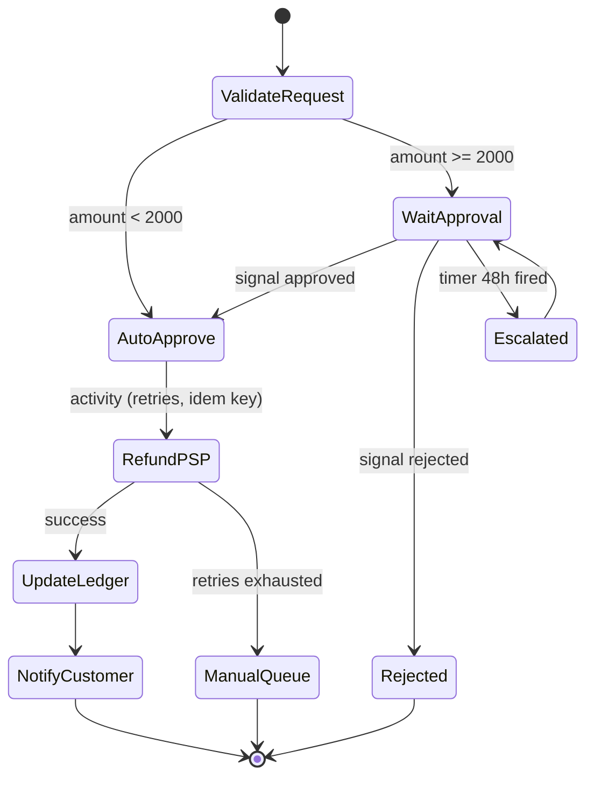
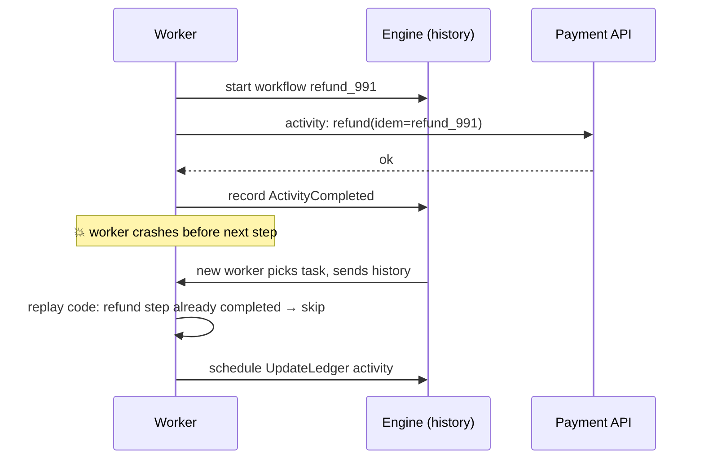
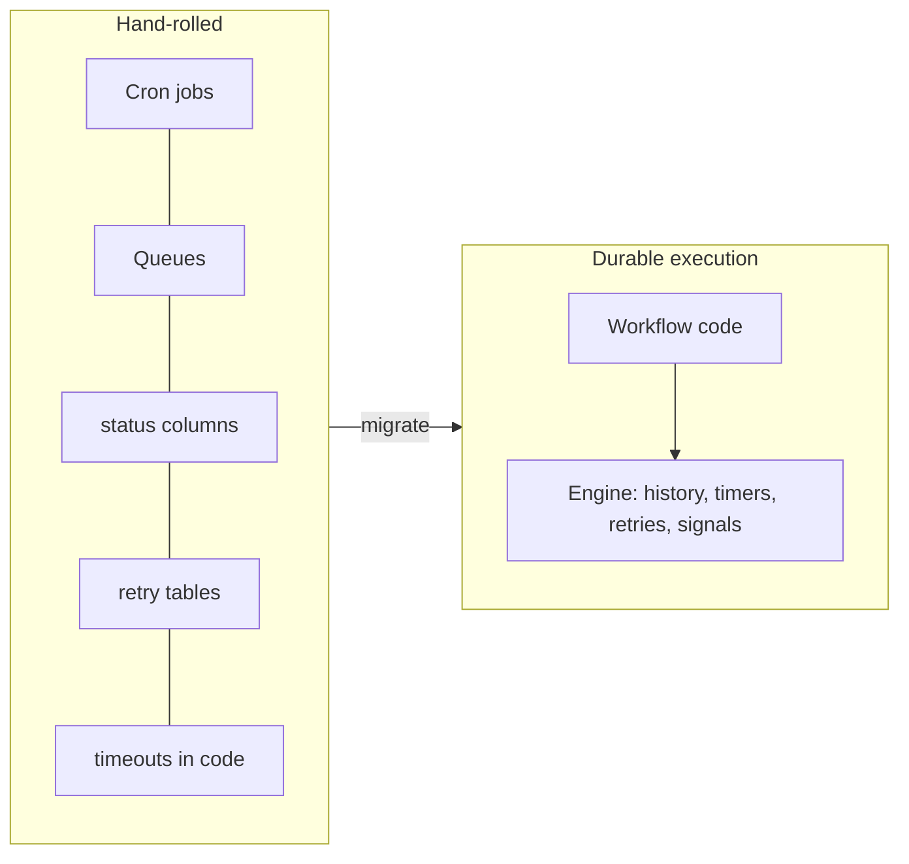
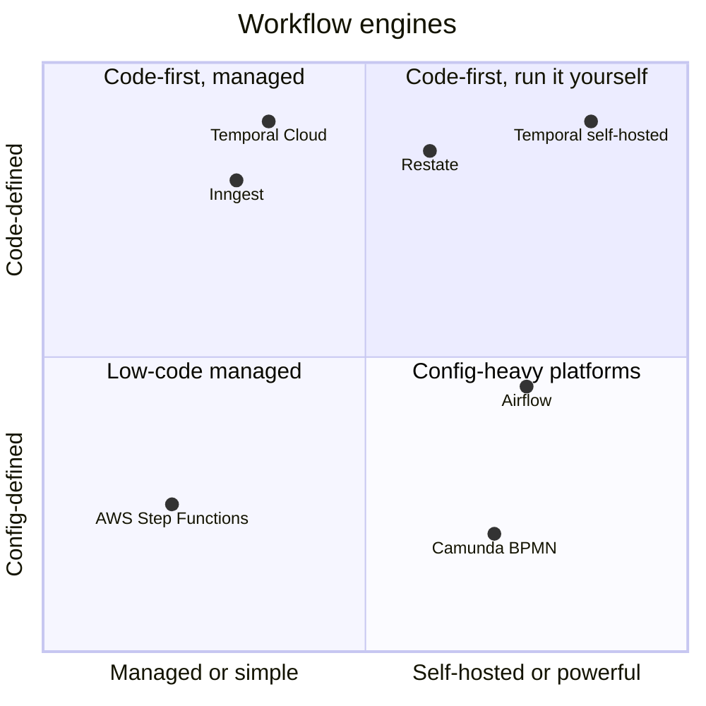

# Workflow Orchestration and Durable Execution

## What is it?

A way to write **long-running, multi-step business processes** (order fulfilment, KYC onboarding, refunds, AI agent runs) as ordinary-looking code that **survives crashes, retries, deploys and waits of days**. The engine persists every step's progress, so execution resumes exactly where it stopped.

## Why it matters at SDE-2/3

Without it, teams hand-build state machines out of cron jobs, queues, status columns and retry tables, and every edge case becomes an incident. Durable execution (Temporal, AWS Step Functions, Azure Durable Functions, Restate, Inngest) has become the default for sagas and, increasingly, **AI agent workflows**.

## Analogy

A video game with **auto-save after every level**. If the power goes out, you don't replay from the start; you continue from the last completed level. Each level must be safe to replay (idempotent) because the save may have happened just before the crash.

## Interview definition

> "Durable execution persists workflow state as an event history, so a workflow function can be replayed deterministically after any failure. Side effects run as activities with retries and timeouts. It turns sagas, timers and human approvals into straightforward code."

## Core concepts (Temporal vocabulary)

| Concept | Meaning |
|---|---|
| **Workflow** | Deterministic orchestration code; its state is rebuilt by **replaying event history** |
| **Activity** | A side-effecting step (call payment API, send email). Retried with policies; must be idempotent |
| **Event history** | Append-only log of what happened (activity scheduled/completed, timer fired, signal received) |
| **Timer** | Durable sleep: `sleep(3 days)` costs nothing and survives restarts |
| **Signal / Query** | Send external input (human approval) / read workflow state |
| **Task queue + workers** | Your code runs in workers that poll the engine; engine holds state |
| **Determinism rule** | Workflow code must not use random, wall clock, or direct I/O; use SDK APIs |

## Orchestration vs choreography (revisited)

| | Choreography (events) | Orchestration (workflow engine) |
|---|---|---|
| Visibility | Implicit, spread across services | One place shows the whole flow + state |
| Changes | Edit many services | Edit one workflow |
| Failure handling | Each service handles its own | Central retries, timeouts, compensations |
| Best for | Simple fan-out reactions | Business processes with steps, waits, compensations |

→ Background: [[Distributed-Transactions]]

## 📊 Visual model

**A refund workflow with a human approval and compensation:**

**How replay survives a crash:**

**What engines replace:**

**Options:**

> [!note] Airflow/Dagster are for **data pipelines** (batch DAGs), not millions of per-user business workflows.

## Where it shows up
Payments and refunds ([[Design-Payment-System]]), onboarding/KYC, order fulfilment ([[Design-Food-Delivery]]), infra provisioning, subscription billing cycles, and **AI agents** that run for minutes to hours and must resume after failures ([[AI-Agent-Systems]]). Temporal publicly lists users such as Netflix, Stripe, Coinbase and Snap.

## Common mistakes

> [!warning] Traps to avoid
> 1. Non-deterministic workflow code (using `Date.now()` / random / direct HTTP inside workflow code).
> 2. Non-idempotent activities (retries double-charge).
> 3. Putting huge payloads in history (store in S3, pass references).
> 4. Changing workflow code without versioning while old executions are still running.
> 5. Using a workflow engine for simple fire-and-forget events.

## Interview understanding

> [!question] What the interviewer is really testing
> - *"How would you implement a multi-day onboarding with approvals?"* — Durable workflow: activities + timers + signals + compensations; status queryable.
> - *Tricky:* "Why must workflow code be deterministic?" — State is rebuilt by replay; different decisions on replay would corrupt state.
> - *Tricky:* "Workflow engine vs Kafka choreography?" — Visibility, central retries/timeouts vs loose coupling for simple reactions.
> - *Tricky:* "How do you change a workflow while 10k instances are mid-flight?" — Versioning/patching APIs; new runs use new code, old runs follow old branch.

## Mini quiz
1. Workflow vs activity?
2. What makes a timer "durable"?
3. Why must activities be idempotent?
4. One use case besides payments?
5. Airflow vs Temporal?

> [!success]- Answers (click to reveal)
> 1. Deterministic orchestration logic vs side-effecting step with retries.
> 2. The engine persists it; it fires even after restarts/deploys.
> 3. They can be retried after failures or partial completion.
> 4. KYC onboarding, order fulfilment, subscription billing, AI agent runs, infra provisioning.
> 5. Batch data-pipeline DAG scheduler vs durable execution of business workflows at high volume.

---
**Next:** [[Testing-Distributed-Systems]] · **Up:** [[Senior-Engineering-MOC]]

## 📚 Resources
- 📄 [Temporal — documentation and concepts](https://docs.temporal.io/)
- 📄 [AWS Step Functions — developer guide](https://docs.aws.amazon.com/step-functions/latest/dg/welcome.html)
- 📄 [Restate — durable execution explained](https://restate.dev/)

## My notes
-
