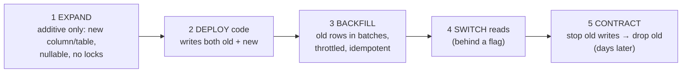
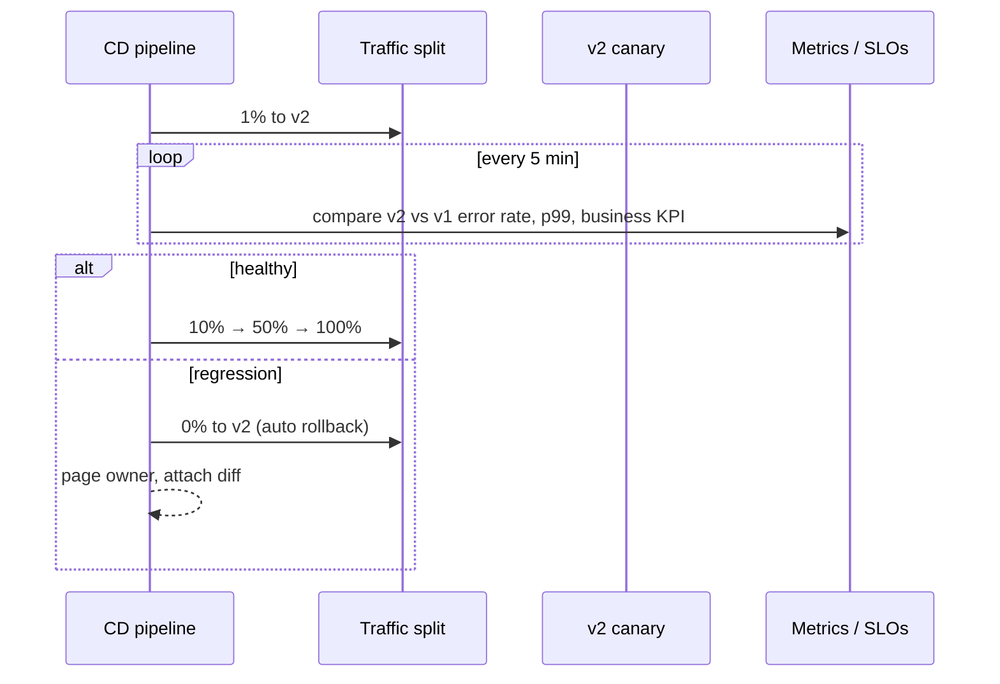
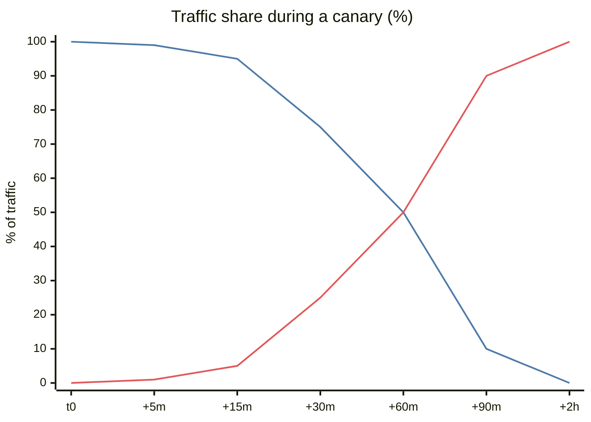
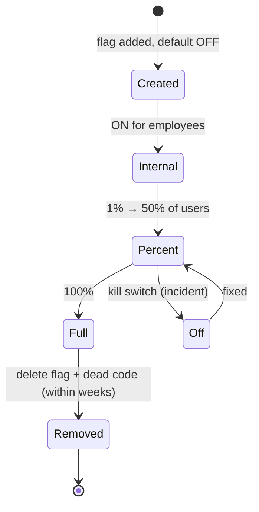
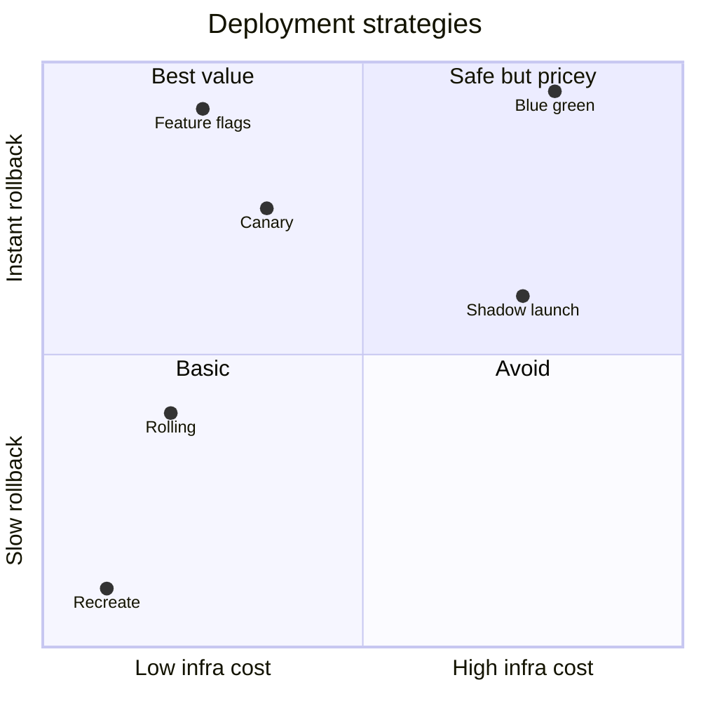

# Zero-Downtime Migrations and Deployments

## What is it?

Shipping code **and** database changes to a live system without users noticing: no outage, no errors, no data loss, and with a fast way back.

## Why it matters at SDE-2/3

Most outages are self-inflicted: **a deploy or a config change**. Google's SRE book attributes roughly 70% of outages to changes in a live system. The senior skill is making change **boring**: small, reversible, observable, gradual.

## Analogy

Replacing the wheels of a moving bus: you add the new wheel before removing the old one, one at a time, while someone watches the road.

## Interview definition

> "Decouple deploy from release, ship backward-compatible changes in expand–contract steps, roll out gradually behind feature flags or canaries with automated rollback on SLO regression, and never couple a code deploy with a destructive schema change."

## Deployment strategies

| Strategy | How | Rollback | Cost | Use when |
|---|---|---|---|---|
| Recreate | Stop all, start new | Redeploy old | Downtime ❌ | Dev only |
| **Rolling** | Replace instances gradually | Roll back gradually | Low | Default on Kubernetes |
| **Blue/green** | Full new env; switch traffic at once | Switch back instantly | 2× capacity during switch | Risky releases, instant rollback |
| **Canary** | 1% → 5% → 25% → 100%, watching metrics | Shift traffic back | Low | Most production services |
| Shadow / dark launch | Mirror real traffic to new version, discard responses | Nothing to roll back | Extra compute | Rewrites, new DBs, ML models |
| **Feature flags** | Code deployed off; enable per user/% at runtime | Flip flag off | Flag debt | Decouple deploy from release |

**Progressive delivery** = canary + feature flags + automated analysis (Argo Rollouts, Flagger, Spinnaker, LaunchDarkly, Unleash, OpenFeature).

## Database migrations: expand → migrate → contract

Rules:
- Each step is deployable and **reversible on its own**.
- **Never** combine "deploy code that needs new schema" + "migration" in one atomic step: old pods are still running.
- Big tables: use online schema change tools (**gh-ost**, **pt-online-schema-change**, Postgres `CREATE INDEX CONCURRENTLY`, adding nullable columns is metadata-only in modern Postgres/MySQL).
- Backfills: batch by primary key ranges, throttle on replica lag, make them resumable and idempotent.

## 📊 Visual model

**Canary with automated analysis:**

**Traffic over a canary rollout:**

> [!note] Line 1 (blue) = v1. Line 2 (red) = v2 canary.

**Feature flag lifecycle (flags are debt):**

**Choosing a strategy:**

## Release safety checklist (say this in interviews)
- Backward-compatible API + schema? Old clients still work?
- Behind a flag? Kill switch exists?
- Canary metrics defined (errors, p99, **business metric** like orders/min)?
- Automated rollback trigger?
- Migration reversible? Backfill throttled?
- Dashboards + on-call aware? Avoid Friday-evening deploys during sale days.

## Common mistakes

> [!warning] Traps to avoid
> 1. Destructive migration in the same deploy as the code change.
> 2. Canaries watching only CPU, not error rate or business KPIs.
> 3. Flags never removed → combinatorial complexity, dead code.
> 4. Backfill without throttling → replica lag → stale reads → incident.
> 5. Config changes treated as "not a deploy" (they cause many outages).

## Interview understanding

> [!question] What the interviewer is really testing
> - *"How would you roll out this change?"* — Flag + canary + metrics + rollback; expand–contract for schema.
> - *Tricky:* "Blue/green vs canary?" — Instant full switch with 2× capacity vs gradual exposure with less blast radius.
> - *Tricky:* "How do you add a NOT NULL column to a 1B-row table?" — Add nullable/with default (metadata-only where supported), backfill in batches, then add the constraint (validated separately, e.g. `NOT VALID` then `VALIDATE` in Postgres).
> - *Tricky:* "Rollback after a migration already ran?" — Expand-only migrations need no DB rollback; old code ignores new columns.

## Mini quiz
1. What does "decouple deploy from release" mean?
2. Five steps of expand–contract?
3. What should a canary compare?
4. Why are feature flags "debt"?
5. Tool for online MySQL schema change?

> [!success]- Answers (click to reveal)
> 1. Code ships to prod disabled; turning it on for users is a separate, reversible runtime decision (flags).
> 2. Expand, dual write, backfill, switch reads, contract.
> 3. Canary vs baseline: error rate, latency percentiles, business KPIs.
> 4. Every flag doubles code paths; stale flags hide dead code and surprising interactions.
> 5. gh-ost or pt-online-schema-change.

---
**Next:** [[Multi-Tenancy-and-SaaS-Architecture]] · **Up:** [[Senior-Engineering-MOC]]

## 📚 Resources
- 📄 [Martin Fowler — Feature Toggles](https://martinfowler.com/articles/feature-toggles.html)
- 📄 [Stripe — Online migrations at scale](https://stripe.com/blog/online-migrations)
- 📄 [GitHub — gh-ost](https://github.com/github/gh-ost)
- 📄 [Argo Rollouts](https://argoproj.github.io/rollouts/)

## My notes
-
