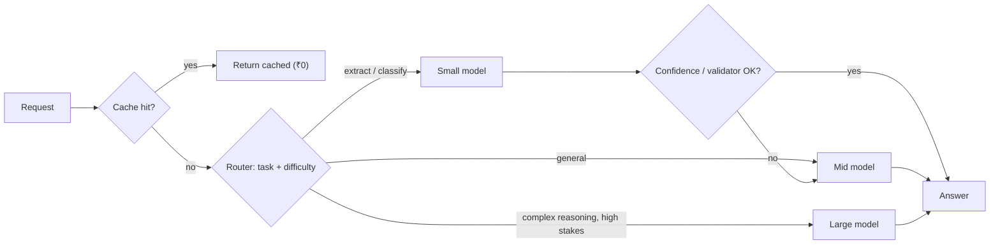
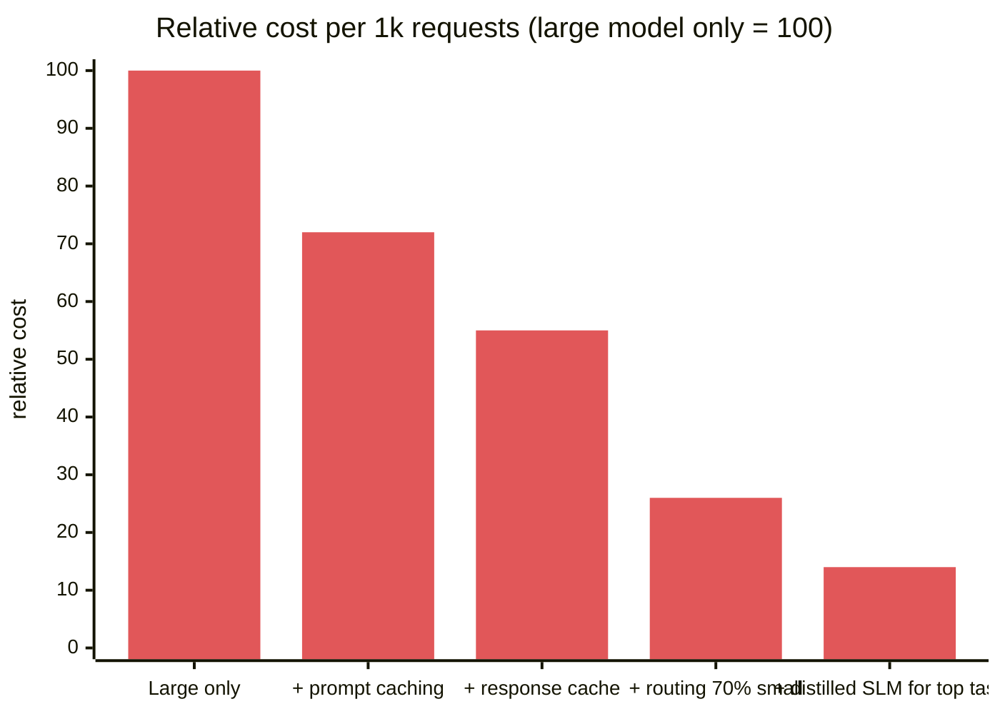
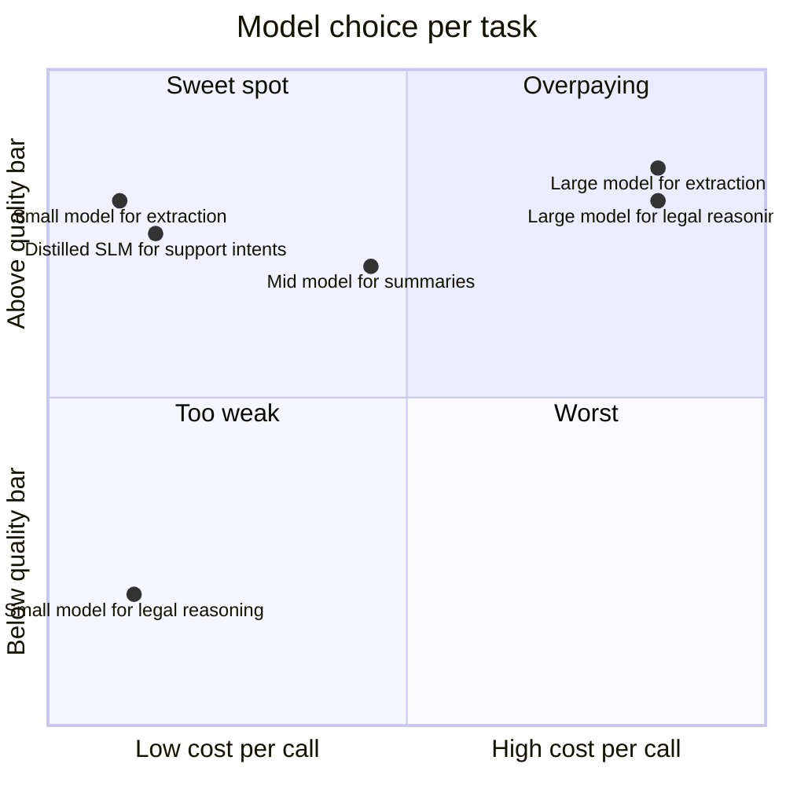
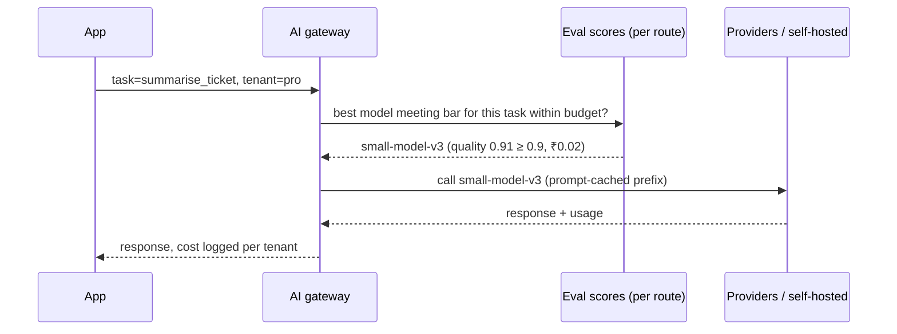

# AI Cost Engineering and Small / On-Device Models

## What is it?

Making AI features **affordable and fast at scale**: choosing the smallest model that meets the quality bar, routing between models, caching, batching, and running **small language models (SLMs)** on cheaper hardware or directly on users' devices.

## Why it matters

- In many AI products, the model bill is the largest variable cost. Interviewers now ask candidates to **estimate per-conversation cost and design a model router**.
- Model choice keeps getting cheaper per unit of capability, and small open-weight models (Gemma, Llama, Qwen, Phi, Mistral families) handle many narrow tasks well. Engineers who match model to task save companies real money.
- On-device AI (phones/laptops with NPUs) enables privacy-preserving, offline, zero-marginal-cost features.

## Analogy

You don't send every patient to the chief surgeon. A nurse triages: most cases go to a general doctor, a few to specialists. **Model routing is triage.**

## Interview definition

> "I model cost per task, then minimise it without dropping below the eval bar: route easy requests to small models and escalate hard ones, cache aggressively, trim and cache prompts, batch offline work, and consider fine-tuned or distilled small models, or on-device inference, for narrow high-volume tasks."

## Cost math you should be able to do

$$\text{cost/request} = \frac{T_{in}\cdot p_{in} + T_{out}\cdot p_{out}}{10^6} \qquad \text{(prices per million tokens)}$$

> [!example] Worked example
> Support bot: 3,000 input tokens (system + history + RAG), 400 output tokens, 2M conversations/month × 4 turns.
> With a large model at an illustrative $3 in / $15 out per 1M tokens: (3000×3 + 400×15)/10⁶ = $0.015 per turn → 8M turns ≈ **$120k/month**.
> Route 70% of turns to a small model at an illustrative $0.25 / $1.25 → $0.00125 per turn. Blended ≈ 0.3×0.015 + 0.7×0.00125 ≈ $0.0054 → **≈ $43k/month (−64%)**, *if evals show quality holds*.
> Prices change constantly. Always use current pricing pages.

## Levers (ordered by typical ROI)

| Lever | How | Watch out |
|---|---|---|
| **Prompt caching** | Stable prefix (system prompt, tools, docs) cached by provider/engine | Keep prefixes stable; order matters |
| **Exact/semantic response caching** | Reuse answers for repeated questions → [[Caching]] | Wrong-answer risk with loose thresholds; never for personal context |
| **Model routing / cascades** | Classifier or rules send easy → small, hard → large; or try small, escalate on low confidence | Router errors; evaluate per route |
| **Prompt diet** | Fewer, better RAG chunks (re-ranking), summarised history, shorter outputs | Quality regression → evals |
| **Batch APIs / offline jobs** | Non-urgent work at a discount (often ~50%) | Latency of hours |
| **Structured outputs** | JSON schemas → fewer retries | — |
| **Fine-tuning / distillation** | Train a small model on a large model's outputs for one task | Data quality, maintenance, licence terms |
| **Quantisation** | FP16 → INT8/INT4 for self-hosted models | Small quality loss; benchmark it |
| **Self-hosting open weights** | vLLM/TGI on GPUs at high steady volume → [[LLM-Serving-and-Inference]] | Ops burden, GPU utilisation must stay high |
| **On-device** | Run SLMs on phone/laptop NPUs | Device fragmentation, model size limits |

## Small models and on-device

| Option | Fits | Examples |
|---|---|---|
| SLM via API | Classification, extraction, routing, simple chat | Smaller tiers from major providers |
| Self-hosted SLM (1–14B params) | High volume, data residency, customisation | Gemma, Llama, Qwen, Phi, Mistral families |
| On-device | Privacy, offline, latency, zero marginal cost | Gemini Nano on Android, Apple's on-device models, WebGPU / ONNX Runtime / llama.cpp |
| Task-specific non-LLM models | Embeddings, rerankers, classifiers | Often 100× cheaper than an LLM call |

## 📊 Visual model

**A model cascade:**

**Cost per 1,000 requests by strategy (illustrative, same quality bar):**

**Quality vs cost — choose the frontier, not the biggest model:**

**Where the decision lives in the stack:**

## Common mistakes

> [!warning] Traps to avoid
> 1. Using the largest model for everything "to be safe".
> 2. Optimising cost without an eval suite (silent quality drop).
> 3. Self-hosting GPUs at 15% utilisation (more expensive than APIs).
> 4. Semantic caching personalised answers (privacy leak).
> 5. Ignoring output tokens. They usually cost several times more than input tokens.

## Interview understanding

> [!question] What the interviewer is really testing
> - *"Your AI feature costs too much — what do you do?"* — Measure cost per task, then caching, routing, prompt diet, batch, distillation; gate every change with evals.
> - *Tricky:* "When does self-hosting beat APIs?" — High, steady volume with high GPU utilisation, data residency needs, or customisation; otherwise APIs win.
> - *Tricky:* "Why on-device?" — Privacy, offline, latency, no marginal cost; limited by device memory/compute.
> - *Tricky:* "Distillation vs fine-tuning?" — Distillation trains a smaller student to mimic a larger teacher; fine-tuning adapts any model to a task/domain (distillation is one way to fine-tune).

## Mini quiz
1. Formula for cost per request?
2. What is a model cascade?
3. Two risks of semantic caching?
4. Why do output tokens matter more?
5. One reason to run a model on-device?

> [!success]- Answers (click to reveal)
> 1. (input tokens × input price + output tokens × output price) / 1M.
> 2. Try a cheap model first and escalate to bigger ones when confidence/validation fails.
> 3. Returning wrong answers for similar-but-different questions; leaking personalised content.
> 4. Output tokens are priced higher and generated sequentially (latency).
> 5. Privacy, offline use, low latency, zero per-call cost.

---
**Next:** [[Platform-Engineering]] · **Up:** [[Future-Engineering-MOC]]

## 📚 Resources
- 📄 [FrugalGPT: How to use LLMs while reducing cost (Chen et al.)](https://arxiv.org/abs/2305.05176)
- 📄 [RouteLLM — learning to route between LLMs](https://arxiv.org/abs/2406.18665)
- 📄 [llama.cpp](https://github.com/ggml-org/llama.cpp) · [ONNX Runtime](https://onnxruntime.ai/)
- 📄 Provider pricing pages (check current prices before any estimate)

## My notes
-
