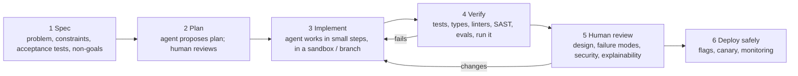
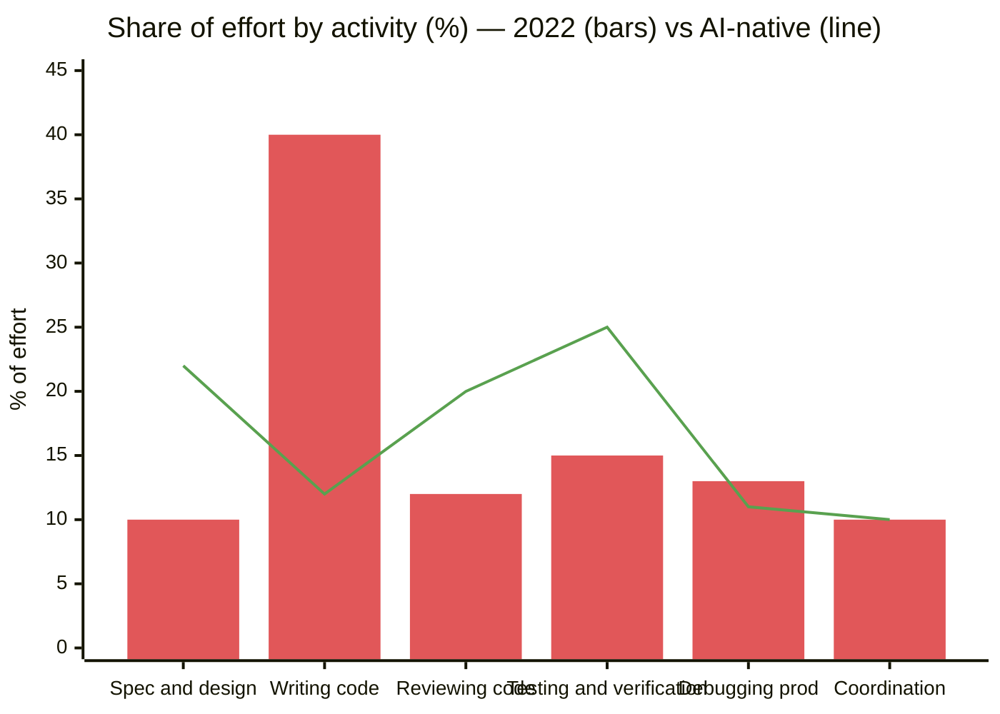
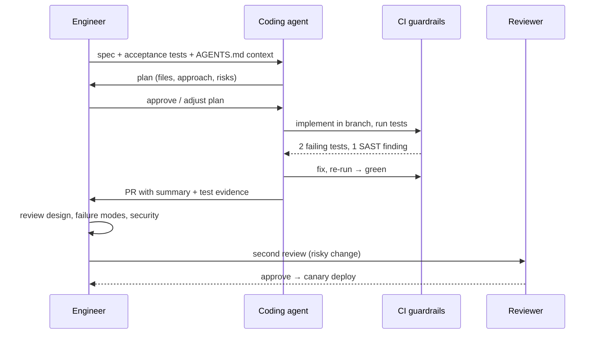
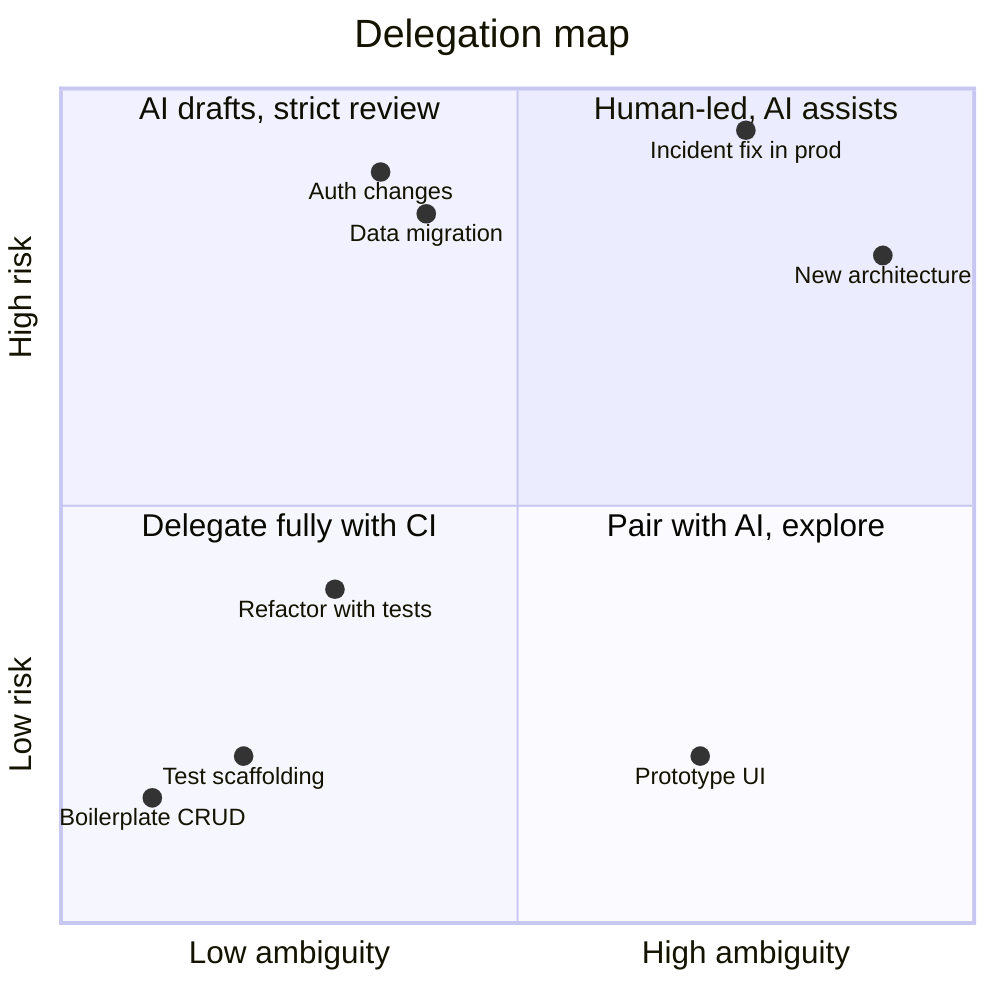

# The AI-Native Software Development Lifecycle

## What is it?

How software gets built when **AI coding agents** (Claude Code, Cursor, GitHub Copilot agent mode, OpenAI Codex, Gemini CLI and similar) write a large share of the code. The engineer's role shifts from typing implementation to **specifying, directing, reviewing and verifying**.

## Why it matters

- 84% of developers use or plan to use AI tools, but 46% don't trust the accuracy of their output (Stack Overflow 2025).
- Gartner expects "AI-native software engineering", where most code is AI-generated, in the medium term, and says ~80% of engineers must upskill through 2027.
- Interviews are changing too. Karat reports a shift to human-led, "AI-native" interviews that test how engineers *collaborate with* AI.
- Evidence is mixed on speed. A 2025 METR randomised study found experienced open-source developers were ~19% **slower** with AI tools on their own repos, while *believing* they were faster. **Process and verification decide whether AI helps.**

## Analogy

You become a **tech lead for a team of very fast, very confident interns**. They write a lot, quickly, and are sometimes brilliantly right and sometimes confidently wrong. Your value is clear instructions, good guardrails, and catching mistakes before they ship.

## Interview definition

> "AI-native development means specs and tests become the primary artifacts: I write a clear spec and acceptance tests, let agents implement in small, reviewable steps inside guardrails (CI, linters, security scans, sandboxes), and verify every change before merge. I measure outcomes like lead time, change-failure rate and escaped defects, not lines of code."

## The workflow



## Spec-driven development

Write the **what and why** precisely before generating the **how**:
- Requirements + acceptance criteria (Given/When/Then), API contracts, data model, edge cases, non-goals.
- Tools formalising this: GitHub Spec Kit, AWS Kiro, and repo-level instruction files (`AGENTS.md`, `CLAUDE.md`, `.cursor/rules`) that tell agents your conventions, commands and boundaries.
- The spec doubles as the review checklist and test plan. → [[Design-Docs-and-ADRs]]

```markdown
<!-- AGENTS.md (repo root) -->
## Build & test
- `pnpm i && pnpm test` must pass; `pnpm lint` and `pnpm typecheck` clean
## Conventions
- Money in integer paise; never floats. All POST handlers take Idempotency-Key.
## Boundaries
- Never edit /migrations without a matching down migration.
- Never add dependencies without approval; never touch .env or secrets.
```

## Guardrails that make agents safe
| Guardrail | Why |
|---|---|
| Small PRs / small tasks | Reviewable; agents drift on big tasks |
| Tests written or reviewed by humans first | Agents tend to write tests that assert their own behaviour |
| CI: types, lint, tests, SAST, dependency + licence scan, secret scan | Mechanical checks catch a large share of agent mistakes |
| Sandboxed execution, least-privilege tokens | Agents run commands; limit blast radius → [[AI-Security-Engineering]] |
| Dependency allow-list | Hallucinated package names → "slopsquatting" supply-chain attacks → [[Supply-Chain-Security-and-Post-Quantum]] |
| Provenance labels on AI-generated code | Audit and compliance |
| Human owner per change | Someone must be able to explain it |

## 📊 Visual model

**Where engineering time shifts (illustrative):**



**Who does what:**



**Which tasks to delegate:**



## Measuring whether AI helps
Use DORA metrics (lead time, deploy frequency, change-failure rate, time to restore) plus escaped defects, review time and rework rate. DORA's 2025 research on AI-assisted development frames AI as an **amplifier**: strong practices get stronger, weak ones get weaker.

## Skills to build
1. Writing precise specs and acceptance tests.
2. Decomposing work into agent-sized tasks.
3. Reading and reviewing code faster than you write it.
4. Verification depth. → [[Verification-Engineering]]
5. Context engineering for your repo (instruction files, MCP tools). → [[Context-Engineering-and-Agent-Protocols]]
6. Knowing the fundamentals well enough to spot plausible-but-wrong code. **This vault is that foundation.**

## Common mistakes

> [!warning] Traps to avoid
> 1. "Vibe coding" production systems: merging code nobody understands.
> 2. Letting agents write both the code and the only tests.
> 3. Giant agent PRs that can't be reviewed.
> 4. Measuring productivity by lines of code or PR count.
> 5. Giving agents prod credentials or unrestricted shell access.

## Interview understanding

> [!question] What the interviewer is really testing
> - *"How do you use AI in your workflow?"* — Spec → plan → small steps → verification → review; give a concrete example where you caught a subtle AI bug.
> - *Tricky:* "Does AI make developers faster?" — Depends; controlled studies show mixed results; gains come from process, verification and task fit.
> - *Tricky:* "What's slopsquatting?" — Attackers register package names that LLMs hallucinate, so blindly installing suggested packages pulls malware.
> - *Tricky:* "What should never be fully delegated?" — Security-critical, irreversible or ambiguous work (auth, migrations, money, architecture).

## Mini quiz
1. Six steps of the AI-native workflow?
2. What goes in AGENTS.md?
3. Why shouldn't the agent write the only tests?
4. Which metrics measure AI impact properly?
5. What did the METR 2025 study find?

> [!success]- Answers (click to reveal)
> 1. Spec → plan → implement → verify → human review → safe deploy.
> 2. Build/test commands, conventions, boundaries and forbidden actions for agents.
> 3. Tests may encode the agent's misunderstanding, so they pass while the behaviour is wrong.
> 4. DORA metrics (lead time, deploy frequency, change-failure rate, restore time) + escaped defects, rework.
> 5. Experienced devs were ~19% slower with AI on their own repos while believing they were faster.

---
**Next:** [[Verification-Engineering]] · **Up:** [[Future-Engineering-MOC]]

## 📚 Resources
- 📄 [METR — Measuring the impact of early-2025 AI on experienced open-source developer productivity](https://metr.org/blog/2025-07-10-early-2025-ai-experienced-os-dev-study/)
- 📄 [DORA research](https://dora.dev/research/)
- 📄 [AGENTS.md](https://agents.md/)
- 📄 [GitHub Spec Kit](https://github.com/github/spec-kit)
- 📄 [Stack Overflow 2025 Developer Survey — AI](https://survey.stackoverflow.co/2025/ai)

## My notes
-
