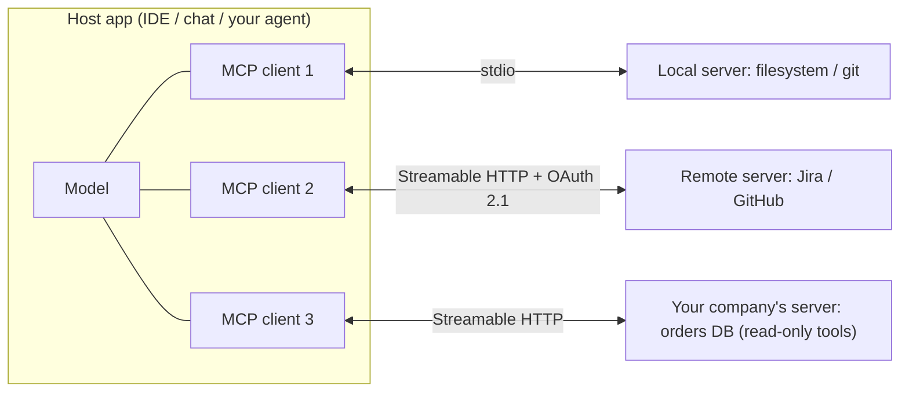
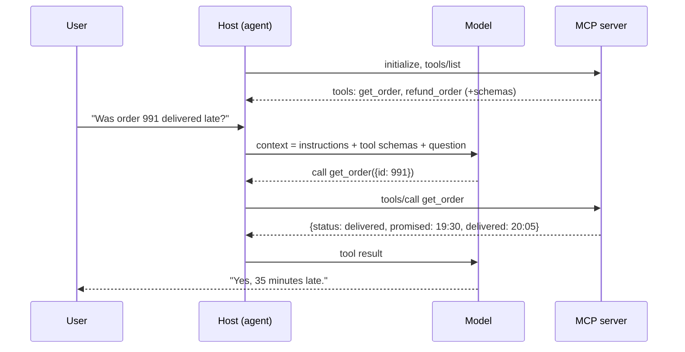
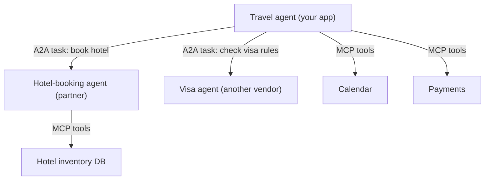
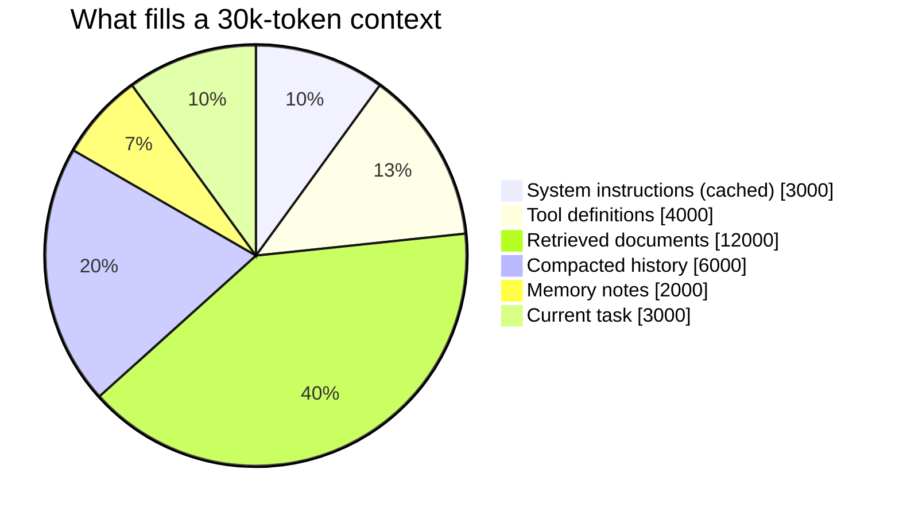

# Context Engineering and Agent Protocols

## What is it?

- **Context engineering:** deciding *exactly what information* goes into a model's context window at each step (instructions, retrieved knowledge, tool definitions, memory, conversation history) so the model can do the task reliably and cheaply. It's the successor to "prompt engineering".
- **Agent protocols:** open standards that let models and agents connect to tools and to each other. **MCP** (Model Context Protocol) connects agents to tools and data. **A2A** (Agent2Agent) connects agents to other agents.

## Why it matters

- Agent quality is mostly a **context problem**: wrong or missing info, too much noise, badly described tools. Hiring guides list MCP integration and agent orchestration among the top AI-engineer skills for 2026.
- MCP went from Anthropic's launch (Nov 2024) to an industry standard supported by major AI clients and IDEs, and was donated to the Linux Foundation's Agentic AI Foundation in Dec 2025. Building an MCP server is becoming as normal as building a REST API.

## Analogy

A brilliant consultant with amnesia. Every morning you hand them a briefing folder. Context engineering is **curating that folder**: the right documents, a clear task, the phone numbers (tools) they're allowed to call, and notes from yesterday (memory). Too thin and they guess; too thick and they miss the key page.

## Interview definition

> "Context engineering curates the minimal, high-signal set of tokens for each model step: stable instructions, just-in-time retrieved data, well-designed tools, and compressed memory. Protocols like MCP standardise how agents discover and call tools, so integrations are built once and reused across clients."

## The context window budget

| Slot | Content | Techniques |
|---|---|---|
| System instructions | Role, rules, output format | Stable → **prompt caching** |
| Tool definitions | Names, descriptions, JSON schemas | Few, well-named, non-overlapping tools; load tools on demand |
| Retrieved knowledge | Docs, records | Just-in-time retrieval, re-ranking, small chunks → [[RAG-and-Vector-Databases]] |
| Memory | Facts about user/task from earlier | Summaries, structured notes, vector memory with scoping |
| Conversation history | Previous turns | **Compaction** / summarisation of old turns |
| Current task | The user's request + step state | Clear goal, constraints, acceptance criteria |

**Context rot:** quality degrades as context grows with irrelevant tokens, even below the window limit. More context is not better context.

## Tool design (what good MCP servers do)
- Tools map to **user intentions**, not raw API endpoints (`schedule_meeting` > `list_users` + `get_calendar` + `create_event`).
- Clear names and descriptions; strict input schemas; **concise, high-signal outputs** (paginate, truncate, return IDs + summaries).
- Helpful errors that tell the model how to recover.
- Idempotent, least-privilege, confirm-before-destructive. → [[AI-Security-Engineering]]

## MCP in one picture

**Roles:** *Host* (the AI app, e.g. an IDE or chat app) runs *clients*, each connected to one *server* that exposes capabilities.

| Server exposes | Meaning |
|---|---|
| **Tools** | Functions the model can call (side effects allowed) |
| **Resources** | Read-only data the app can load into context (files, records) |
| **Prompts** | Reusable prompt templates/workflows |

Clients can also offer servers capabilities such as **sampling** (server asks the host's model to generate) and **elicitation** (ask the user for input). Transports: **stdio** (local) and **Streamable HTTP** (remote), with OAuth 2.1 authorization for remote servers.

## A2A in one picture
Agents publish an **Agent Card** (capabilities, endpoint, auth). A client agent sends **tasks** to a remote agent, which streams status, messages and artifacts back. A2A is for agent ↔ agent delegation across vendors; MCP is for agent ↔ tool. They're complementary.

## 📊 Visual model

**MCP architecture:**

**A tool call round trip:**

**MCP vs A2A:**

**Context budget for one agent step (tokens, illustrative):**

## Memory patterns
- **Short-term:** the running conversation, compacted when long.
- **Long-term:** extracted facts/preferences stored outside the model (DB/vector store), retrieved by relevance, scoped per user/tenant, with deletion support (privacy!). → [[Privacy-and-AI-Regulation]]
- **Scratchpad/notes:** agent writes progress notes to a file to survive context resets on long tasks.

## Common mistakes

> [!warning] Traps to avoid
> 1. Dumping every document and every tool into context "just in case".
> 2. Wrapping every REST endpoint as a tool (dozens of overlapping tools confuse the model).
> 3. Tools returning 50 KB JSON blobs.
> 4. Remote MCP servers without auth, or with over-broad tokens.
> 5. Trusting tool outputs as instructions (prompt injection vector).

## Interview understanding

> [!question] What the interviewer is really testing
> - *"How would you give an agent access to our internal systems?"* — An MCP server with intent-level tools, OAuth scoped to the user, read-only by default, confirmations for writes, audit logs, rate limits.
> - *Tricky:* "Prompt engineering vs context engineering?" — Wording one prompt vs designing the whole information pipeline per step (retrieval, tools, memory, compaction).
> - *Tricky:* "MCP vs A2A?" — Agent-to-tool vs agent-to-agent.
> - *Tricky:* "Why can a bigger context make answers worse?" — Context rot / distraction; the signal gets diluted; costs and latency rise.

## Mini quiz
1. Three things an MCP server can expose?
2. Two MCP transports?
3. What is context rot?
4. One rule of good tool design?
5. What does an A2A Agent Card describe?

> [!success]- Answers (click to reveal)
> 1. Tools, resources, prompts.
> 2. stdio and Streamable HTTP.
> 3. Quality degradation as context fills with low-signal tokens.
> 4. Design tools around user intents, with clear schemas and concise outputs (also: helpful errors, least privilege).
> 5. An agent's capabilities, endpoint and authentication requirements.

---
**Next:** [[AI-Security-Engineering]] · **Up:** [[Future-Engineering-MOC]]

## 📚 Resources
- 📄 [Model Context Protocol — specification and docs](https://modelcontextprotocol.io/)
- 📄 [A2A protocol](https://a2a-protocol.org/)
- 📄 [Anthropic — Effective context engineering for AI agents](https://www.anthropic.com/engineering/effective-context-engineering-for-ai-agents)
- 📄 [Anthropic — Writing effective tools for agents](https://www.anthropic.com/engineering/writing-tools-for-agents)

## My notes
-
