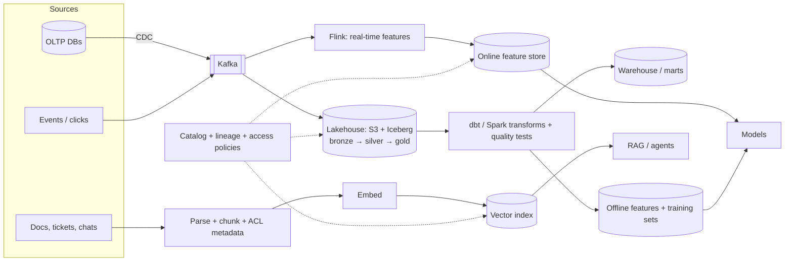
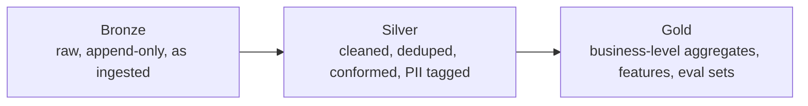
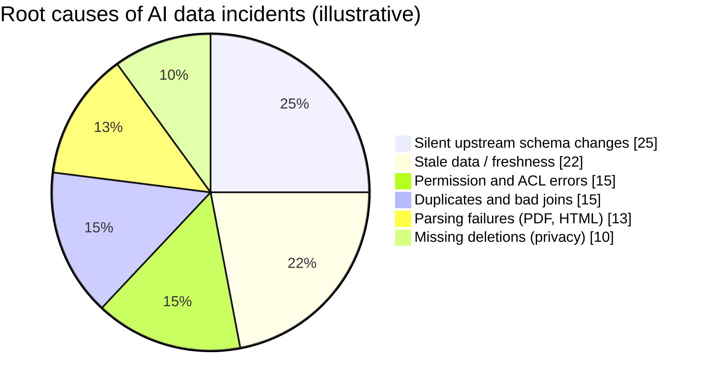
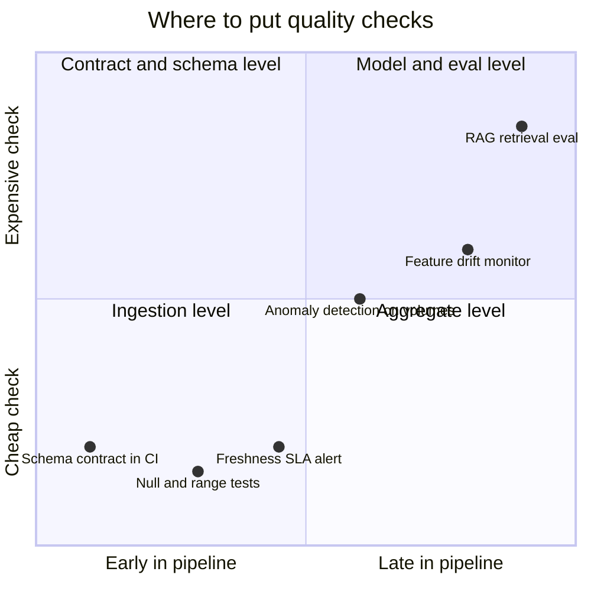

# Data Engineering for AI

## What is it?

Building the pipelines, storage and governance that feed AI systems: **clean, fresh, documented, permissioned data**. That covers structured tables for analytics and ML features, unstructured documents for RAG, event streams for real-time features, and the contracts, quality checks and lineage that make them trustworthy.

## Why it matters

- India's GCCs report the **largest talent shortfall (43%) in AI, data and analytics**, and data engineers are among the fastest-growing roles. → [[Market-Research-2026]]
- Most AI project failures are **data failures**: stale docs in RAG, permission leaks, silent schema changes breaking features, training–serving skew.
- "Garbage in, confident garbage out." LLMs make bad data *sound* right.

## Analogy

A restaurant is only as good as its supply chain. The chef (model) can be brilliant, but if vegetables arrive late, mislabelled or spoiled, dinner fails. Data engineering is the cold chain, the labels and the quality inspection.

## Interview definition

> "Data engineering for AI means reliable pipelines from sources to features, embeddings and training sets, with data contracts at the boundaries, automated quality checks, lineage and access control, on an open lakehouse, so models and RAG systems get fresh, correct and permitted data."

## The modern data stack for AI

| Layer | What | Tools |
|---|---|---|
| Ingestion | Batch + CDC + events + documents | Debezium, Kafka, Fivetran/Airbyte, unstructured parsers |
| Storage | **Open lakehouse**: object storage + table format | S3/GCS + **Apache Iceberg**, Delta Lake, Hudi |
| Processing | Batch + streaming transforms | Spark, Flink, dbt, DuckDB |
| Serving | Warehouse/OLAP, feature store, vector store | Snowflake/BigQuery/ClickHouse, Feast, pgvector/Qdrant |
| Quality | Tests, freshness, anomaly detection | Great Expectations, Soda, dbt tests, Monte Carlo |
| Contracts | Schema + semantics + SLAs agreed with producers | Data contract specs, schema registry, CI checks |
| Lineage & catalog | Where data came from, who uses it | OpenLineage, DataHub, Unity Catalog, Apache Polaris |
| Governance | Access control, PII tagging, retention | Column/row-level security, tagging, policies |

## Pipelines AI specifically needs

1. **Feature pipelines** (offline + online) with one definition for both → no training–serving skew. → [[Recommendation-and-Ranking-Systems]]
2. **Unstructured → RAG pipeline:** parse (PDF/HTML/Slack) → clean → chunk → enrich metadata (ACLs, timestamps, source) → embed → index; incremental updates and deletions. → [[RAG-and-Vector-Databases]]
3. **Eval and feedback datasets:** production traces + labels → versioned datasets. → [[LLM-Evals-and-AI-Observability]]
4. **Training/fine-tuning datasets:** deduped, PII-scrubbed, licensed, versioned, reproducible.

## Data contracts (the key 2026 practice)

```yaml
# contracts/orders.v2.yaml
dataset: orders
owner: team-orders
schema:
  order_id: {type: bigint, required: true, unique: true}
  amount_paise: {type: bigint, required: true, min: 0}
  status: {type: enum, values: [CREATED, PAID, CANCELLED, DELIVERED]}
  customer_email: {type: string, pii: true}
sla:
  freshness: "< 15 minutes"
  completeness: "> 99.9% of orders"
compatibility: backward
```

Producers can't ship a breaking change without CI failing. Consumers (analytics, ML, RAG) get guarantees. → [[Data-Modeling-and-Schema-Evolution]]

## 📊 Visual model

**End-to-end data platform for AI:**



**Medallion layers:**



**Where AI data problems come from (illustrative):**



**Data quality checks by stage:**



## Common mistakes

> [!warning] Traps to avoid
> 1. RAG indexes built once and never updated (stale answers, deleted docs still retrievable).
> 2. Ingesting documents without ACL metadata → permission leaks.
> 3. No contracts → an upstream rename silently breaks features.
> 4. Different feature code for training and serving.
> 5. Copying PII into training/eval datasets without consent or scrubbing. → [[Privacy-and-AI-Regulation]]

## Interview understanding

> [!question] What the interviewer is really testing
> - *"Design the data pipeline behind a RAG assistant for company docs."* — Connectors + CDC/webhooks, parsing, chunking with ACL/timestamp metadata, embeddings, incremental upserts and deletes, freshness SLA, quality checks, lineage.
> - *Tricky:* "Why a lakehouse table format like Iceberg?" — ACID tables on cheap object storage, schema evolution, time travel, multiple engines (Spark, Flink, Trino, DuckDB) on the same data.
> - *Tricky:* "What's a data contract?" — A producer-owned, versioned agreement on schema, semantics and SLAs, enforced in CI.
> - *Tricky:* "How do you honour a deletion request across AI data?" — Lineage to find copies, deletes in lakehouse (Iceberg row deletes), vector index, caches, eval/training sets, and retraining policy.

## Mini quiz
1. Three layers of the medallion architecture?
2. What does a data contract contain?
3. Two pipelines AI needs beyond analytics?
4. Why lineage?
5. What does Iceberg add to object storage?

> [!success]- Answers (click to reveal)
> 1. Bronze (raw), silver (cleaned), gold (business-ready).
> 2. Schema, semantics, owner, quality and freshness SLAs, compatibility rules.
> 3. Feature pipelines (online/offline), unstructured → RAG pipelines, eval/feedback dataset pipelines.
> 4. Trace where data came from and who uses it, for debugging, impact analysis and deletion/compliance.
> 5. ACID transactions, schema evolution, partition evolution, time travel, multi-engine access.

---
**Next:** [[Edge-Wasm-and-eBPF]] · **Up:** [[Future-Engineering-MOC]]

## 📚 Resources
- 📄 [Apache Iceberg docs](https://iceberg.apache.org/docs/latest/)
- 📄 [OpenLineage](https://openlineage.io/)
- 📄 [Data contracts — datacontract.com](https://datacontract.com/)
- 📖 *Fundamentals of Data Engineering* (Reis & Housley).

## My notes
-
