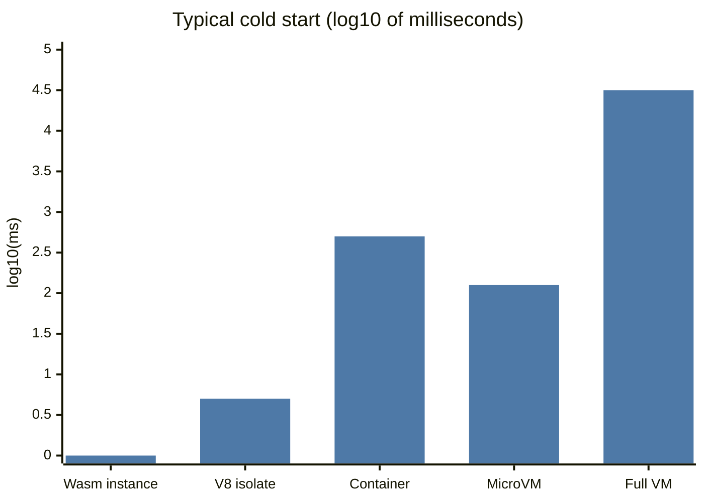
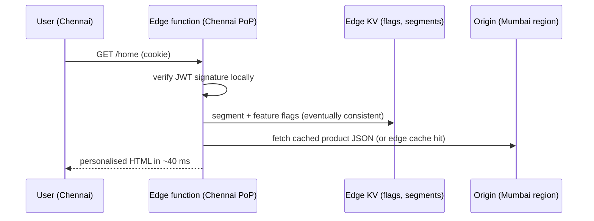
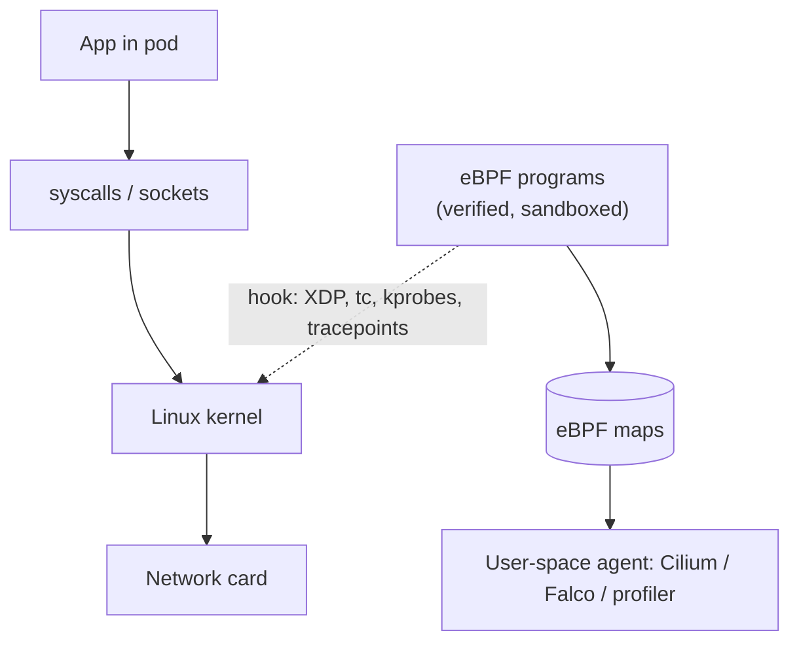
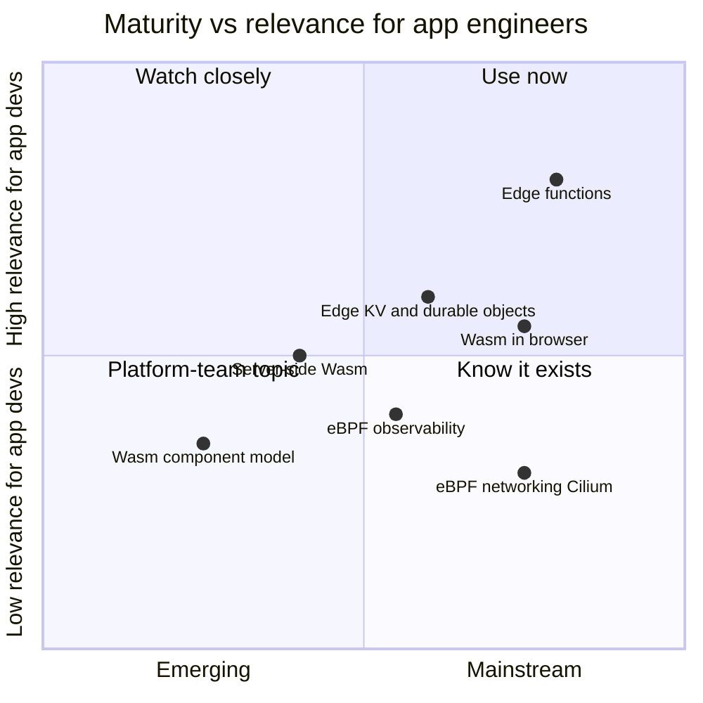

# Edge Computing, WebAssembly and eBPF

## What is it?

Three shifts in **where code runs**:
- **Edge computing:** running logic at CDN points of presence close to users (Cloudflare Workers, Vercel/Netlify Edge, Fastly Compute, Lambda@Edge), not only in one cloud region.
- **WebAssembly (Wasm):** a portable, sandboxed binary format that runs at near-native speed in browsers *and* on servers/edge via WASI. Fast cold starts, strong isolation, many languages.
- **eBPF:** safely running small programs **inside the Linux kernel** for networking, observability and security without kernel modules. It powers Cilium, Falco, Pixie and modern profilers.

## Why they matter (awareness level, 💡)

- Global apps want sub-50 ms personalisation, auth and A/B routing **at the edge**. Next.js and other frameworks deploy parts of apps there by default. → [[Frontend-System-Design]]
- Wasm gives **millisecond cold starts and sandboxing**, which suits plugins, multi-tenant user code and edge functions.
- eBPF is the foundation of modern Kubernetes networking and **zero-instrumentation observability/security**, which platform teams increasingly own. → [[Platform-Engineering]]
- On-device and edge AI inference pushes compute out of the data centre. → [[AI-Cost-and-Small-Models]]

## Analogy

- **Edge:** opening small branch kitchens in every neighbourhood for quick items, while the main kitchen still cooks the complex dishes.
- **Wasm:** a universal sealed lunchbox. Any kitchen can heat it, and nothing leaks out.
- **eBPF:** CCTV and smart turnstiles installed inside the building's walls, watching and routing everyone without stopping them.

## Interview definition

> "Edge functions run latency-sensitive, lightweight logic near users; Wasm provides portable, sandboxed, fast-starting execution for edge and plugins; eBPF lets platforms observe and control networking and security in the kernel with low overhead. Each comes with constraints: limited runtime APIs at the edge, a maturing Wasm ecosystem, and kernel-level expertise for eBPF."

## Edge: what belongs there

| ✅ Good at the edge | ❌ Keep in region |
|---|---|
| Auth token checks, geo/AB routing, redirects | Transactions on the primary DB |
| Personalised HTML from cached data | Heavy CPU/GPU work |
| Rate limiting, bot filtering, header rewrites | Long-running jobs |
| Image resizing, edge caching of APIs | Anything needing strong consistency across regions |

Edge data: KV stores (eventually consistent), durable objects/actors (strongly consistent per key), edge SQLite replicas (read-mostly). Know the consistency model before using them. → [[Consistency-Models]]

## Wasm: where it's used
- Browser: heavy compute (Figma's renderer, video/photo editors, in-browser ML via WebGPU + Wasm).
- Server/edge: Fastly Compute, Cloudflare Workers (supports Wasm), Fermyon Spin, wasmCloud.
- Plugins/extensibility: Envoy proxy filters (proxy-wasm), database UDFs, SaaS user-defined code with strong isolation.
- **WASI** standardises system interfaces; the **component model** lets components in different languages interoperate.

## eBPF: where it's used
- **Networking:** Cilium (Kubernetes CNI, load balancing, network policy), XDP for DDoS filtering at line rate.
- **Observability:** profiling, tracing syscalls/HTTP without code changes (Pixie, Parca, Grafana Beyla).
- **Security:** runtime threat detection (Falco, Tetragon).

## 📊 Visual model

**Where code runs in a modern stack:**

**Cold start and isolation trade-offs (illustrative orders of magnitude):**

> [!note] Roughly: Wasm ~1 ms, V8 isolate ~5 ms, container ~0.5 s, Firecracker microVM ~125 ms, full VM ~30 s. Orders of magnitude, not benchmarks.

**Edge request with personalisation:**

**eBPF in the kernel path:**

**Adoption map:**

## Common mistakes

> [!warning] Traps to avoid
> 1. Moving DB-heavy logic to the edge (every call goes back to one region anyway, so it's slower).
> 2. Assuming edge KV is strongly consistent.
> 3. Using Wasm where a normal container is simpler.
> 4. Writing eBPF programs yourself when Cilium/Falco/Beyla already do it.

## Interview understanding

> [!question] What the interviewer is really testing
> - *"How would you cut latency for global users?"* — CDN + edge functions for auth/routing/personalisation from cached data; keep writes in the home region. → [[Multi-Region-and-Disaster-Recovery]]
> - *Tricky:* "Why Wasm for multi-tenant plugins?" — Strong sandboxing, fast start, language-agnostic, capability-based access.
> - *Tricky:* "What's eBPF in one line?" — Verified programs running in the kernel on events, for networking/observability/security without modules.

## Mini quiz
1. Two things that belong at the edge and two that don't?
2. What is WASI?
3. Why do Wasm runtimes start faster than containers?
4. Name an eBPF-based tool for networking and one for security.
5. Consistency of typical edge KV stores?

> [!success]- Answers (click to reveal)
> 1. Edge: auth checks, routing, personalisation from cache, image resizing. Not: DB transactions, heavy compute.
> 2. The WebAssembly System Interface, a standard API for Wasm outside the browser.
> 3. No OS boot or image layers; just instantiate a sandboxed module in an existing process.
> 4. Cilium (networking); Falco or Tetragon (security).
> 5. Eventually consistent (use durable objects or a central DB for strong consistency).

---
**Next:** [[Supply-Chain-Security-and-Post-Quantum]] · **Up:** [[Future-Engineering-MOC]]

## 📚 Resources
- 📄 [Cloudflare Workers — how it works (isolates)](https://developers.cloudflare.com/workers/reference/how-workers-works/)
- 📄 [WebAssembly — WASI and component model](https://component-model.bytecodealliance.org/)
- 📄 [ebpf.io — What is eBPF?](https://ebpf.io/what-is-ebpf/)
- 📄 [Cilium](https://cilium.io/)

## My notes
-
