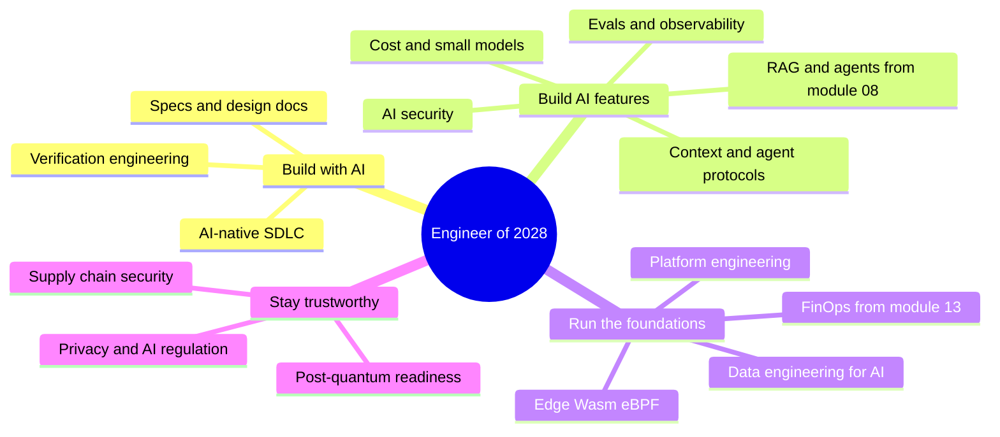
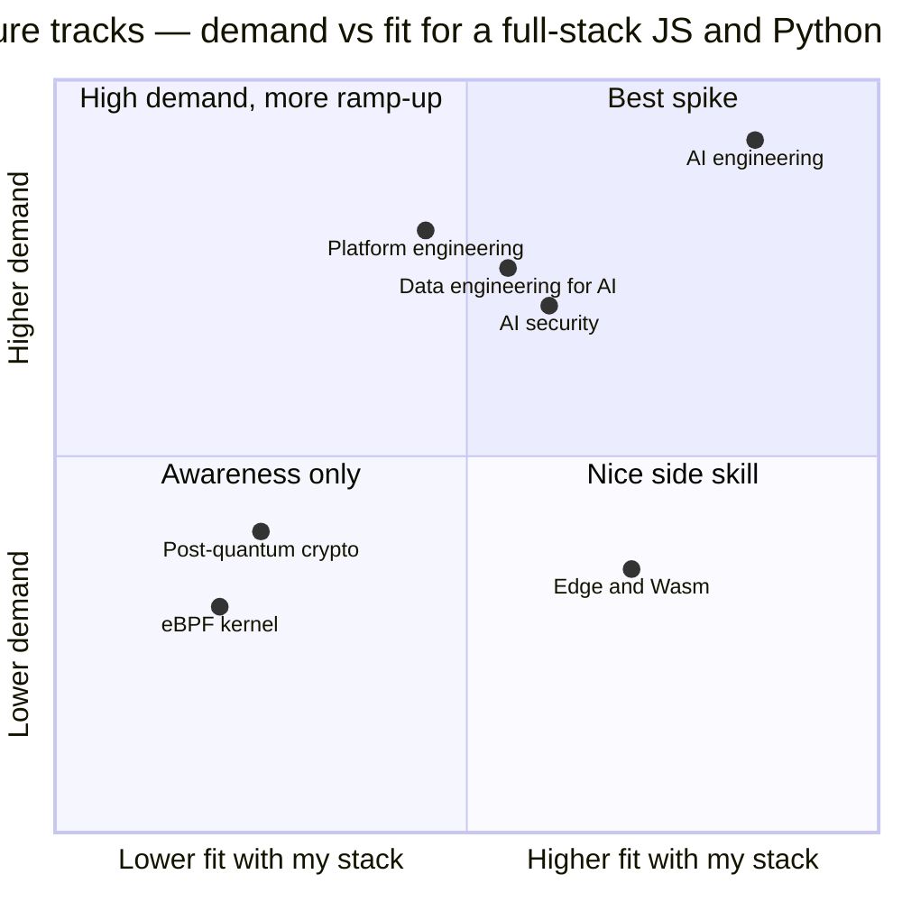
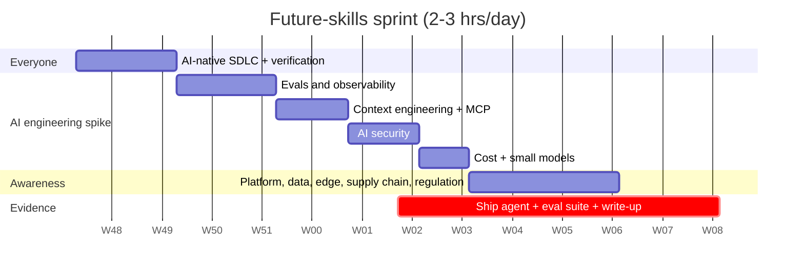

# 🔭 14 · Future Engineering MOC — What Companies Will Demand in 1–3 Years ➕

> [!important] The thesis (from [[Market-Research-2026]])
> AI is making **code cheap** and **judgment expensive**. Over the next 1–3 years the engineers in demand will be the ones who can (1) direct and *verify* AI-written software, (2) build reliable, safe, affordable AI features, and (3) run the platforms, data and security those features depend on. India's GCCs already report their biggest shortfalls in exactly these areas: AI/data (43%) and platform engineering (38%), plus MLOps, AI observability, FinOps and security.

## How to use this module

You **don't** need all of it. Read the overview of every note once (awareness), then pick **one spike** to go deep on and prove with a project. With my stack (Node/Next/Python + Gemini), the natural spike is the **AI engineering track**.

## The notes

| # | Note | Track | Why it will matter |
|---|---|---|---|
| 1 | [[AI-Native-SDLC]] | Everyone | How software gets built when agents write much of the code |
| 2 | [[Verification-Engineering]] | Everyone | Verification is the scarce skill when generation is cheap |
| 3 | [[LLM-Evals-and-AI-Observability]] | AI eng | The #1 signal of real LLM production experience |
| 4 | [[Context-Engineering-and-Agent-Protocols]] | AI eng | MCP, A2A, tool design, memory: the plumbing of agents |
| 5 | [[AI-Security-Engineering]] | AI eng / security | Prompt injection and excessive agency are the new SQLi |
| 6 | [[AI-Cost-and-Small-Models]] | AI eng / platform | Routing, distillation, on-device: making AI affordable |
| 7 | [[Platform-Engineering]] | Platform | Internal developer platforms; a 38% talent gap |
| 8 | [[Data-Engineering-for-AI]] | Data | AI is only as good as its data pipelines and contracts |
| 9 | [[Edge-Wasm-and-eBPF]] | Platform / infra | Compute moving to the edge and into the kernel |
| 10 | [[Supply-Chain-Security-and-Post-Quantum]] | Security | SBOMs, signing, and the crypto migration ahead |
| 11 | [[Privacy-and-AI-Regulation]] | Everyone (senior) | DPDP, GDPR, EU AI Act are architecture requirements |

## The map

**Pick your spike:**

> [!note] Positions are my judgment based on the demand data in [[Market-Research-2026]] and the Node/Next/Python + LLM stack, not survey data.

## Suggested order (12 weeks, alongside core prep)

## The evidence that gets you hired (portfolio ideas)
1. An **MCP server** for a real tool you use (e.g., your JobPilot data) with OAuth and tests. → [[Context-Engineering-and-Agent-Protocols]]
2. A **RAG or agent app with an eval suite in CI**, a cost-per-task dashboard, and a write-up of what the evals caught. → [[LLM-Evals-and-AI-Observability]]
3. A **prompt-injection red-team report** on your own app with fixes. → [[AI-Security-Engineering]]
4. A **design doc** for one of the above with alternatives, cost and rollout. → [[Design-Docs-and-ADRs]]

**Prev module:** [[Senior-Engineering-MOC]] · **Up:** [[System-Design-MOC]] · **Builds on:** [[Modern-Topics-MOC]]
