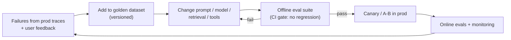
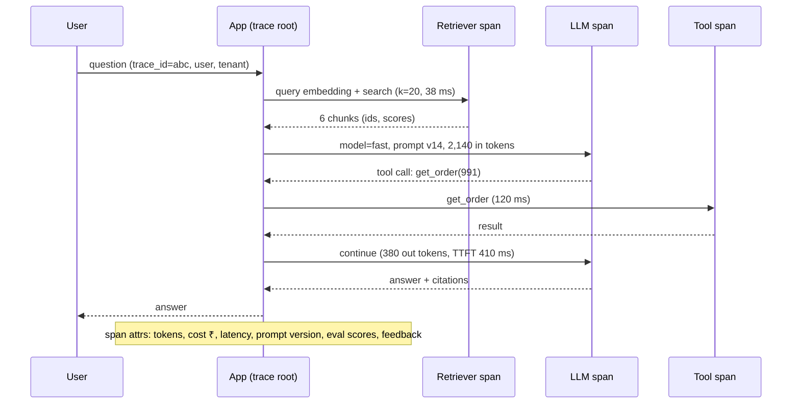
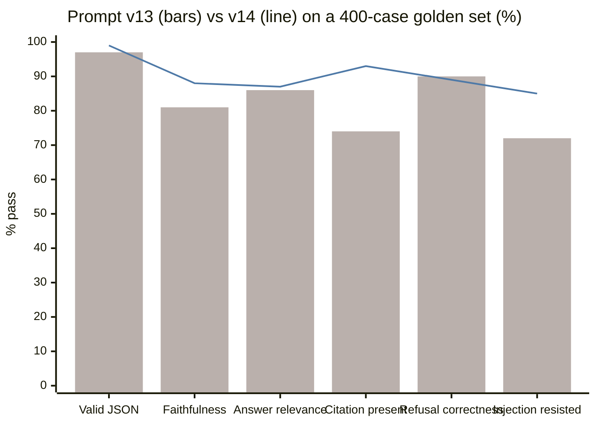
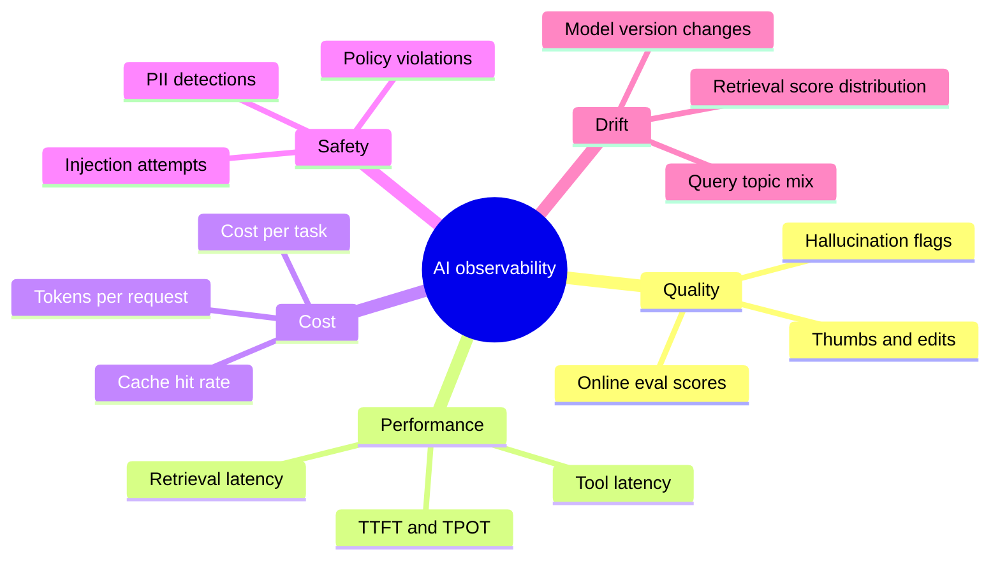
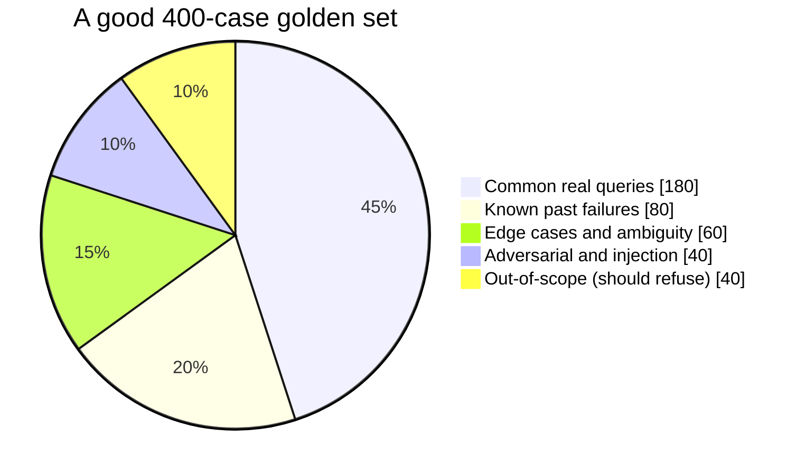

# LLM Evals and AI Observability (LLMOps)

## What is it?

- **Evals:** systematic tests for LLM features. Datasets plus scoring that tell you whether a prompt, model or retrieval change made things better or worse.
- **AI observability:** tracing, monitoring and alerting for LLM apps in production: every model call, retrieval, tool call, token count, cost, latency and quality signal.

## Why it's the #1 future AI skill

- Hiring guides for AI engineers in 2026 call **eval design** "the top signal of real LLM experience". Interviewers ask candidates to walk through an eval they built and what it caught.
- "AI observability" and "MLOps/GenAI ops" are named in India's GCC talent shortfall. → [[Market-Research-2026]]
- LLM output is non-deterministic and fails *plausibly*. Unit tests alone can't tell you a prompt change made answers 8% less faithful.

## Analogy

Evals are the **exam paper** you set your model before letting it work; observability is the **CCTV + meter readings** once it's at work. Without the exam you're hiring blind; without the CCTV you won't know when it starts making things up.

## Interview definition

> "I treat prompts, models and retrieval configs as code under test: a versioned golden dataset, task-specific metrics (deterministic checks first, LLM-as-judge calibrated against humans where needed), offline evals as CI gates, online evals and user feedback in production, and end-to-end tracing with token cost and latency per step."

## Types of evals

| Type | How | Use for |
|---|---|---|
| **Deterministic checks** | Exact match, regex, JSON schema validity, contains citation, SQL executes | Format, structure, extraction — cheapest, use first |
| **Reference-based** | Compare to a gold answer (semantic similarity, F1) | QA with known answers |
| **LLM-as-judge** | A model grades output with a rubric (pointwise or pairwise) | Helpfulness, tone, faithfulness at scale |
| **Human review** | Experts label samples | Calibrating judges, high-stakes domains |
| **RAG metrics** | Context recall/precision, faithfulness (answer supported by context), answer relevance | Retrieval quality vs generation quality |
| **Agent evals** | Task success rate, steps taken, tool-call correctness, cost per task | Agents and workflows → [[AI-Agent-Systems]] |
| **Safety evals** | Prompt-injection suites, jailbreaks, PII leakage | → [[AI-Security-Engineering]] |
| **Online evals** | Sampled production traffic scored continuously; A/B tests; thumbs up/down; edit distance of accepted drafts | Real-world quality |

**LLM-as-judge pitfalls:** position bias (prefers first option), verbosity bias, self-preference, rubric drift. Mitigations: pairwise with swapped order, clear rubrics with examples, judge different from generator, periodic agreement checks against human labels.

## The eval-driven development loop

## AI observability: what to trace

Standards and tools: **OpenTelemetry GenAI semantic conventions** (`gen_ai.*` attributes), Langfuse, Arize Phoenix, LangSmith, Braintrust, Helicone, Datadog LLM Observability.

## 📊 Visual model

**Eval report for a prompt change (illustrative):**

> [!example] Reading it
> v14 improves faithfulness and citations, holds relevance, slightly drops refusal correctness (investigate), and clearly improves injection resistance. Ship only if the refusal drop is within tolerance.

**What to monitor in production:**

**Golden dataset composition:**

## Common mistakes

> [!warning] Traps to avoid
> 1. "Vibe checking" a few prompts instead of a dataset.
> 2. Only LLM-as-judge with no calibration against humans.
> 3. Evaluating the final answer only; never separating retrieval failures from generation failures.
> 4. No prompt/model versioning in traces → can't explain regressions.
> 5. Logging full prompts with PII without redaction/retention policy.
> 6. Claiming "100% accuracy" (a hiring red flag).

## Interview understanding

> [!question] What the interviewer is really testing
> - *"How do you know your RAG system works?"* — Golden set with retrieval metrics (recall@k) and generation metrics (faithfulness, relevance), CI gate, online sampling, user feedback loop.
> - *Tricky:* "LLM-as-judge biases?" — Position, verbosity, self-preference; mitigate with pairwise swaps, rubrics, different judge model, human agreement checks.
> - *Tricky:* "What do you put in a trace?" — Prompt version, model, tokens, cost, latency per span, retrieved doc IDs, tool calls, eval scores, user/tenant (redacted).
> - *Tricky:* "Offline vs online evals?" — Fixed dataset for regression gates vs live-traffic quality and drift.

## Mini quiz
1. Cheapest type of eval to start with?
2. Three RAG metrics?
3. Two LLM-as-judge biases?
4. What standard defines GenAI trace attributes?
5. What goes into a golden dataset besides common queries?

> [!success]- Answers (click to reveal)
> 1. Deterministic checks (schema, regex, exact match, executes).
> 2. Context recall/precision, faithfulness, answer relevance.
> 3. Position bias, verbosity bias, self-preference.
> 4. OpenTelemetry GenAI semantic conventions.
> 5. Past failures, edge cases, adversarial/injection cases, out-of-scope queries.

---
**Next:** [[Context-Engineering-and-Agent-Protocols]] · **Up:** [[Future-Engineering-MOC]]

## 📚 Resources
- 📄 [Hamel Husain — Your AI product needs evals](https://hamel.dev/blog/posts/evals/)
- 📄 [Anthropic docs — Define success criteria and build evaluations](https://docs.claude.com/en/docs/test-and-evaluate/develop-tests)
- 📄 [OpenTelemetry — GenAI semantic conventions](https://opentelemetry.io/docs/specs/semconv/gen-ai/)
- 📄 [Ragas — RAG evaluation metrics](https://docs.ragas.io/)
- 📄 [Langfuse](https://langfuse.com/docs) · [Arize Phoenix](https://docs.arize.com/phoenix)

## My notes
-
