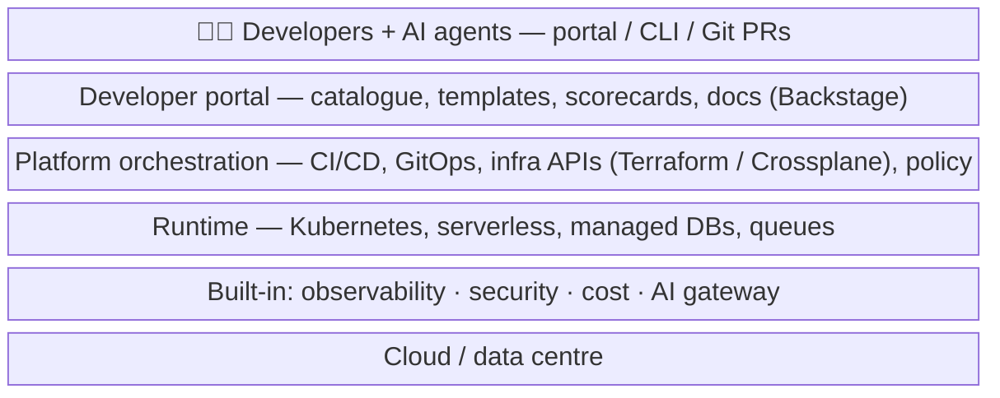
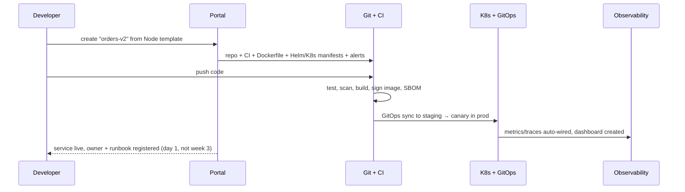
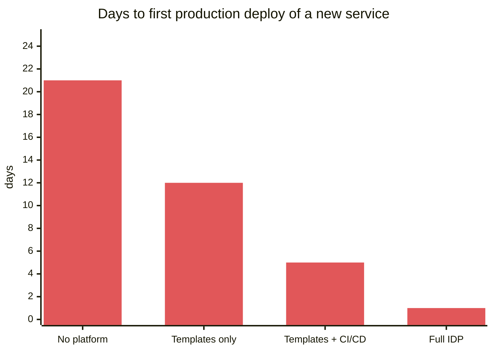
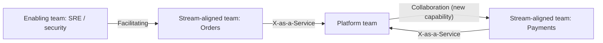

# Platform Engineering and Internal Developer Platforms (IDPs)

> DevOps-vault link: my DevOps notes cover the tools (Kubernetes, Terraform, ArgoCD). This note covers the **product and architecture** view that SDE-2/3s and platform teams own.

## What is it?

Building an internal **product for developers**: a self-service platform with **golden paths** (paved, opinionated ways to create, build, deploy, observe and secure services), so product teams ship without becoming Kubernetes, Terraform and security experts.

## Why it matters

- India's GCCs report a **38% talent shortfall in platform engineering**, with Terraform, Kubernetes, hybrid-cloud reliability and cloud governance named. → [[Market-Research-2026]]
- Gartner predicted that by 2026, 80% of large software engineering organisations would have platform teams.
- AI coding agents need the same thing humans need: **standard templates, safe deploy paths and guardrails**. Platforms are becoming the control plane for AI-written code too.

## Analogy

Indian Railways doesn't ask each passenger to lay their own track. The platform team builds tracks, signals and stations; product teams just run trains on schedule. A **golden path** is the main line: fast and safe. You *can* go off-road, but you own the consequences.

## Interview definition

> "Platform engineering treats infrastructure as a product for internal developers: self-service golden paths for creating, deploying and operating services, with security, compliance and observability built in. Its success is measured by developer outcomes like lead time, onboarding time and adoption, not by the number of tools."

## What an IDP provides

| Capability | Example | Tools |
|---|---|---|
| **Service catalogue + docs** | Who owns what, APIs, runbooks, scorecards | Backstage, Port, Cortex |
| **Scaffolding templates** | "New Node service" → repo, CI, Dockerfile, dashboards, alerts, on-call in 5 minutes | Backstage Software Templates, cookiecutter |
| **CI/CD golden path** | Build, test, scan, sign, deploy with canary | GitHub Actions, GitLab CI, ArgoCD, Argo Rollouts |
| **Infra self-service** | Request a Postgres DB / queue / bucket via PR or portal | Terraform modules, Crossplane, OpenTofu |
| **Runtime platform** | Kubernetes with sane defaults, autoscaling, secrets | EKS/GKE/AKS, Karpenter, External Secrets |
| **Observability by default** | Logs/metrics/traces wired automatically | OpenTelemetry, Grafana stack |
| **Security & compliance by default** | SBOM, image signing, policy checks, least-privilege IAM | Sigstore, OPA/Kyverno → [[Supply-Chain-Security-and-Post-Quantum]] |
| **Cost visibility** | Cost per service/team | OpenCost/Kubecost → [[Cost-Aware-Architecture]] |
| **AI platform layer** | Approved models, LLM gateway, eval harness, vector stores | → [[LLM-Evals-and-AI-Observability]] |

## Key principles
1. **Platform as a product:** user research with developers, a roadmap, docs, SLAs, adoption metrics.
2. **Golden paths, not golden cages:** opinionated defaults, escape hatches allowed.
3. **Thinnest viable platform:** start with the top pain (e.g., "new service takes 3 weeks") instead of building everything.
4. **Self-service via APIs and Git**, not tickets.
5. **Measure:** DORA metrics, time-to-first-deploy for new services, onboarding time, developer satisfaction surveys.

## 📊 Visual model

**Layers of an internal developer platform:**

**Golden path: new service to production:**

**Before vs after a platform (illustrative):**

**Platform team interaction modes (Team Topologies):**

## Common mistakes

> [!warning] Traps to avoid
> 1. Building a platform nobody asked for ("if we build it they will come").
> 2. Ticket-driven "platform" (just a renamed ops queue).
> 3. Golden cages with no escape hatch.
> 4. Measuring success by number of tools integrated.
> 5. Ignoring docs and developer experience.

## Interview understanding

> [!question] What the interviewer is really testing
> - *"How would you speed up how teams ship services?"* — Golden path templates, self-service infra, built-in CI/CD + observability + security, measured by DORA and time-to-first-deploy.
> - *Tricky:* "DevOps vs platform engineering?" — DevOps is a culture of shared ownership; platform engineering productises the tooling so every team doesn't rebuild it.
> - *Tricky:* "How do you get adoption without mandates?" — Make the golden path the easiest path, migrate a flagship team first, publish metrics.
> - *Tricky:* "Where do AI agents fit?" — They consume the same templates, CI guardrails and deploy paths; the platform enforces policy on their output.

## Mini quiz
1. What is a golden path?
2. Three things an IDP provides?
3. "Thinnest viable platform" means?
4. Two metrics for platform success?
5. DevOps vs platform engineering?

> [!success]- Answers (click to reveal)
> 1. An opinionated, supported, self-service way to do a common task (create, deploy, operate a service).
> 2. Service catalogue, templates, CI/CD, infra self-service, observability/security/cost by default (any three).
> 3. Start with the smallest platform that removes the biggest developer pain, then grow.
> 4. Time-to-first-deploy, DORA metrics, adoption rate, developer satisfaction.
> 5. Culture and practices vs a product team building internal self-service tooling.

---
**Next:** [[Data-Engineering-for-AI]] · **Up:** [[Future-Engineering-MOC]]

## 📚 Resources
- 📄 [platformengineering.org — What is platform engineering](https://platformengineering.org/blog/what-is-platform-engineering)
- 📄 [Backstage (CNCF)](https://backstage.io/)
- 📄 [CNCF — Platforms white paper](https://tag-app-delivery.cncf.io/whitepapers/platforms/)
- 📖 *Team Topologies* (Skelton & Pais).

## My notes
-
