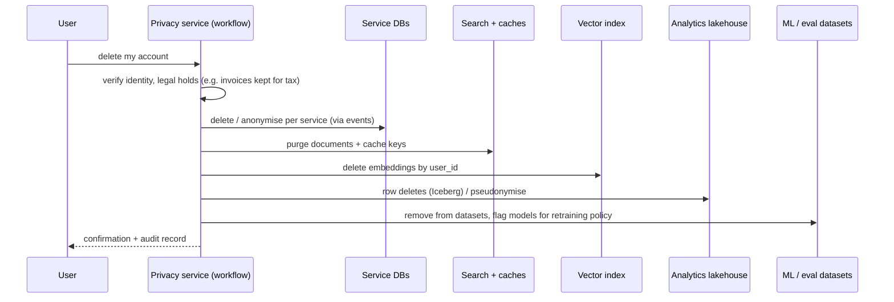
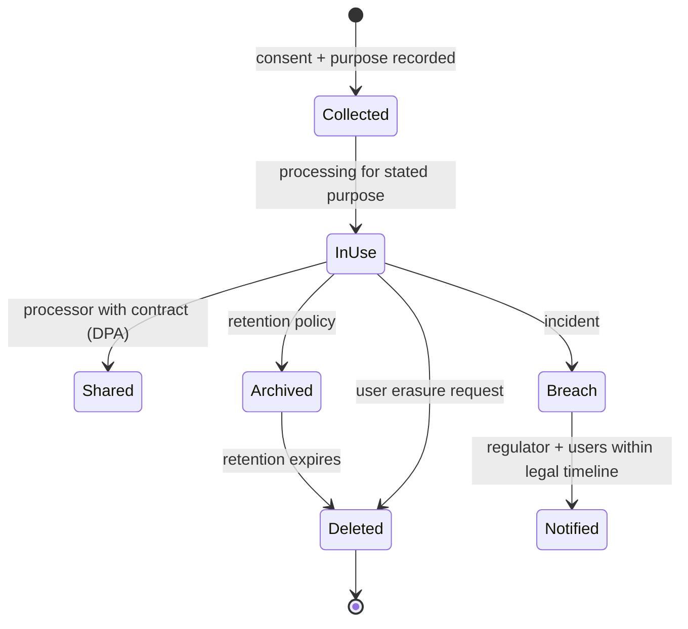
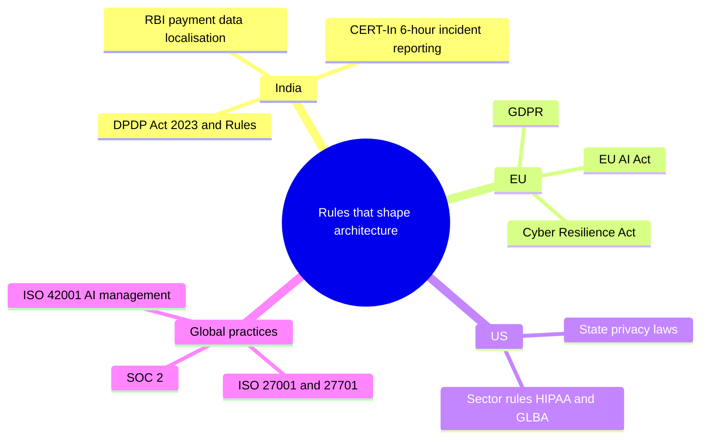
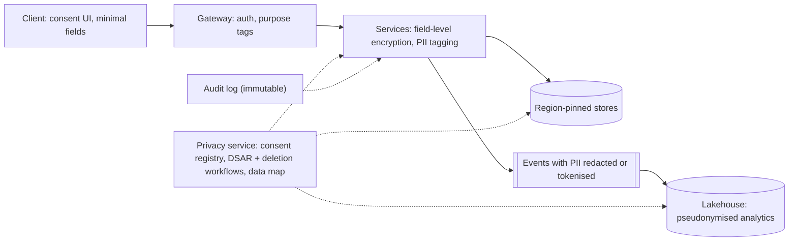

# Privacy Engineering and AI Regulation

> [!warning] Not legal advice
> This is an engineer's map of what regulations *mean for architecture*. Deadlines and rules change. Check current official sources and your company's legal team before relying on any date.

## What is it?

Designing systems so **personal data** is collected minimally, used only for stated purposes, protected, deletable and auditable, and so **AI systems** meet transparency, risk-management and human-oversight requirements. Increasingly these are legal obligations, not nice-to-haves.

## Why it matters for engineers (1–3 years)

- **India — DPDP Act 2023:** consent-based processing, purpose limitation, data principal rights (access, correction, erasure), breach notification, penalties up to ₹250 crore for some failures (e.g. inadequate security safeguards). The **DPDP Rules were notified on 13 Nov 2025**. Consent-manager rules apply after 1 year (Nov 2026), and **all remaining substantive obligations apply from May 2027** (18 months): notice and consent, fiduciary duties, children's data, rights, breach notification, retention and erasure.
- **Sectoral rules in India:** RBI requires payment system data to be stored in India; CERT-In requires certain cyber incidents to be reported within 6 hours.
- **EU — GDPR** (applies to EU users' data wherever you are) and the **EU AI Act**, which entered into force in Aug 2024. Prohibited practices and general-purpose AI model obligations started in 2025. A 2026 "digital omnibus" amendment moved high-risk deadlines: **2 Dec 2027** for stand-alone high-risk systems (Annex III, e.g. hiring/HR AI) and **2 Aug 2028** for AI embedded in regulated products (Annex I). Verify the current status before relying on these dates.
- Every one of these turns into **architecture requirements**: where data lives, how deletion propagates, what you log, how models are documented.

## Analogy

Personal data is like other people's money in a bank. You may hold it only for agreed purposes, must be able to show where every rupee is, must return it on request, and must report a robbery quickly.

## Interview definition

> "Privacy by design means data minimisation, purpose-tagged data, consent and preference enforcement in code, encryption and access control, residency-aware storage, deletion that propagates through every copy including caches, search, vectors and backups, and audit trails. AI regulation adds risk classification, documentation, human oversight and logging for AI systems."

## Engineering requirements → patterns

| Requirement | Engineering pattern |
|---|---|
| **Data minimisation** | Collect only needed fields; drop or aggregate early; short retention by default |
| **Purpose limitation & consent** | Consent service + purpose tags on data; enforce at query/pipeline time |
| **Right to access / portability** | Per-user data export job across services (needs a data map) |
| **Right to erasure** | Deletion workflow fanning out to every store: DBs, caches, search, **vector indexes**, analytics, logs, ML/eval datasets; backups via retention or crypto-shredding → [[Workflow-Orchestration-and-Durable-Execution]] |
| **Data residency / localisation** | Region-pinned storage per user/tenant, routing by home region → [[Multi-Region-and-Disaster-Recovery]] |
| **Security safeguards** | Encryption at rest/in transit, field-level encryption/tokenisation, least privilege → [[Security-Essentials]] |
| **Breach notification** | Detection + incident process with legal timelines → [[Operational-Excellence-and-Incidents]] |
| **Pseudonymisation** | Replace identifiers with tokens in analytics/ML datasets |
| **Audit** | Immutable access logs: who accessed which personal data and why |
| **Children's data** | Age gating, parental consent flows, no tracking/targeting where the law forbids |

## AI-specific obligations (what engineers build)

| Obligation | What it looks like in systems |
|---|---|
| Risk classification | Inventory of AI systems and their use cases (e.g., hiring and credit are high-risk categories under the EU AI Act) |
| Transparency | Disclose AI interactions; label AI-generated content where required |
| Data governance | Documented, representative, lawful training/eval data → [[Data-Engineering-for-AI]] |
| Logging & traceability | Record inputs/outputs/decisions for high-risk systems → [[LLM-Evals-and-AI-Observability]] |
| Human oversight | Review/override paths for consequential decisions |
| Accuracy & robustness | Evals, monitoring, security testing → [[AI-Security-Engineering]] |
| Documentation | Model cards, system cards, data sheets |

## 📊 Visual model

**Deletion request fan-out (the hardest privacy feature):**

**Personal data lifecycle:**

**Regulatory landscape (engineer's view):**

**Where privacy controls sit in the stack:**

## Common mistakes

> [!warning] Traps to avoid
> 1. No data map. You can't delete or export what you can't find.
> 2. PII in logs, analytics events and LLM traces without redaction.
> 3. Deleting from the primary DB but not search, caches, vectors or datasets.
> 4. Sending personal data to third-party AI APIs without a processing agreement or consent basis.
> 5. Treating compliance as a launch-week checklist instead of a design input.

## Interview understanding

> [!question] What the interviewer is really testing
> - *"How would you support account deletion across 30 microservices?"* — Data map + `UserDeleted` event + durable workflow tracking acknowledgements per service, legal-hold exceptions, crypto-shredding for backups, audit record.
> - *Tricky:* "How do you meet data localisation for Indian payment data on a global platform?" — Region-pinned storage and processing for that data class, routing by user/tenant home region, replication only within the allowed region.
> - *Tricky:* "Can you put user data into an LLM prompt?" — Only with a lawful basis/consent, minimisation, provider agreements (no training on your data, retention limits), redaction where possible, and logging controls.
> - *Tricky:* "What is crypto-shredding?" — Deleting the per-user/tenant key so encrypted copies (including backups) become unreadable.

## Mini quiz
1. Four privacy-by-design patterns?
2. Why is deletion hard in modern systems?
3. What does India's RBI require for payment data?
4. Two AI-specific obligations under the EU AI Act for high-risk systems?
5. What's a data map?

> [!success]- Answers (click to reveal)
> 1. Minimisation, purpose/consent enforcement, encryption + access control, residency, deletion fan-out, audit logs (any four).
> 2. Personal data is copied into caches, search, vectors, analytics, logs, ML datasets and backups.
> 3. Payment system data must be stored in India.
> 4. Risk management, data governance, logging/traceability, human oversight, transparency, accuracy/robustness (any two).
> 5. An inventory of what personal data exists, where, why, for how long, and who accesses it.

---
**Up:** [[Future-Engineering-MOC]] · **Back to:** [[SDE-Career-Ladder]]

## 📚 Resources
- 📄 [MeitY — Digital Personal Data Protection Act, 2023](https://www.meity.gov.in/data-protection-framework)
- 📄 [AZB & Partners — DPDP phased rollout and key compliance milestones (Nov 2025)](https://www.azbpartners.com/bank/indias-digital-personal-data-protection-act-phased-rollout-and-key-compliance-milestones/)
- 📄 [Sidley — EU lawmakers agree to delay key EU AI Act obligations (Jun 2026)](https://datamatters.sidley.com/2026/06/22/eu-lawmakers-reach-provisional-agreement-to-delay-key-eu-ai-act-obligations/)
- 📄 [EU AI Act — official overview (European Commission)](https://digital-strategy.ec.europa.eu/en/policies/regulatory-framework-ai)
- 📄 [GDPR text](https://gdpr-info.eu/)
- 📄 [RBI — Storage of Payment System Data (2018 circular)](https://www.rbi.org.in/Scripts/NotificationUser.aspx?Id=11244)

## My notes
-
