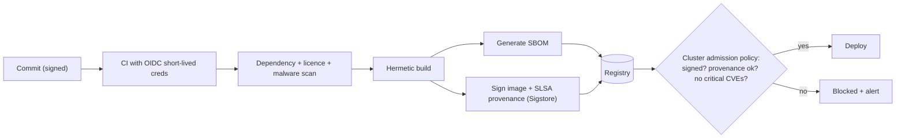
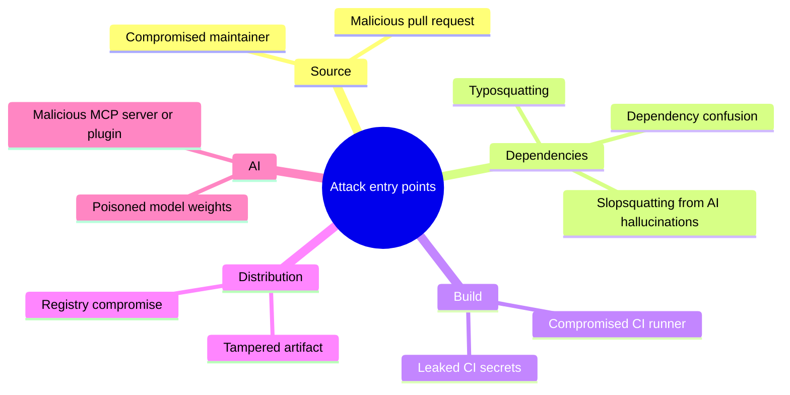
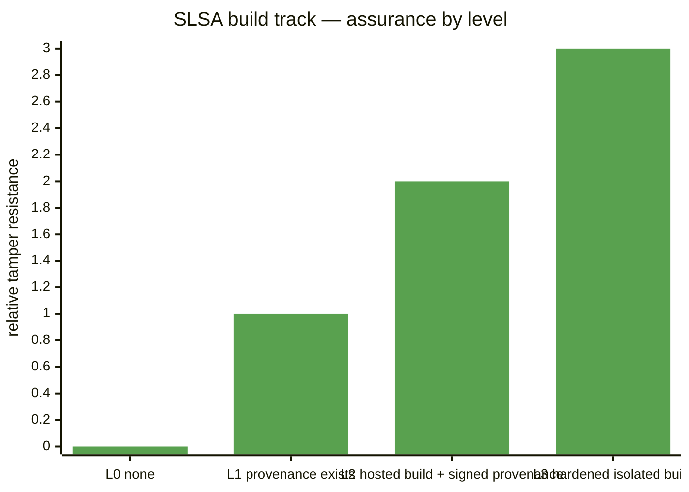
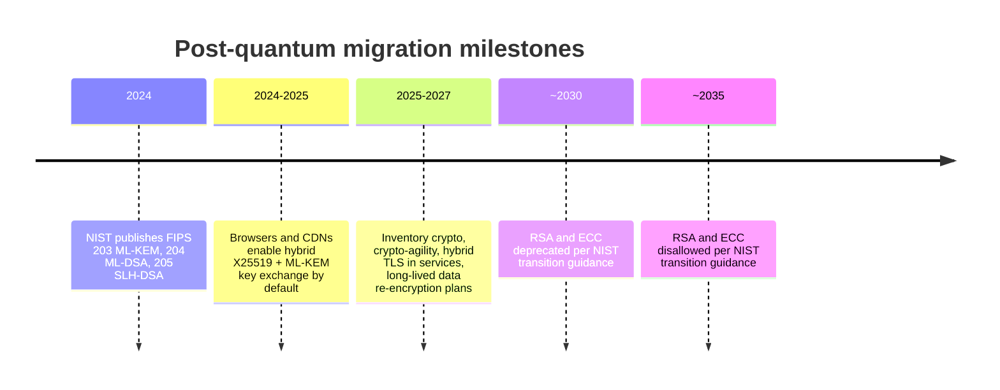

# Software Supply-Chain Security and Post-Quantum Readiness

## What is it?

Two security shifts every senior engineer should understand:
1. **Supply-chain security:** protecting everything that goes *into* your software: dependencies, build systems, CI secrets, container images, models and AI-suggested packages.
2. **Post-quantum cryptography (PQC):** migrating encryption and signatures to algorithms that resist future quantum computers, before attackers who record traffic today can decrypt it later.

## Why they matter

- Big recent incidents came through the supply chain, not the front door: SolarWinds (2020, build system), Log4Shell (2021, dependency), the xz-utils backdoor (2024, maintainer social engineering), and a wave of malicious npm/PyPI packages.
- AI coding agents add new risks: **hallucinated package names** that attackers register ("slopsquatting"), and agents running installs with broad tokens. → [[AI-Native-SDLC]]
- Regulation is arriving. The EU Cyber Resilience Act phases in vulnerability reporting (from 2026) and security requirements (2027) for products with digital elements. US federal buyers ask for SBOMs.
- PQC: NIST published the first PQC standards in Aug 2024 (FIPS 203 ML-KEM, FIPS 204 ML-DSA, FIPS 205 SLH-DSA), and major browsers/CDNs already use hybrid post-quantum key exchange. NIST guidance plans to deprecate RSA/ECC around 2030 and disallow them by 2035. "Harvest now, decrypt later" makes long-lived secrets urgent today.

## Analogy

- **Supply chain:** a restaurant can have a perfect kitchen and still poison guests if a supplier's ingredient is contaminated. You need labels (SBOM), sealed packaging (signatures) and trusted suppliers (provenance).
- **PQC:** someone is photocopying your locked letters today, planning to pick the lock in 10 years. Letters that must stay secret for 10+ years need a new lock **now**.

## Interview definition

> "Supply-chain security means knowing exactly what's in a build (SBOM), proving how and where it was built (SLSA provenance, signatures), and continuously checking dependencies and policies in CI and at deploy time. Post-quantum readiness means crypto-agility: inventory where cryptography is used, adopt hybrid PQC key exchange, and plan migration of signatures and long-lived data."

## Supply-chain controls

| Control | What it does | Tools / standards |
|---|---|---|
| **SBOM** | Ingredient list of every component and version | SPDX, CycloneDX; Syft, Trivy |
| **Dependency scanning** | Known CVEs, licences, malicious packages | Dependabot, Renovate, Snyk, OSV-Scanner, Socket |
| **Pinning + lockfiles + private registry/proxy** | Reproducible, vetted dependencies | npm/pnpm lockfiles, Artifactory/Nexus |
| **Build provenance** | Signed attestation of how/where an artifact was built | **SLSA** levels, in-toto |
| **Artifact signing + verification** | Only signed images deploy | **Sigstore** (cosign, keyless signing, Rekor transparency log) |
| **Admission policies** | Block unsigned/vulnerable images in the cluster | Kyverno, OPA Gatekeeper |
| **CI hardening** | Short-lived OIDC credentials, least-privilege tokens, pinned actions | GitHub OIDC, step-security |
| **Secret scanning** | Catch leaked keys | gitleaks, GitHub secret scanning |
| **Model/AI supply chain** | Verify model weights, MCP servers, datasets | Model signing, vetted registries → [[AI-Security-Engineering]] |

## Zero trust (connects both)
Never trust the network; authenticate and authorise every request (users, services, workloads), use short-lived credentials, device posture and mTLS. Workload identity standards: **SPIFFE/SPIRE**. → [[Authentication-and-Authorization]]

## 📊 Visual model

**A secure build-to-deploy pipeline:**

**Where supply-chain attacks enter:**

**SLSA levels (build track):**

**PQC migration timeline:**

**Prioritising PQC work (Mosca's rule of thumb):**

$$\text{If } X + Y > Z \text{ you are already late}$$

> X = how long data must stay secret, Y = how long migration takes, Z = years until a cryptographically relevant quantum computer.

## Common mistakes

> [!warning] Traps to avoid
> 1. "We scan for CVEs" as the whole strategy (no provenance, no signing, no policy).
> 2. Long-lived CI tokens with org-wide write access.
> 3. Installing packages an AI suggested without checking they exist and are reputable.
> 4. Hard-coded crypto algorithms everywhere (no crypto-agility).
> 5. Treating PQC as a 2035 problem for data that must stay secret for 15 years.

## Interview understanding

> [!question] What the interviewer is really testing
> - *"How do you secure your CI/CD pipeline?"* — OIDC short-lived creds, pinned dependencies/actions, scans, SBOM, signed artifacts with provenance, admission policies.
> - *Tricky:* "What's an SBOM good for during an incident like Log4Shell?" — Instantly answering "which services contain the vulnerable version?"
> - *Tricky:* "What's harvest-now-decrypt-later?" — Recording encrypted traffic today to decrypt once quantum computers exist; long-lived secrets need PQC sooner.
> - *Tricky:* "What is crypto-agility?" — Being able to swap algorithms/keys via configuration without rewriting systems.

## Mini quiz
1. Two SBOM formats?
2. What does Sigstore provide?
3. What is slopsquatting?
4. Name the three NIST PQC standards (2024).
5. What's Mosca's inequality about?

> [!success]- Answers (click to reveal)
> 1. SPDX and CycloneDX.
> 2. Keyless signing and verification of artifacts with a public transparency log (cosign, Fulcio, Rekor).
> 3. Registering malicious packages under names that AI models tend to hallucinate.
> 4. FIPS 203 (ML-KEM), FIPS 204 (ML-DSA), FIPS 205 (SLH-DSA).
> 5. Whether secrecy lifetime + migration time exceeds time until quantum attacks, i.e. whether you must migrate now.

---
**Next:** [[Privacy-and-AI-Regulation]] · **Up:** [[Future-Engineering-MOC]]

## 📚 Resources
- 📄 [SLSA framework](https://slsa.dev/)
- 📄 [Sigstore](https://www.sigstore.dev/)
- 📄 [NIST — Post-quantum cryptography standards announcement (Aug 2024)](https://www.nist.gov/news-events/news/2024/08/nist-releases-first-3-finalized-post-quantum-encryption-standards)
- 📄 [OpenSSF — Concise guide for evaluating open source software](https://best.openssf.org/Concise-Guide-for-Evaluating-Open-Source-Software)

## My notes
-
