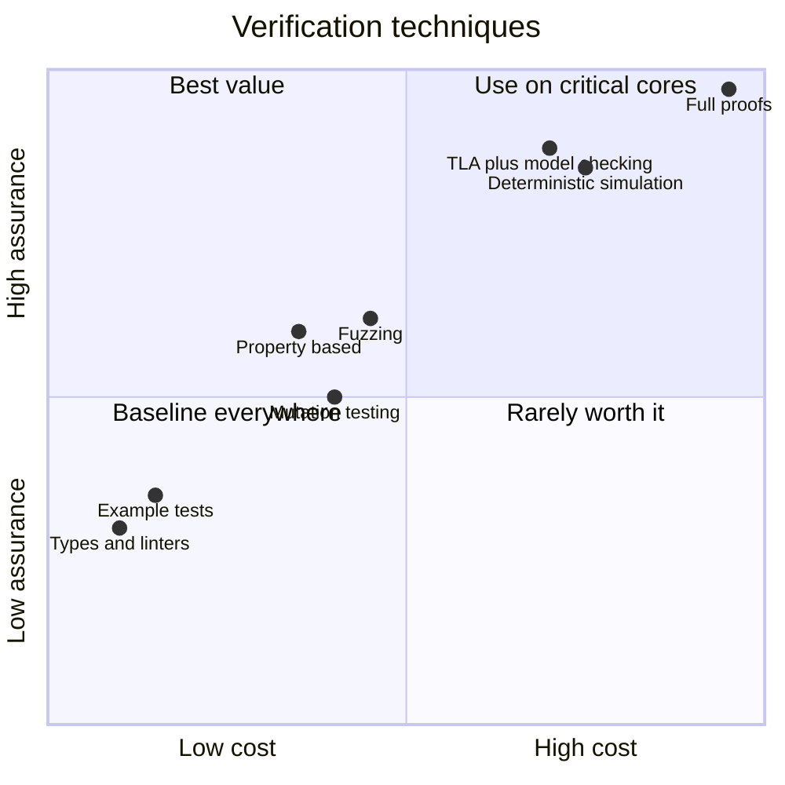
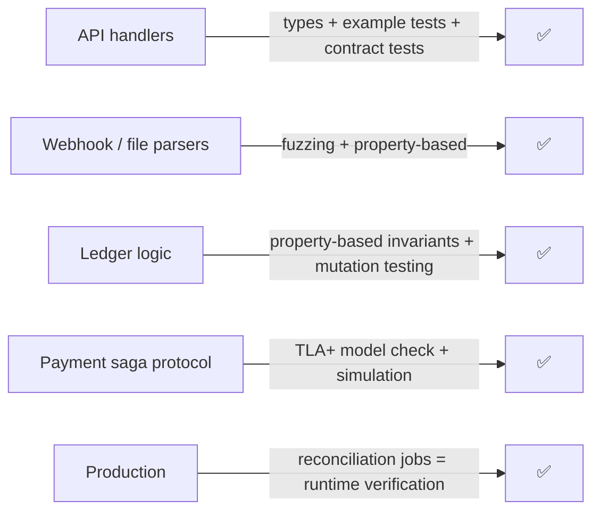
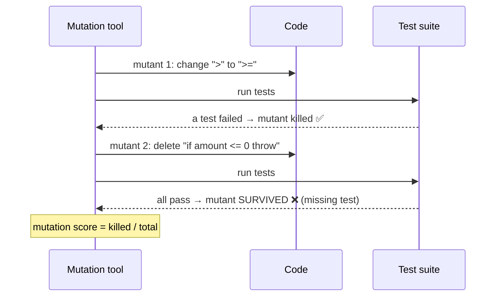
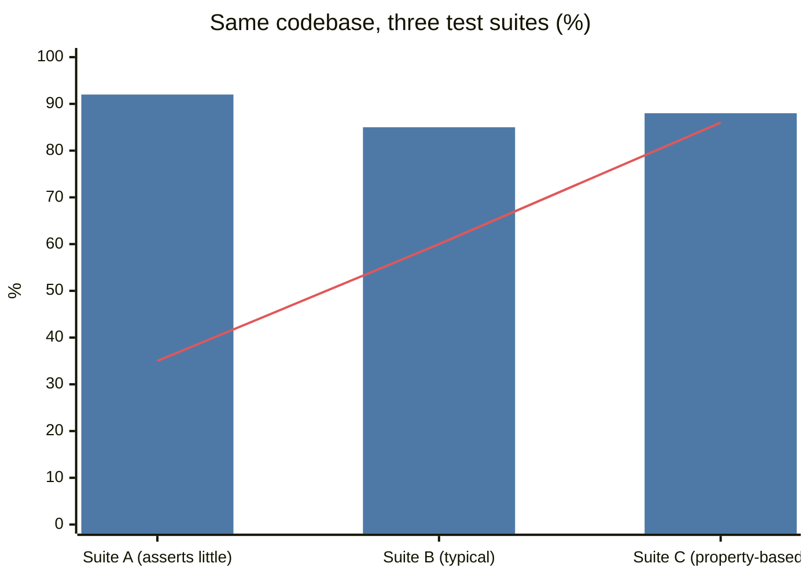

# Verification Engineering

## What is it?

The discipline of **proving or gaining high confidence that software does what it should**, using a ladder of techniques from tests to types to fuzzing to formal specifications. The goal is to trust code you didn't write line by line, including AI-written code.

## Why it's a future skill

A June 2026 paper summarising researcher and industry round-tables (Roychoudhury, Kang, Ray) concludes that **verification and validation is increasing in importance as agents handle implementation**. When generating code is nearly free, the bottleneck is knowing it's right. AWS has used formal methods (TLA+, P, automated reasoning) for years on S3, DynamoDB and IAM because testing alone misses rare distributed bugs.

## Analogy

Generating code is like printing money; verification is the anti-counterfeit check. When printing becomes trivial, the value moves to the checking.

## Interview definition

> "Verification engineering means choosing the right level of assurance per component: tests and types everywhere, property-based tests and fuzzing for tricky logic and parsers, invariants and runtime checks in production, and formal specifications for the few protocols where a bug is catastrophic."

## The verification ladder

| Level | Technique | Catches | Cost | Tools |
|---|---|---|---|---|
| 1 | **Static types + linters** | Whole classes of errors at compile time | Low | TypeScript strict, mypy/pyright, ESLint |
| 2 | **Example-based tests** | Known cases | Low | Jest/Vitest, pytest |
| 3 | **Property-based tests** | Unknown edge cases via invariants | Medium | fast-check, Hypothesis |
| 4 | **Mutation testing** | Weak tests (tests that don't fail when code changes) | Medium | Stryker, mutmut, PIT |
| 5 | **Fuzzing** | Crashes, security bugs in parsers/inputs | Medium | libFuzzer, AFL++, Jazzer.js, OSS-Fuzz |
| 6 | **Differential testing** | Behaviour drift between old/new implementations | Medium | Shadow traffic, GitHub Scientist → [[Large-Scale-Migrations]] |
| 7 | **Static analysis / SAST** | Injection, unsafe patterns | Low–medium | Semgrep, CodeQL |
| 8 | **Runtime verification** | Invariant violations in production | Medium | Assertions, reconciliation jobs, monitors |
| 9 | **Deterministic simulation** | Rare concurrency/failure interleavings | High | FoundationDB-style, Antithesis |
| 10 | **Formal specification & model checking** | Design-level bugs in protocols | High | TLA+, P, Alloy |
| 11 | **Proofs** | Mathematical guarantees | Very high | Dafny, Lean, Coq, Verus |

## Key ideas

- **Invariants are the specification.** "Ledger always balances", "a seat is booked at most once", "every message is processed at least once". Write them down; test them with properties; monitor them in production.
- **Mutation score > coverage %.** 90% line coverage with weak assertions catches little; mutation testing checks whether tests *notice* bugs.
- **Oracles:** how do you know an output is correct? Use reference implementations, round-trips (`decode(encode(x)) == x`), metamorphic relations (sorting a shuffled list gives the same result), or invariants.
- **AI as verifier, carefully:** agents can propose properties, generate fuzz harnesses and write TLA+ drafts, but humans must review the *specification*, because a wrong spec verifies the wrong thing.

## 📊 Visual model

**Assurance vs cost — pick per component:**



**Where each technique fits in a payments system:**



**Mutation testing — does the test suite notice bugs?**



**Coverage vs mutation score (why coverage lies):**



> [!note] Bars = line coverage. Line = mutation score. Illustrative numbers. Suite A has high coverage but catches few bugs.

**A tiny TLA+-style invariant (idea, not syntax drill):**

```text
Invariant NoDoubleBooking ==
  \A s \in Seats : Cardinality({b \in Bookings : b.seat = s /\ b.status = "CONFIRMED"}) <= 1
Model checker explores every interleaving of holds, payments, expiries and retries → finds the race.
```

## Common mistakes

> [!warning] Traps to avoid
> 1. Equating coverage with correctness.
> 2. Letting the same agent write code and its oracle.
> 3. Formal methods everywhere (too costly) or nowhere (critical protocols untested).
> 4. No runtime verification. Invariants should be monitored, not just tested.
> 5. Verifying against a wrong or vague spec.

## Interview understanding

> [!question] What the interviewer is really testing
> - *"How do you trust AI-generated code?"* — Spec + invariants first, property tests and mutation testing, SAST, human review of risky paths, runtime checks.
> - *Tricky:* "Coverage is 95%. Are we safe?" — No. Check mutation score and whether tests assert meaningful properties.
> - *Tricky:* "When are formal methods worth it?" — Concurrency/distributed protocols where rare bugs are catastrophic (consensus, payments, storage), and the spec is small relative to the code.
> - *Tricky:* "What's a test oracle?" — The mechanism deciding if an output is correct.

## Mini quiz
1. What does mutation testing measure?
2. Two kinds of test oracles?
3. Name a property for a sorting function.
4. Why monitor invariants in production?
5. One company known for formal methods in production?

> [!success]- Answers (click to reveal)
> 1. Whether tests detect injected code changes (test suite strength).
> 2. Reference implementation, round-trip, metamorphic relation, invariant.
> 3. Output is ordered and is a permutation of the input.
> 4. Tests can't cover every real-world interleaving; production checks catch violations early.
> 5. AWS (TLA+, P, automated reasoning).

---
**Next:** [[LLM-Evals-and-AI-Observability]] · **Up:** [[Future-Engineering-MOC]]

## 📚 Resources
- 📄 [Roychoudhury, Kang, Ray — Skills for the future software profession (arXiv 2606.21894)](https://arxiv.org/abs/2606.21894)
- 📄 [Newcombe et al. — How Amazon Web Services uses formal methods (CACM 2015)](https://cacm.acm.org/research/how-amazon-web-services-uses-formal-methods/)
- 📄 [Learn TLA+](https://learntla.com/)
- 📄 [Stryker mutation testing](https://stryker-mutator.io/)
- 📄 [Hypothesis — property-based testing](https://hypothesis.readthedocs.io/)

## My notes
-
