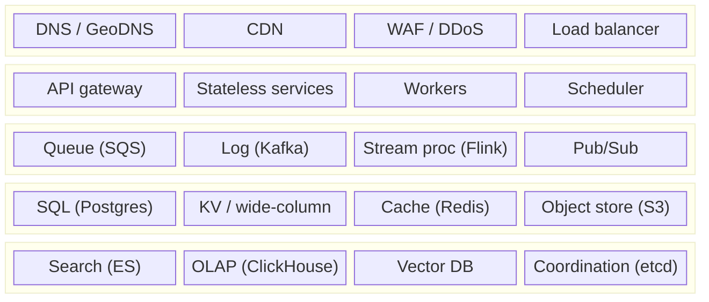

# 🧱 Cheat Sheet — Building Blocks

> One line per component: **what it's for, when to add it, what it costs.** Print this.

## The component palette

## Component table

| Component | Add it when… | Watch out for |
|---|---|---|
| **DNS / GeoDNS** | Multi-region routing | TTL limits failover speed |
| **CDN** | Static/media or cacheable public content; global users | Never cache personalised responses |
| **Load balancer** | > 1 server; zero-downtime deploys | It can be a SPOF; L4 vs L7 choice |
| **API gateway** | Multiple services/clients; central auth & rate limits | Keep business logic out |
| **Cache (Redis)** | Read-heavy, skewed access; expensive computations | Invalidation, stampedes, hot keys, cold start |
| **Read replicas** | Reads overwhelm the primary | Replication lag, read-your-writes |
| **Sharding** | Writes/data exceed one primary | Shard key, hotspots, cross-shard queries |
| **Message queue** | Async work, spikes, retries | Duplicates → idempotency; DLQ |
| **Kafka** | Event streams, multiple consumers, replay, ordering per key | Partitions = parallelism; ops complexity |
| **Stream processor** | Real-time aggregates, windows, fraud | Event time, watermarks, state size |
| **Object storage** | Files/media/backups | Presigned access, lifecycle costs |
| **Search engine** | Full-text, fuzzy, faceted search | Derived index → CDC sync, near-real-time |
| **OLAP store** | Dashboards over billions of rows | Not for OLTP; rollups/retention |
| **Vector DB** | Semantic search, RAG, recommendations | ACL filtering, recall tuning, memory |
| **Coordination (etcd/ZK)** | Leader election, locks, config | Small data only; odd cluster sizes |
| **WebSocket gateway** | Server push, chat, live tracking | Stateful → registry, reconnect storms |
| **Workflow engine (Temporal)** | Long multi-step processes, sagas, agents | Determinism rules; another system to run |
| **LLM gateway** | Any LLM feature at scale | Token quotas, fallback, caching, logging PII |

## Numbers to keep handy

| Thing | Ballpark |
|---|---|
| App server (simple API) | 1k–10k RPS |
| Postgres single node | 5k–20k simple QPS |
| Redis node | 100k+ ops/s, sub-ms |
| Kafka partition | ~10 MB/s+ |
| WebSocket server (tuned) | 100k–1M connections |
| 1 day | ~10⁵ s |
| 1M/day | ~12/s |
| Same-DC round trip | ~0.5 ms |
| India ↔ US round trip | ~200–250 ms |

→ full table in [[Estimation-and-Latency-Numbers]]

---
**Up:** [[SD-Resources]] · **Pair with:** [[Cheat-Sheet-Problem-to-Pattern]]
