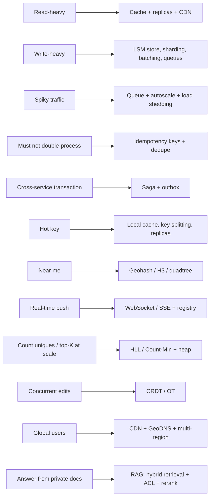

# 🗺️ Cheat Sheet — Problem → Pattern

> When the interviewer says **this** → reach for **that**.

| Signal in the prompt | Pattern | Note |
|---|---|---|
| "100:1 read/write", "millions of views" | Cache-aside, read replicas, CDN | [[Caching]] |
| "Huge write volume", "logs/events/metrics" | LSM stores, partitioning, batching, Kafka | [[Indexing]] · [[Kafka-Deep-Dive]] |
| "Sale at 12:00", "spike", "IPL final" | Waiting room, queue, pre-scale, load shedding | [[Design-Flash-Sale]] |
| "Never charge twice", "retries" | Idempotency keys, unique constraints | [[Idempotency]] |
| "Order + payment + inventory" | Orchestrated saga, outbox, compensations | [[Distributed-Transactions]] |
| "No double booking", "last seat" | Atomic conditional update, holds with TTL | [[Design-Ticket-Booking]] |
| "Celebrity", "viral" | Hot key handling, hybrid fan-out | [[Design-News-Feed]] |
| "Nearby", "within 2 km" | Geo index, neighbours, in-memory, shard by region | [[Geospatial-Indexing]] |
| "Live", "real-time updates", "typing…" | WebSocket/SSE, registry, pub/sub | [[Real-Time-Communication]] |
| "Unique visitors", "trending", "top 10" | HLL, Count-Min + heap, Redis ZSET | [[Probabilistic-Data-Structures]] |
| "Search", "autocomplete" | Inverted index, trie + top-k, edge caching | [[Search-Systems]] · [[Design-Typeahead]] |
| "Upload large files", "videos" | Presigned multipart to S3, async processing DAG, CDN | [[Object-Storage]] |
| "Exactly once", "billing accuracy" | At-least-once + dedupe + batch reconciliation | [[Design-Ad-Click-Aggregator]] |
| "Only one instance should run X" | Leader election with leases + fencing | [[Consensus-and-Leader-Election]] |
| "Run at 9 AM", "retry in 5 min" | Scheduler: time buckets + timing wheel + queue | [[Design-Job-Scheduler]] |
| "Unique short code", "IDs across shards" | Range allocation + base62, Snowflake/UUIDv7 | [[Unique-ID-Generation]] |
| "Slow dependency", "cascading failure" | Timeouts, retries + jitter, circuit breaker, bulkheads | [[Resilience-Patterns]] |
| "Region outage" | Multi-region, RPO/RTO, cells | [[Multi-Region-and-Disaster-Recovery]] |
| "Edit together" | CRDT/OT, doc-affinity routing, op log + snapshots | [[Real-Time-Collaboration-CRDTs]] |
| "Personalised feed/recommendations" | Multi-stage ranking funnel, feature store | [[Recommendation-and-Ranking-Systems]] |
| "Chat with an LLM", "stream answers" | SSE, token quotas, continuous batching, caching | [[Design-LLM-Chat-Service]] |
| "Q&A over company docs" | RAG with ACL filtering, hybrid search, re-rank | [[RAG-and-Vector-Databases]] |
| "Agent that takes actions" | Durable orchestrator, sandboxed tools, approvals | [[AI-Agent-Systems]] |

---
**Up:** [[SD-Resources]] · **Pair with:** [[Cheat-Sheet-Building-Blocks]]
