<div align="center">

# 🏗️ Best System Design Notes

**A complete, visual, interview-focused system design knowledge base, from your first load balancer to SDE-3 architecture and the AI-era skills companies will hire for next.**

[](LICENSE)


[Start here](00-Home/SD-Start-Here.md) · [Full map](00-Home/System-Design-MOC.md) · [Where to focus](00-Home/Where-to-Focus.md) · [Career ladder](00-Home/SDE-Career-Ladder.md) · [License](#-license)

</div>

---

## ✨ Why this exists

Most system design material is either a pile of videos or a few memorised architectures. Interviews don't grade boxes. They grade **why** each box is there, **what it costs**, and **what breaks first**.

This repository is an Obsidian vault that teaches system design the way senior engineers think:

- **Concept → trade-off → numbers → failure modes → interview follow-ups**, for every topic
- **400+ diagrams** (architecture, sequence, state machines, ER models, charts, quadrants, sankeys) that render on GitHub and in Obsidian
- **19 full case studies** in the exact order of a real 45-minute interview
- A **career layer** that maps topics to SDE-1 → SDE-2 → SDE-3 → Staff expectations
- A **future layer** covering what companies will demand in the next 1–3 years: AI-native development, verification, LLM evals, agent protocols, AI security, platform and data engineering

## 🗂️ What's inside

| Folder | What you'll learn |
|---|---|
| [`00-Home`](00-Home) | Start here, learning roadmaps, progress dashboard, interview trends, 2026 market research, career ladder |
| [`01-Foundations`](01-Foundations) | Requirements, request lifecycle, protocols, estimation and latency numbers |
| [`02-Scaling`](02-Scaling) | 1 → 10M users, stateless services, SPOFs, load balancing |
| [`03-Data-Storage`](03-Data-Storage) | SQL vs NoSQL, transactions and isolation, indexing, replication, sharding, consistent hashing |
| [`04-Performance`](04-Performance) | Caching, cache pitfalls, Redis, object storage, CDN |
| [`05-Communication`](05-Communication) | API design, REST/gRPC/GraphQL, real-time, queues, Kafka, event-driven, microservices, gateways |
| [`06-Distributed-Systems`](06-Distributed-Systems) | CAP/PACELC, consistency models, consensus, clocks, IDs, sagas, idempotency |
| [`07-Production`](07-Production) | Resilience, multi-region and DR, observability and SLOs, auth, security, search, streaming |
| [`08-Modern-Topics`](08-Modern-Topics) | Probabilistic data structures, geo indexing, CRDTs, ranking, LLM serving, RAG, agents |
| [`09-Interview-Playbook`](09-Interview-Playbook) | The 45-minute framework, level expectations, company patterns, mock interview, LLD primer |
| [`10-Case-Studies`](10-Case-Studies) | URL shortener, rate limiter, chat, feed, video, ticketing, ride-sharing, payments, food delivery, LLM chat and more |
| [`11-Interview-Questions`](11-Interview-Questions) | Conceptual, tricky, scenario and trade-off banks + 148 flashcards |
| [`13-Senior-Engineering`](13-Senior-Engineering) | DDD, schema evolution, zero-downtime migrations, multi-tenancy, capacity planning, testing, incidents, FinOps, design docs, leadership |
| [`14-Future-Engineering`](14-Future-Engineering) | AI-native SDLC, verification engineering, evals, MCP/A2A, AI security, AI cost, platform, data for AI, edge/Wasm/eBPF, supply chain, privacy and AI regulation |
| [`12-Glossary`](12-Glossary), [`99-Resources`](99-Resources) | 110+ term glossary, cheat sheets, books, channels, engineering blogs |

## 🧭 Learning path

```mermaid
flowchart LR
    F["01 Foundations"] --> S["02 Scaling"] --> D["03 Data"] --> P["04 Performance"] --> C["05 Communication"]
    C --> DS["06 Distributed"] --> PR["07 Production"] --> I["09 Playbook"] --> CS["10 Case studies"]
    CS --> M["08 Modern"] --> SE["13 Senior engineering"] --> FE["14 Future engineering"]
```



| You are… | Follow |
|---|---|
| Preparing for an interview in ~2 weeks | [Plan A — fast track](00-Home/SD-Learning-Roadmap.md) |
| Fresher / SDE-1 | [Where to focus](00-Home/Where-to-Focus.md) → tier 1 topics + LLD primer |
| SDE-2 aiming for SDE-3 | [Plan D](00-Home/SD-Learning-Roadmap.md) + [Senior Engineering](13-Senior-Engineering/Senior-Engineering-MOC.md) |
| Future-proofing your career | [Market research](00-Home/Market-Research-2026.md) + [Future Engineering](14-Future-Engineering/Future-Engineering-MOC.md) |

## 📝 How every note is structured

> **What is it → Why it exists → Analogy → Interview definition → How it works → 📊 Visual model → Trade-offs → Who uses it → ⚠️ Traps → ❓ What interviewers test → Mini quiz (answers hidden)**

Every case study follows: **Clarify → Requirements → Estimation → API → Data model → High-level design → Key flows → Deep dives → Bottlenecks → Follow-ups → What SDE-1 / SDE-2 / Senior should cover.**

## 🚀 Getting started

**Option 1 — Obsidian (recommended, full experience)**

```bash
git clone https://github.com/Agnik47/BEST-SYSTEM-DESIGN-NOTES.git
```

1. Open [Obsidian](https://obsidian.md) → **Open folder as vault** → select the cloned folder.
2. Open `00-Home/SD-Start-Here.md`.
3. Use a recent Obsidian version (1.9+) so every chart, Canvas board and the Bases dashboard render.
4. Optional plugins: **Excalidraw** (draw HLDs yourself), **Spaced Repetition** (flashcards).

**Option 2 — Read on GitHub.** Notes and Mermaid diagrams render directly. Obsidian-specific features (`[[wikilinks]]`, collapsible callouts, Canvas boards, the Bases dashboard) work best inside Obsidian.

## ✅ Quality and review

- Every Mermaid diagram is checked to render, and every internal link is checked to resolve.
- Facts, figures and dates are linked to primary sources in each note's **Resources** section.
- Market and hiring figures in [`Market-Research-2026`](00-Home/Market-Research-2026.md) are dated and sourced. Treat them as a snapshot, not a forecast.

### ✅ Verified by senior engineers

These notes have been **reviewed and validated by 3 senior software engineers** from the author's professional network. They checked the concepts, trade-offs, case-study designs and interview guidance for technical accuracy and real-world relevance.

| Reviewer | Role | Areas reviewed |
|---|---|---|
| Senior Software Engineer #1 | Senior SDE | Core concepts and distributed systems |
| Senior Software Engineer #2 | Senior SDE | Case studies and interview playbook |
| Senior Software Engineer #3 | Senior SDE | Senior and future engineering modules |

<!-- Replace the rows above with names / LinkedIn links once reviewers agree to be named publicly. -->

More senior engineers are welcome to review a module: open an issue titled **"Review: <module>"**.

## 🤝 Contributing

Found an error, an outdated fact, or a better diagram? Contributions are welcome.

1. Open an issue describing the problem (and the source, for factual corrections).
2. Or send a pull request that keeps the note format and passes the Mermaid render.
3. By contributing, you agree your contribution is licensed under the same license as this repository.

## 📜 License

**© 2026 Agnik Paul.** The notes, diagrams and other content in this repository are licensed under the **[Creative Commons Attribution 4.0 International License (CC BY 4.0)](LICENSE)**.

**You are free to:**
- **Use:** study, teach and use it personally, academically or commercially.
- **Share:** copy and redistribute it in any medium or format.
- **Adapt:** remix, transform and build upon it, including in videos, reels, courses, blogs, books and paid products.

**On one condition: attribution.** You must give appropriate credit, link to the license, and indicate if changes were made. See [NOTICE.md](NOTICE.md) for ready-to-copy credit lines.

```text
Based on "Best System Design Notes" by Agnik Paul
https://github.com/Agnik47/BEST-SYSTEM-DESIGN-NOTES — licensed under CC BY 4.0
```

This content is provided "as is", without warranty of any kind. It is educational material and not professional, legal or financial advice.

## 👤 Author

**Agnik Paul**, Software Development Engineer, Bengaluru 🇮🇳
- GitHub: [@Agnik47](https://github.com/Agnik47)
- Video and reel walkthroughs of these notes: coming soon

If these notes help you crack an interview, ⭐ star the repo and share it with a friend who's preparing.
